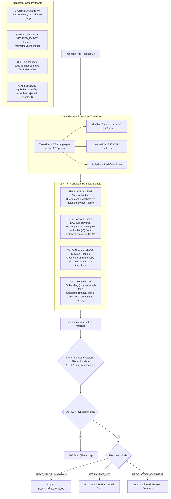
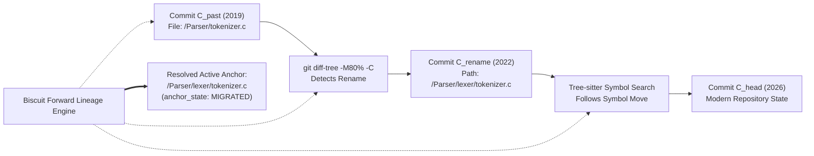

# Code Grounding, AST Symbol Anchors, and Warning Authorization

**Project:** Biscuit — Open Source Decision Intelligence and Knowledge Recovery  
**Team:** Chole Bhature (`@mriarc-08`, `@daksheshsharma2409`, `@utksh1`)  
**Scope:** Alternative-Specific Code Anchoring, AST Parsing, Forward Commit-DAG Lineage Traversal, and Warning Authorization Guardrails.  
**Specification Level:** Implementation Contract (Consolidated with Issue #5 and PR #7 review requirements).

---

## 1. Architectural Invariant: Anchoring to Specific Alternatives

Per **Issue #5 (E1)** and **PR #7 Review (4)**:
> *Two alternatives in one decision can have completely different code anchors.*

In our canonical data model, **code anchors attach directly to `decision_alternatives.id`**, not the top-level decision:

```
  [Decision: PEP-505 (None-aware operators)]
      │
      ├── Alternative 1: Unary '?' Syntax (a?b) [REJECTED]
      │      └── Code Anchor: Grammar & Parser (`Parser/parser.c`, `Grammar/python.gram`)
      │
      └── Alternative 2: Functional coalesce() [REJECTED]
             └── Code Anchor: Runtime Built-ins (`Python/bltinmodule.c`)
```

When a pull request modifies `Python/bltinmodule.c`, Biscuit evaluates *only* Alternative 2 (`coalesce()`). It does **not** evaluate Alternative 1 (the parser change), eliminating false cross-alternative associations.

### Dual Grounding Lifecycles (The Past vs. Day 1+):
* **Historical Anchors (Pillar 1):** Anchored at the historical debate commit $C_{\text{past}}$. Traced forward to modern `HEAD` via forward commit-DAG diff traversal (`git diff-tree -M80% -C -B`), assigning `anchor_state = 'MIGRATED'`.
* **Living Day 1+ Anchors (Pillar 2):** When a living decision is approved by maintainers via a Switch approval card (`living_decision_drafts`), Biscuit parses the affected subsystem files at modern `HEAD` using Tree-sitter, immediately establishing active `code_anchors` with `anchor_state = 'CURRENT'`.

---

## 2. The 4-Tier Code Grounding Engine



---

## 3. Tier 1: Concrete AST Symbol Anchors

Per **PR #7 Review (4)**, code anchors store complete provenance, locators, and parser versions:

```
Structure: CodeSymbolAnchor
    id                         : UUID
    alternative_id             : UUID REFERENCES decision_alternatives(id)
    repository_url             : String (e.g. "https://github.com/python/cpython")
    language                   : String (e.g. "python", "c", "rust", "go")
    symbol_type                : Enum (FUNCTION, CLASS, METHOD, GRAMMAR_RULE, AST_NODE, MODULE)
    qualified_symbol_name      : String (e.g. "cpython.Parser.Tokenizer.get_next_token")
    source_locator_type        : Enum (AST_NODE_QUERY, FILE_BYTE_RANGE, FILE_LINE_RANGE)
    start_line, end_line       : Integer or Null
    start_byte, end_byte       : Integer or Null
    parser_name                : String (language-specific parser identifier)
    parser_version             : String (exact parser release)
    grammar_version            : String (exact grammar release or commit)
    fingerprint_algorithm      : String (versioned canonical fingerprint algorithm)
    ast_normalization_version  : String (exact AST/CST normalization ruleset)
    ast_structural_fingerprint : String (SHA-256 of versioned identifier-masked subtree)
    signature_hash             : String (SHA-256 of normalized parameter signature)
    anchor_state               : Enum (HISTORICAL, CURRENT, MIGRATED, SPLIT, MERGED, DELETED, AMBIGUOUS)
    historical_file_path       : String (Relative path at time of debate)
    historical_commit_sha      : String (40/64-char Git SHA at time of debate)
    head_commit_sha            : String or Null
    mapping_confidence         : Float or Null (0.0 to 1.0; NULL until supported by mapping evidence)
```

---

## 4. Tier 2: Forward Commit-DAG & Diff Lineage Traversal

Per **PR #7 Review (4)**:
> *`git log --follow` follows a single path's history backwards and is not a general forward historical-to-HEAD resolver.*

To resolve historical paths forward from the debate commit ($C_{\text{past}}$) to modern `HEAD`, Biscuit employs a **forward topological commit-DAG traversal** with rename and split heuristics:



### Forward Traversal Strategy:
1. **Direct Path Check:** Check the historical path at `HEAD`. This is only a fast path; a path match does not by itself prove the same symbol survived.
2. **Enumerate the Forward DAG:** Enumerate every commit reachable from `HEAD` but not before the historical anchor commit, in topological order. Process commits in that order rather than following only one path.
3. **Diff Every Parent:** For each commit, run `git diff-tree -r -M80% -C -B <parent> <commit>` for every parent. Compare a root commit with the empty tree. For merge commits, record a separate lineage transition for each parent and do not silently select only the first parent.
4. **Persist Mapping Evidence:** Store `transition_commit_sha`, `compared_parent_sha`, parent index, old/new paths, transition classification, diff/patch digest, matching symbol identifiers, and the exact parser, grammar, and normalization versions in `code_anchor_lineage.mapping_evidence`.
5. **Resolve or Abstain:** Collapse parent paths into one current anchor only when all viable parent histories converge on the same symbol/path or AST/CST evidence independently confirms equivalence. If parents disagree, a split/copy has multiple plausible targets, or the symbol is deleted, mark the anchor `SPLIT`, `AMBIGUOUS`, or `DELETED`; leave confidence NULL unless measured evidence supports a score and abstain from warnings.
6. **Reproducibility:** Store Git object IDs and mapping evidence for every traversed transition so a future run can replay the same path-resolution decision.

---

## 5. Tier 3: Normalized AST Subtree Hashing (Surviving Refactors)

When a developer refactors code by renaming local variables or reformatting syntax:

```
Developer's Modified Code:
    def check_value(stream):
        if stream.peek() == '?':
            return parse_chain()
        return None

Normalized AST (Masked Identifiers):
    FunctionDef(
        params=[$ARG_0],
        body=[
            If(test=Compare(Call(Attr($ARG_0, "peek")), Eq, Constant("?")),
               body=[Return(Call("parse_chain"))]),
            Return(Constant(None))
        ]
    )

➔ AST Structural Fingerprint: SHA-256 of Normalized Subtree
```

Tier 3 flags structural matches even when all variable names and formatting are novel.

---

## 6. Tier 4: Semantic Diff Embedding Alignment (Surviving Rewrites)

When a subsystem undergoes an architectural rewrite:
1. Extract the PR diff hunk (added code lines, grammar rules, docstrings).
2. Generate an embedding using `nomic-embed-text-v1.5` with prefix `search_query:`.
3. Compute cosine similarity against `decision_alternatives.embedding`.
4. A cosine score at or above provisional `0.82` may add an item to the candidate set for further analysis.
   * **Retrieval-Only Threshold:** `0.82` is a tunable candidate-retrieval parameter. It is not a warning invariant, does not establish semantic equivalence, and can never authorize a comment. A candidate must independently pass alternative-specific AST/CST structural verification and every authoritative evidence/authorization check.

---

## 7. Strict Warning Authorization & Abstention Invariants

Per **PR #7 Review (5)**:
> *Candidate retrieval is explicitly separated from warning authorization. Four-tier matchers generate candidate signals; authorization requires all four invariants.*

### Mandatory Authorization Invariants:

| Invariant | Requirement | Failure Action |
|---|---|---|
| **1. Decision State** | `decision_alternatives.lifecycle_status == 'REJECTED'` | **ABSTAIN.** (Never warn on `DISPUTED`, `UNRESOLVED`, or `PROPOSED` items). |
| **2. Authoritative Ruling** | `ruling_evidence_id` is a `VERIFIED_EXACT` `RULING` span linked to this exact alternative and authored by an identified authorized human. The database enforces a BDFL ruling, Core Maintainer consensus (ruling author plus one other verified Core Maintainer), or Working Group authority (Chair plus one other verified group member); model inference is never authority. | **ABSTAIN.** (Never warn based on unverified or speculative evidence). |
| **3. Alternative Code Anchor** | Modified PR code touches an active `code_anchor` bound directly to THIS alternative. | **ABSTAIN.** (Never warn based on semantic similarity to unrelated code). |
| **4. AST Structural Equivalence** | AST/CST subtree comparison confirms PR introduces the rejected syntax/construct (not an accepted or refactored pattern). | **ABSTAIN.** (Never warn on semantic embedding similarity alone). |

### Hard Negatives and Threshold Recalibration:
- **Hard Negative Filtering:** If a PR modifies syntax for an accepted language feature (e.g. ternary operator `a if b else c`) in the same file where unary `?` was rejected, the verifier checks the actual AST/CST node; file or symbol overlap is insufficient.
- **Abstention:** Unsupported syntax, parser errors, unknown parser/grammar versions, ambiguous lineage, missing evidence, or incomplete mapping evidence cause abstention.
- **Calibration Governance:** Candidate-retrieval thresholds are recalibrated only in a versioned offline evaluation using labeled positives, benign refactors, hard negatives, and ambiguous cases. Runtime threshold changes cannot weaken or bypass authorization invariants.

---

## 8. Dry-Run & Audit Mode Enforcement

Per **PR #7 Review (7)**:
- **Default Execution Mode:** Automatic GitHub PR warning comments are **DISABLED by default**.
- Biscuit runs in **`AUDIT_DRY_RUN` Mode**:
  - All candidate evaluations and authorized warnings are recorded in the `pr_watchdog_audit_log` table.
  - Interactive Human-in-the-Loop (`INTERACTIVE_HITL`) mode routes warnings to Slack/Discord cards via Switch for human confirmation before PR commenting.
  - Public GitHub PR comments (`PRODUCTION_COMMENT`) are only enabled after human verification or passing benchmark gates.
