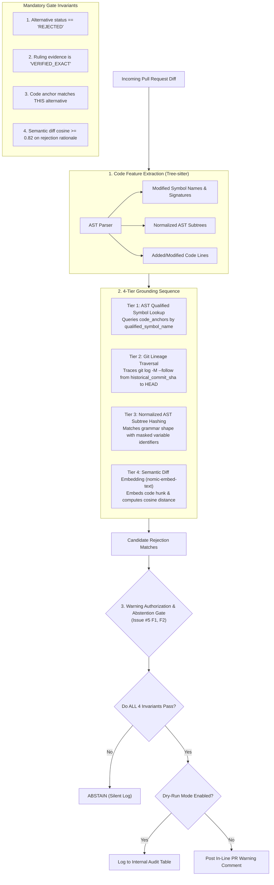
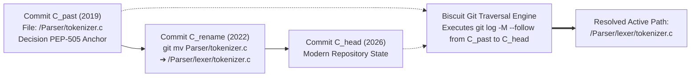

# Code Grounding, AST Symbol Anchors, and Warning Authorization

**Project:** Biscuit — Open Source Decision Intelligence and Knowledge Recovery  
**Team:** Chole Bhature (`@mriarc-08`, `@daksheshsharma2409`, `@utksh1`)  
**Scope:** Alternative-Specific Code Anchoring, AST Parsing, Git Lineage Traversal, and Warning Authorization Gate.  
**Specification Level:** Implementation Contract (Consolidated with Issue #5 fixes).

---

## 1. Architectural Invariant: Anchoring to Specific Alternatives

Per **Issue #5 (E1)**:
> *Two alternatives in one decision can have completely different code anchors.*

In our canonical data model, **code anchors attach directly to `decision_alternatives.id`**, not the top-level decision:

```
  [Decision: PEP-505 (None-aware operators)]
      │
      ├── Alternative 1: Unary '?' Syntax (a?b) [REJECTED]
      │      └── Code Anchor: Grammar / Parser / Tokenizer (`Parser/tokenizer.c`)
      │
      └── Alternative 2: Functional coalesce() [REJECTED]
             └── Code Anchor: Runtime Built-ins (`Python/bltinmodule.c`)
```

When a pull request modifies `Python/bltinmodule.c`, Biscuit evaluates *only* Alternative 2 (`coalesce()`). It does **not** evaluate Alternative 1 (the parser change), eliminating false cross-alternative associations.

---

## 2. The 4-Tier Code Grounding Engine



---

## 3. Tier 1: Concrete AST Symbol Anchors

Per **Issue #5 (E2)**, code anchors store unambiguous, language-agnostic symbols parsed with Tree-sitter:

```
Structure: CodeSymbolAnchor
    anchor_id                  : UUID
    alternative_id             : UUID REFERENCES decision_alternatives(id)
    language                   : Enum (PYTHON, C, RUST, GO, JAVASCRIPT)
    symbol_type                : Enum (FUNCTION, CLASS, METHOD, GRAMMAR_RULE, INTERFACE, AST_NODE)
    qualified_symbol_name      : String (e.g. "cpython.Parser.Tokenizer.get_next_token")
    signature_hash             : String (SHA-256 of normalized parameter/type signature)
    ast_structural_fingerprint : String (SHA-256 of identifier-masked AST subtree)
    historical_file_path       : String (Relative path at time of debate)
    historical_commit_sha      : String (40-char Git SHA at time of debate)
```

### Reproducibility:
- Even when line offsets shift by thousands of lines due to edits, the AST qualified symbol name (`cpython.Parser.Tokenizer.get_next_token`) resolves unambiguously in $<1\text{ms}$.

---

## 4. Tier 2: Git Lineage & Rename Traversal (`git log --follow`)

Per **Issue #5 (E3)**, when a file path changes between the historical decision commit ($C_{\text{past}}$) and modern `HEAD`:



### Traversal Algorithm:
1. If `historical_file_path` is not present at `HEAD`, query the local Git DAG:
   ```bash
   git log --follow --name-only --format="" <historical_commit_sha>..HEAD -- <historical_file_path>
   ```
2. Git's internal similarity heuristics (`-M80%`) trace the rename forward across commits.
3. If the file was **deleted without rename**, mark anchor status as `CODE_PATH_DELETED` and abstain from path-based matching.

---

## 5. Tier 3: Normalized AST Subtree Hashing (Surviving Refactors)

When a developer refactors code by renaming local variables or reformatting syntax:

```
Developer's Modified Code:
    def check_value(stream):
        if stream.peek() == '?':
            return parse_chain()
        return None

Normalized AST (Masked Identifiers):
    FunctionDef(
        params=[$ARG_0],
        body=[
            If(test=Compare(Call(Attr($ARG_0, "peek")), Eq, Constant("?")),
               body=[Return(Call("parse_chain"))]),
            Return(Constant(None))
        ]
    )

➔ AST Structural Fingerprint: SHA-256 of Normalized Subtree
```

If a pull request introduces an AST subtree whose structural fingerprint matches a known rejected proposal's prototype, Tier 3 flags the structural match even if all variable names are completely novel.

---

## 6. Tier 4: Semantic Diff Embedding Alignment (Surviving Rewrites)

When a subsystem is **completely rewritten from scratch** (e.g., Python moving from its C-based LL(1) parser to a PEG parser):
- AST symbol names may change.
- Git rename tracking breaks because the old file was deleted and a new file created.

### Alignment Logic:
1. Extract the PR diff hunk (added code lines, grammar rules, docstrings).
2. Generate an embedding using `nomic-embed-text-v1.5` with prefix `search_query:`.
3. Compute cosine distance against `decision_alternatives.embedding`.
4. If cosine similarity $\ge 0.82$, it triggers as a candidate match.

---

## 7. Warning Authorization & Abstention Gate

Per **Issue #5 (F1, F2)**:
> *A retrieval match alone is NOT proof of a violation. Biscuit must distinguish between candidate discovery and warning authorization.*

### Strict Warning Authorization Invariants:
An automated PR warning comment is **authorized if and only if ALL four invariants hold**:

| Invariant | Requirement | Failure Action |
|---|---|---|
| **1. Decision State** | `decision_alternatives.lifecycle_status == 'REJECTED'` | **ABSTAIN.** (Do not warn on `DISPUTED`, `UNRESOLVED`, or `PROPOSED` items). |
| **2. Evidence Veracity** | `ruling_evidence_id` has `verification_status == 'VERIFIED_EXACT'` | **ABSTAIN.** (Never warn based on unverified or stale evidence). |
| **3. Code Grounding** | Modified PR code touches an active `code_anchor` bound directly to THIS alternative (Tier 1/2/3 match) | **ABSTAIN.** (Never warn based on semantic similarity to unrelated code). |
| **4. Semantic Confidence** | Semantic diff cosine similarity $\ge 0.82$ against the specific rejection rationale | **ABSTAIN.** (If match is borderline or ambiguous, stay silent). |

---

## 8. Dry-Run & Audit Mode Enforcement

Per **Issue #5 (F3, H6)**:
- **Default Execution Mode:** Automatic GitHub PR warning comments are **DISABLED by default**.
- Biscuit runs in **Audit/Dry-Run Mode**:
  - Potential warnings are recorded in an internal `pr_watchdog_audit_log` table.
  - No automated comments are posted to public GitHub PRs until held-out evaluation benchmarks demonstrate **0.0% false rejections** and **$\ge 85\%$ recall**.
