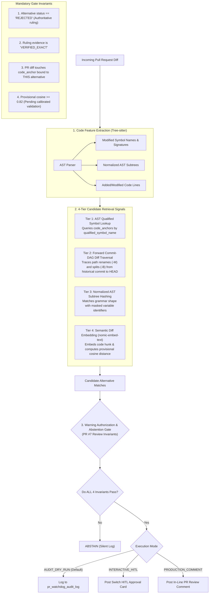
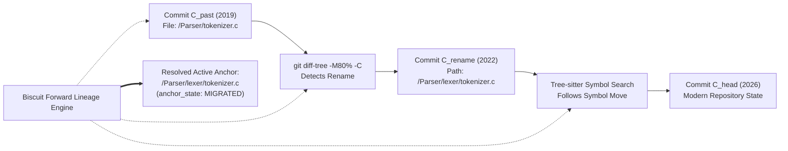

# Code Grounding, AST Symbol Anchors, and Warning Authorization

**Project:** Biscuit — Open Source Decision Intelligence and Knowledge Recovery  
**Team:** Chole Bhature (`@mriarc-08`, `@daksheshsharma2409`, `@utksh1`)  
**Scope:** Alternative-Specific Code Anchoring, AST Parsing, Forward Commit-DAG Lineage Traversal, and Warning Authorization Guardrails.  
**Specification Level:** Implementation Contract (Consolidated with Issue #5 and PR #7 review requirements).

---

## 1. Architectural Invariant: Anchoring to Specific Alternatives

Per **Issue #5 (E1)** and **PR #7 Review (4)**:
> *Two alternatives in one decision can have completely different code anchors.*

In our canonical data model, **code anchors attach directly to `decision_alternatives.id`**, not the top-level decision:

```
  [Decision: PEP-505 (None-aware operators)]
      │
      ├── Alternative 1: Unary '?' Syntax (a?b) [REJECTED]
      │      └── Code Anchor: Grammar & Parser (`Parser/parser.c`, `Grammar/python.gram`)
      │
      └── Alternative 2: Functional coalesce() [REJECTED]
             └── Code Anchor: Runtime Built-ins (`Python/bltinmodule.c`)
```

When a pull request modifies `Python/bltinmodule.c`, Biscuit evaluates *only* Alternative 2 (`coalesce()`). It does **not** evaluate Alternative 1 (the parser change), eliminating false cross-alternative associations.

### Dual Grounding Lifecycles (The Past vs. Day 1+):
* **Historical Anchors (Pillar 1):** Anchored at the historical debate commit $C_{\text{past}}$. Traced forward to modern `HEAD` via forward commit-DAG diff traversal (`git diff-tree -M80% -C -B`), assigning `anchor_state = 'MIGRATED'`.
* **Living Day 1+ Anchors (Pillar 2):** When a living decision is approved by maintainers via a Switch approval card (`living_decision_drafts`), Biscuit parses the affected subsystem files at modern `HEAD` using Tree-sitter, immediately establishing active `code_anchors` with `anchor_state = 'CURRENT'`.

---

## 2. The 4-Tier Code Grounding Engine



---

## 3. Tier 1: Concrete AST Symbol Anchors

Per **PR #7 Review (4)**, code anchors store complete provenance, locators, and parser versions:

```
Structure: CodeSymbolAnchor
    id                         : UUID
    alternative_id             : UUID REFERENCES decision_alternatives(id)
    repository_url             : String (e.g. "https://github.com/python/cpython")
    language                   : String (e.g. "python", "c", "rust", "go")
    symbol_type                : Enum (FUNCTION, CLASS, METHOD, GRAMMAR_RULE, AST_NODE, MODULE)
    qualified_symbol_name      : String (e.g. "cpython.Parser.Tokenizer.get_next_token")
    source_locator_type        : Enum (AST_NODE_QUERY, FILE_BYTE_RANGE, FILE_LINE_RANGE)
    start_line, end_line       : Integer or Null
    start_byte, end_byte       : Integer or Null
    parser_name                : String (e.g. "tree-sitter-python")
    grammar_version            : String (e.g. "v0.22.0")
    fingerprint_algorithm      : String (e.g. "ast-canonical-hash-v1")
    ast_structural_fingerprint : String (SHA-256 of identifier-masked AST subtree)
    signature_hash             : String (SHA-256 of normalized parameter signature)
    anchor_state               : Enum (HISTORICAL, CURRENT, MIGRATED, SPLIT, MERGED, DELETED, AMBIGUOUS)
    historical_file_path       : String (Relative path at time of debate)
    historical_commit_sha      : String (40/64-char Git SHA at time of debate)
    head_commit_sha            : String or Null
    mapping_confidence         : Float (0.0 to 1.0)
```

---

## 4. Tier 2: Forward Commit-DAG & Diff Lineage Traversal

Per **PR #7 Review (4)**:
> *`git log --follow` follows a single path's history backwards and is not a general forward historical-to-HEAD resolver.*

To resolve historical paths forward from the debate commit ($C_{\text{past}}$) to modern `HEAD`, Biscuit employs a **forward topological commit-DAG traversal** with rename and split heuristics:



### Forward Traversal Strategy:
1. **Direct Path Check:** Verify if `historical_file_path` exists unchanged at `HEAD`. If yes, `anchor_state = CURRENT`.
2. **Forward DAG Diff Traversal:** If the path no longer exists at `HEAD`, traverse forward from $C_{\text{past}}$ to `HEAD` using `git diff-tree -r -M80% -C -B`:
   - **`-M80%` (Rename Tracking):** Follows renames when file similarity $\ge 80\%$.
   - **`-C` (Copy Tracking):** Detects code copied into new utility modules.
   - **`-B` (Break/Rewrite Detection):** Identifies total file rewrites or splits.
3. **Tree-sitter Symbol Move Tracking:** If file-level heuristics fail (e.g., Python 3.9 parser rewrite from LL(1) to PEG), Tree-sitter scans candidate grammar files for the qualified AST symbol.
4. **Ambiguity & Abstention Contract:**
   - If a file split produces multiple candidate locations, or a symbol is deleted, the anchor is marked `anchor_state = SPLIT` or `AMBIGUOUS` with a low `mapping_confidence`.
   - **Biscuit strictly abstains from auto-resolving ambiguous paths** and logs the event in `code_anchor_lineage`.

---

## 5. Tier 3: Normalized AST Subtree Hashing (Surviving Refactors)

When a developer refactors code by renaming local variables or reformatting syntax:

```
Developer's Modified Code:
    def check_value(stream):
        if stream.peek() == '?':
            return parse_chain()
        return None

Normalized AST (Masked Identifiers):
    FunctionDef(
        params=[$ARG_0],
        body=[
            If(test=Compare(Call(Attr($ARG_0, "peek")), Eq, Constant("?")),
               body=[Return(Call("parse_chain"))]),
            Return(Constant(None))
        ]
    )

➔ AST Structural Fingerprint: SHA-256 of Normalized Subtree
```

Tier 3 flags structural matches even when all variable names and formatting are novel.

---

## 6. Tier 4: Semantic Diff Embedding Alignment (Surviving Rewrites)

When a subsystem undergoes an architectural rewrite:
1. Extract the PR diff hunk (added code lines, grammar rules, docstrings).
2. Generate an embedding using `nomic-embed-text-v1.5` with prefix `search_query:`.
3. Compute cosine similarity against `decision_alternatives.embedding`.
4. If cosine similarity $\ge 0.82$, it triggers as a candidate match.
   * **Provisional Threshold Notice:** The `0.82` threshold is provisional pending empirical calibration against labeled benchmarks. It serves as a candidate-retrieval filter, not semantic proof of re-introduction.

---

## 7. Strict Warning Authorization & Abstention Invariants

Per **PR #7 Review (5)**:
> *Candidate retrieval is explicitly separated from warning authorization. Four-tier matchers generate candidate signals; authorization requires all four invariants.*

### Mandatory Authorization Invariants:

| Invariant | Requirement | Failure Action |
|---|---|---|
| **1. Decision State** | `decision_alternatives.lifecycle_status == 'REJECTED'` | **ABSTAIN.** (Never warn on `DISPUTED`, `UNRESOLVED`, or `PROPOSED` items). |
| **2. Authoritative Ruling** | `ruling_evidence_id` has `verification_status == 'VERIFIED_EXACT'` signed by an authority or consensus. `MODEL_INFERRED` alone cannot authorize a warning. | **ABSTAIN.** (Never warn based on unverified evidence or speculative inference). |
| **3. Alternative Code Anchor** | Modified PR code touches an active `code_anchor` bound directly to THIS alternative. | **ABSTAIN.** (Never warn based on semantic similarity to unrelated code). |
| **4. Semantic Confidence** | Semantic diff cosine similarity $\ge 0.82$ against the specific rejection rationale. | **ABSTAIN.** (If match is borderline or ambiguous, stay silent). |

### Hard Negatives and Threshold Recalibration:
- **Hard Negative Filtering:** If a PR modifies syntax for an accepted language feature (e.g. ternary operator `a if b else c`) in the same file where unary `?` was rejected, the AST classifier detects that the node is a conditional expression and **ABSTAINS**.
- **Threshold Recalibration Triggers:** If the false positive rate on benign pull requests in benchmark test runs exceeds **2.0%**, the provisional 0.82 threshold is automatically recalibrated upward.

---

## 8. Dry-Run & Audit Mode Enforcement

Per **PR #7 Review (7)**:
- **Default Execution Mode:** Automatic GitHub PR warning comments are **DISABLED by default**.
- Biscuit runs in **`AUDIT_DRY_RUN` Mode**:
  - All candidate evaluations and authorized warnings are recorded in the `pr_watchdog_audit_log` table.
  - Interactive Human-in-the-Loop (`INTERACTIVE_HITL`) mode routes warnings to Slack/Discord cards via Switch for human confirmation before PR commenting.
  - Public GitHub PR comments (`PRODUCTION_COMMENT`) are only enabled after human verification or passing benchmark gates.
