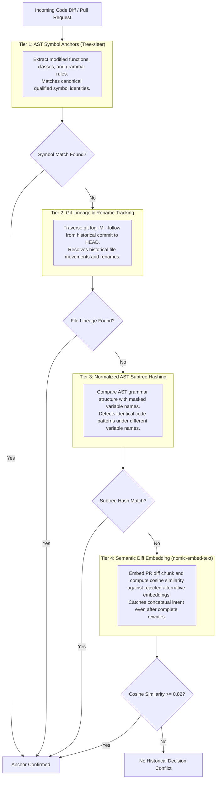
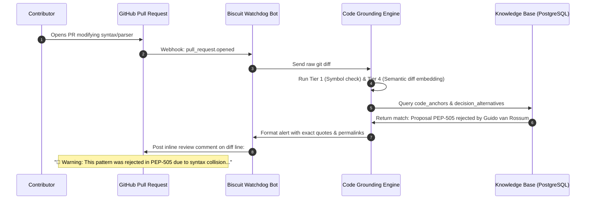

# Code Grounding and AST Tracking Specification

**Project:** Biscuit — Open Source Decision Intelligence and Knowledge Recovery  
**Team:** Chole Bhature (`@mriarc-08`, `@daksheshsharma2409`, `@utksh1`)  
**Scope:** AST Symbol Anchoring, Git History Lineage Traversal, Structural Subtree Fingerprinting, and Semantic Diff Retrieval.

---

## 1. The Core Problem: Why Filepaths Break

In long-running open-source projects, anchoring an architectural decision to a fragile string like:
`cpython/Parser/tokenizer.c#L140-L160` fails rapidly over time:

1. **Line Drift (Weeks):** Adding imports or comments shifts line numbers.
2. **Path Moves & Subdirectory Restructuring (Months):** Files are reorganized (e.g. `Parser/tokenizer.c` $\rightarrow$ `Parser/lexer/tokenizer.c`).
3. **Monolith Splitting & Refactoring (Years):** A 3,000-line monolithic file is split into separate modules.
4. **Architectural Rewrites:** A subsystem is completely rewritten (e.g. Python replacing its LL(1) parser with a PEG parser, or rewriting Python modules into C/Rust).

To preserve decision-to-code traceability across decades, Biscuit implements a **4-Tier Code Grounding Engine**.



---

## 2. Tier 1: AST Symbol Identity Anchoring

Instead of binding decisions to line numbers or file paths, Biscuit binds decisions to **Concrete Syntax Tree (CST) and Abstract Syntax Tree (AST) symbol identities** using language-agnostic parsing (Tree-sitter).

### Canonical Symbol Anchor Schema
```
Structure: CodeSymbolAnchor
    anchor_id          : UUID
    decision_id        : UUID
    symbol_kind        : Enum (FUNCTION, CLASS, METHOD, GRAMMAR_RULE, INTERFACE, MACRO)
    qualified_name     : String (e.g. "cpython.Parser.Tokenizer.get_next_token")
    symbol_signature   : String (e.g. "get_next_token(stream: Stream) -> Token")
    defining_scope     : String (e.g. "module:cpython.parser.tokenizer")
    historical_commit  : String (40-char Git SHA at time of debate)
    historical_file    : String (Path at time of debate)
```

### Why Symbols Survive Edits:
- Line offsets shift whenever code above or below is touched.
- However, the qualified symbol name `Parser.Tokenizer.get_next_token` remains identical across minor and major releases, allowing instant lookup in `<1ms`.

---

## 3. Tier 2: Git Lineage & Rename Tracking (`git log --follow`)

When an open-source project runs `git mv old_path.py new_path.py` or moves files across folders:

### Lineage Traversal Algorithm:
1. Biscuit stores the `historical_commit_sha` with every code anchor.
2. When evaluating modern code at `HEAD`:
   - If `historical_file` no longer exists, Biscuit runs an automated Git commit traversal:
     ```bash
     git log --follow --name-only --format="" <historical_commit>..HEAD -- <historical_file>
     ```
3. Git's internal similarity heuristics (`-M80%`) trace the rename chain forward across commits:
   $$\text{Commit } C_{\text{past}} \xrightarrow{\text{rename}} \text{Commit } C_{\text{split}} \xrightarrow{\text{move}} \text{Commit } C_{\text{HEAD}}$$
4. The system updates its live index with the modern resolved path without altering the immutable historical record.

---

## 4. Tier 3: Normalized AST Subtree Hashing (Surviving Refactors)

When a developer refactors code by:
- Renaming local variables (`buf` $\rightarrow$ `stream_buffer`).
- Reformatting whitespace, brackets, or type annotations.

String hashing and line diffs fail. Biscuit generates a **Normalized AST Subtree Fingerprint**:

```
Raw Code Snippet:
    def parse_optional(stream):
        if stream.peek() == '?':
            return parse_chain()
        return None

Normalized AST (Masked Identifiers):
    FunctionDef(
        params=[$ARG_0],
        body=[
            If(test=Compare(Call(Attr($ARG_0, "peek")), Eq, Constant("?")),
               body=[Return(Call("parse_chain"))]),
            Return(Constant(None))
        ]
    )

➔ AST Structural Hash: SHA-256 of Canonical Tree
```

### Structural Pattern Detection:
If a contributor opens a pull request that re-implements an approach whose AST structure matches a previously rejected proposal, Tier 3 flags the structural equivalence even if all variable and parameter names were completely altered!

---

## 5. Tier 4: Semantic Diff Embedding Alignment (Surviving Rewrites)

When a subsystem undergoes a **complete ground-up rewrite** (e.g., Python moving from its C-based LL(1) parser to a Python/C PEG parser):
- Historical AST symbols may no longer exist.
- Git rename tracking breaks because the old file was deleted and a new file created from scratch.

### How Semantic Diff Embeddings Catch It:
1. When a PR is opened, Biscuit extracts the **PR diff hunk** (the added lines, syntax rules, and docstrings).
2. It generates a 768-dimensional embedding using `nomic-embed-text-v1.5` with prefix `search_query:`.
3. It performs cosine similarity search against the vector index of `decision_alternatives`.

```
PR Diff:
+  # Safe navigation operator rule
+  safe_chain: atom '?.' NAME

Decision Alternative in Vector Store:
   "Proposal to introduce ?. safe navigation operator into grammar.
    Rejected due to ambiguity with ternary expression syntax."

➔ Cosine Similarity: 0.865 (Exceeds 0.82 threshold!)
```

Even after a complete architectural rewrite, the **semantic intent of the code change** matches the historical rejection, and the author is alerted!

---

## 6. The PR Diff Watchdog Workflow



---

## 7. Verifiable Traceability Guarantees

Every code grounding match surfaces three verifiable proofs to developers:
1. **The Code Anchor:** Identifies the historical symbol name and commit SHA where the debate originated.
2. **The Causal Rejection:** Cites the exact reason, the maintainer who objected, and the verbatim quote.
3. **The Ground Truth Link:** Provides a direct URL back to the original discussion (Discourse, GitHub, or CNCF Slack).
