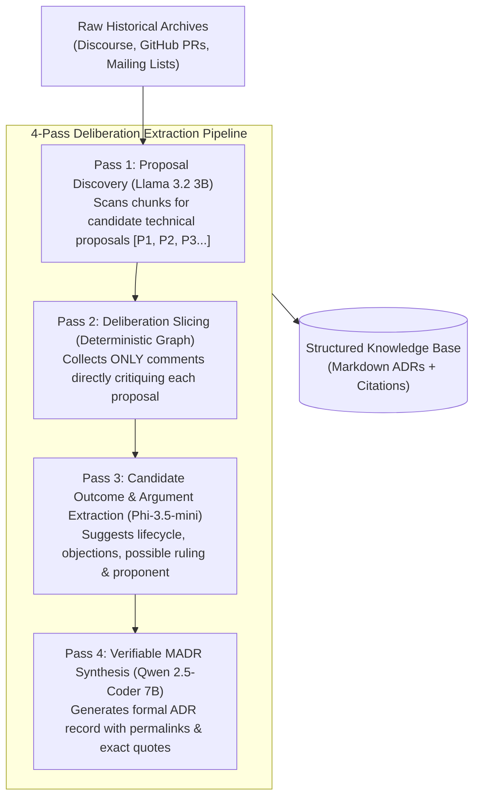

# Biscuit: Open-Source Decision Intelligence & Knowledge Recovery
**Team:** Chole Bhature (`@mriarc-08`, `@daksheshsharma2409`, `@utksh1`)  
**Problem Statement:** Problem 06 — Open Source Decision Intelligence and Knowledge Recovery  
**Document Purpose:** Complete technical alignment and system concept for the team.

---

## 1. The Real-World Problem: "Why Open Source Forgets"

Open-source ecosystems (CPython, CNCF/Kubernetes, Rust, Linux) accumulate **decades of technical debates**. Every major feature or refactor involves intense discussion over trade-offs, performance constraints, and edge cases.

### The Problem Today:
1. **The "Lost Why" (Historical Debt):**
   - Architectural decisions are rarely recorded as clean Architecture Decision Records (ADRs). Instead, they are buried across 10-year-old mailing lists, 300-comment Discourse threads (`discuss.python.org`), and closed GitHub PR reviews.
   - When core maintainers leave, the memory of *why* an approach was rejected is lost.
   - New contributors waste hundreds of hours proposing ideas that were already investigated, tested, and **rejected** years prior.
2. **The Modern Chat Reality (CNCF / Open Source Working Groups):**
   - Modern open-source development does not happen solely on GitHub. Over **150,000 developers on CNCF Slack** hammer out Kubernetes Enhancement Proposals (KEPs) in channels like `#sig-architecture` and `#sig-node` before a PR is ever opened.
   - Python core teams argue in the **Python Discord**, and Rust core teams deliberate in **Zulip/Discord**.
   - **Critical decisions are made in chat and lost into the void before code is ever written.**

---

## 2. Our Unified Solution: Two Halves of One Brain

To build an intelligence platform for the *entire open-source lifecycle*, Biscuit solves two distinct dimensions:

```
┌────────────────────────────────────────────────────────────────────────┐
│                   BISCUIT: THE TWO-PILLAR ARCHITECTURE                 │
├────────────────────────────────────────────────────────────────────────┤
│                                                                        │
│  PILLAR 1: THE PAST (Day -N to Day 0)                                  │
│  "Historical Knowledge Recovery Engine"                                │
│  • Ingests 5–10 years of archives (Discourse, GitHub PRs, Mailing Lists)│
│  • Mines arguments and candidate outcomes; verifies human rulings      │
│    before storing an alternative as authoritatively REJECTED            │
│  • Grounds decisions into code (AST symbols + Git tracking)            │
│  • Directly passes the Hackathon's PEP evaluation benchmark            │
│                                                                        │
│  PILLAR 2: THE PRESENT & FUTURE (Day 1+)                              │
│  "Living Omnichannel Decision Intelligence (Powered by Switch)"        │
│  • Listens to live CNCF Slack / Discord Working Group discussions      │
│  • Drafts structured ADRs from live chat for maintainer approval       │
│  • Routes candidate PR conflicts to maintainers for approval before    │
│    publishing a verifiable warning comment                              │
│                                                                        │
└────────────────────────────────────────────────────────────────────────┘
```

---

## 3. Pillar 1: Solving the Past (Historical Decision Mining)

This engine solves the **core Hackathon Evaluation Scenario**:
> *"Given raw Python PEP / KEP public discussions without the PEP itself, can the system recover the ideas that were rejected and the reasons why?"*

### Why Single-Prompt LLMs Fail on History:
A raw 200-comment debate contains 50,000+ words of quoting, sarcasm, side-tangents, and multi-party debates. Small models (7B) will choke, miss nuanced objections, or hallucinate consensus.

### Our Solution: The 4-Pass Deliberation Pipeline



#### Step-by-Step Breakdown:
1. **Pass 1: Proposal Discovery (`Llama 3.2-3B`):**
   - High-throughput scanning of discussion chunks. Filters conversational noise and extracts candidate technical solutions (e.g., *"Option A: Unary `?` operator"*, *"Option B: Built-in `coalesce()`"*).
2. **Pass 2: Deliberation Slicing (Thread Graph):**
   - Instead of passing 200 comments to an LLM, we use reply-to IDs, quote blocks, and author mentions to slice the debate into **targeted 1,000-word packets** focused on one specific proposal.
3. **Pass 3: Candidate Outcome & Argument Extraction (`Phi-3.5-mini`):**
   - Evaluates the isolated packet to propose a candidate lifecycle and identify:
     - Is the proposal accepted, rejected, unresolved, disputed, withdrawn, or deferred?
     - What was the **fatal objection** (e.g., Grammar ambiguity with ternary operator, GIL contention, backwards incompatibility)?
     - Who voiced the objection, and in which specific comment?
   - The model's label is a hypothesis, not an authoritative state transition. If an exact, verified human `RULING` span and authorized author/consensus cannot be established, the system must keep the alternative `UNRESOLVED` or `DISPUTED`, not `REJECTED`.
4. **Pass 4: Verifiable MADR Generation (`Qwen 2.5-Coder-7B`):**
   - Formats the extracted knowledge into structured **Markdown Architectural Decision Records (MADR)** with verifiable comment links and quotes:

```yaml
decision_id: "PEP-505-RECOVERED"
topic: "None-aware operators (?. and ??)"
status: "REJECTED"
rejected_alternatives:
  - proposal: "Using `?` without a dot (e.g., `a?b`)"
    verdict: "REJECTED"
    rejection_reason: "Lexical ambiguity: conflicts with ternary expression syntax when whitespace is omitted."
    fatal_objection_by: "Guido van Rossum"
    citation:
      comment_id: "post-48"
      quote: "If we allow a?b, the tokenizer cannot distinguish between conditional expressions and safe navigation."
  - proposal: "A functional `coalesce(*args)` built-in"
    verdict: "REJECTED"
    rejection_reason: "Eager argument evaluation defeats short-circuiting semantics."
    fatal_objection_by: "Mark Shannon"
    citation:
      comment_id: "post-112"
      quote: "coalesce(a, expensive_call()) evaluates arguments before invocation, breaking the primary use case."
```

### Code Grounding: Surviving File Moves & Refactoring
*Problem:* A decision made in 2021 in `cpython/Parser/tokenizer.c` may have moved to `cpython/Parser/lexer/tokenizer.c` or been completely rewritten.  
*Solution:*
1. **Alternative-Specific AST/CST Symbol Anchoring:** Decisions are bound directly to `decision_alternatives(id)` with **code symbol identities** (e.g., `Function: parse_subscript()`, `GrammarRule: test_nocond`), not fragile file paths.
2. **Forward Commit-DAG Lineage Traversal:** Rather than relying on backward `git log --follow`, Biscuit enumerates the forward commit DAG from a historical commit that is an ancestor of `HEAD`, compares every transition against each parent (including merge parents), and records versioned mapping evidence. A non-ancestor historical commit, ambiguous split/copy, deleted symbol, or diverging parent path remains unresolved; Biscuit abstains from auto-resolving.

---

## 4. Pillar 2: Solving the Present & Future (Living Decision Intelligence)

From Day 1 forward, Biscuit does not wait for maintainers to write manual documentation. It captures decisions as they happen.

```mermaid
sequenceDiagram
    autonumber
    participant Devs as CNCF Slack / Discord Working Group
    participant Switch as Switch Messaging Service
    participant Engine as Biscuit Decision Engine
    participant PR as GitHub Pull Request

    Devs->>Switch: Maintainers debate feature in #sig-node
    Note over Devs: Senior dev rejects Approach X due to memory leak
    Switch->>Engine: Streamed via FastMCP / SSE
    Engine->>Engine: Runs 4-pass extraction on thread
    Engine->>Engine: Drafts candidate ADR and verifies exact source spans
    Note over Engine: A maintainer must approve publication; a rejection also needs an authorized human RULING span.
    Note over Engine: Weeks later...
    Devs->>PR: New contributor opens PR using Approach X
    Engine->>Switch: Check candidate conflict and route exact PR/commit/payload to HITL
    Switch->>Devs: Maintainer approval card
    Devs->>Switch: Authorized maintainer approves warning
    Switch->>PR: Publish verifiable inline comment with source citation
```

### Why Switch is the Perfect Bridge for Day 1+:
* **Turnkey Multi-Platform Coverage:** Bridges seamlessly into **Slack (CNCF), Discord (Python/Rust), Teams, and Mattermost** without writing bespoke bot code for each.
* **Puppet Personas & Native Tool-Calling:** Connects directly to our agent via **FastMCP** (`connect_to_room`, `post_message`, `read_context`).
* **Active Interception:** When maintainers debate in Slack or Discord, our agent can either:
  1. Draft a candidate MADR when a thread appears to conclude with consensus; publication and any authoritative lifecycle transition still require maintainer review and verified ruling evidence.
  2. Answer maintainer questions in chat: *"Have we ever considered Approach Y before?"*

---

## 5. Model Strategy (Strictly Open-Source & Lightweight)

The design **targets an 8 GB system-RAM deployment** with sequential local inference, but full-stack peak memory has **not been measured** ([tech stack and validation plan](./TECH_STACK.md)).

| Model | Family | Primary Role | Why Selected |
|---|---|---|---|
| **Qwen 2.5-Coder-7B-Instruct** | Qwen | Core Decision Extraction & Code Grounding | Candidate MADR/code outputs must pass deterministic evidence validation and held-out accuracy evaluation. |
| **Llama 3.2-3B-Instruct** | Llama | High-Throughput Thread Ingestion & Noise Filtering | Proposed ingestion model; latency/throughput must be measured on a pinned representative workload. |
| **Phi-3.5-mini-instruct** | Phi | Complex Deliberation & Rejection Reasoning | Proposed argument/rationale classifier; advertised context maximum does not establish RAM fit or measured accuracy. |

---

## 6. The Hackathon Demo Blueprint (How We Win)

During the pitch and judging:
1. **The Automated Benchmark (The Proof):**
   - Feed the evaluation script a raw historical debate thread (e.g., PEP 505 discussions) **without the PEP**.
   - Show Biscuit extracting all 3 rejected alternatives, the exact causal reasons, and direct quote citations.
2. **The CNCF Slack & GitHub PR Flow (The Live Moat):**
   - Show a live Slack channel mimicking a CNCF SIG debate where an idea is rejected.
   - Show a developer opening a PR on GitHub trying that exact idea.
   - Show Biscuit evaluating the diff and routing a commit-specific approval card to an authorized maintainer.
   - After approval, publish the verifiable inline warning with the historical ruling and evidence citation.

---

## 7. Specifications Map
- [`docs/TWO_PILLAR_ARCHITECTURE.md`](./TWO_PILLAR_ARCHITECTURE.md): Authoritative Master Two-Way Architecture Specification (Pillar 1 + Pillar 2).
- [`docs/TECH_STACK.md`](./TECH_STACK.md): Dedicated Master Technology Stack & Dependency Specification.
- [`docs/TECH_STACK_AND_ARCHITECTURE.md`](./TECH_STACK_AND_ARCHITECTURE.md): Tech stack justifications and module architecture.
- [`docs/LIVING_DECISION_INTELLIGENCE.md`](./LIVING_DECISION_INTELLIGENCE.md): Day 1+ live CNCF Slack/Discord interception, Switch FastMCP, and HITL approval cards.
- [`docs/STORAGE_AND_RETRIEVAL.md`](./STORAGE_AND_RETRIEVAL.md): Relational DDL, message versions, typed edges, and vector schema.
- [`docs/INGESTION_AND_EXTRACTION.md`](./INGESTION_AND_EXTRACTION.md): Universal adapters, noise filtering, and 4-pass extraction.
- [`docs/CODE_GROUNDING_AND_AST.md`](./CODE_GROUNDING_AND_AST.md): Tree-sitter CST/Python AST grounding and parent-aware forward commit-DAG lineage.
- [`docs/EVALUATION_AND_BENCHMARKS.md`](./EVALUATION_AND_BENCHMARKS.md): Quantitative metric suites and target benchmark specifications.
