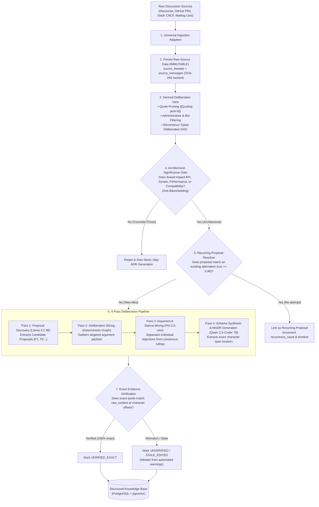

# Ingestion and Extraction Engine Specification

**Project:** Biscuit — Open Source Decision Intelligence and Knowledge Recovery  
**Team:** Chole Bhature (`@mriarc-08`, `@daksheshsharma2409`, `@utksh1`)  
**Scope:** Universal Ingestion, Immutable Source Provenance, Typed Deliberation Graph, Architectural Gating, and 4-Pass Argument Mining.  
**Specification Level:** Implementation Contract (Consolidated with Issue #5 fixes).

---

## 1. High-Level Engine Architecture

The Ingestion and Extraction Engine processes open-source discussions across Discourse, GitHub, and chat working groups into structured **Architectural Decision Records (MADRs)** without losing evidentiary provenance.



---

## 2. Universal Data Ingestion & Immutable Source Storage

Per **Issue #5 (A1, C1)**:
- Raw content is **never mutated, truncated, or replaced**.
- Cleaned content used for token reduction is stored strictly as a derived secondary field.
- If a message was edited or deleted on the remote platform, Biscuit updates `edit_state` but retains the original content hash.

### Canonical Data Contract (Language-Agnostic Schema)

```
Structure: IngestedMessage
    external_message_id : String         (Platform unique ID, e.g. "post-48", "rev-912")
    thread_id           : UUID           (Foreign Key to source_threads)
    parent_message_id   : String or Null (Direct parent comment ID)
    author_identity     : String         (Username, e.g. "guido", "markshannon")
    raw_content         : String         (IMMUTABLE: Exactly as received from API)
    content_hash        : String         (SHA-256 of raw_content)
    canonical_permalink : String         (Direct permanent URL to post)
    timestamp           : Timestamp      (ISO-8601 UTC)
    edit_state          : Enum           (ORIGINAL, EDITED, DELETED, UNAVAILABLE)
    derived_cleaned     : String         (Derived text post-noise-filtering)
```

### Source Platform Adapters
1. **Discourse Adapter (`discuss.python.org`, `internals.rust-lang.org`):**
   - Ingests via `/t/{id}.json`, extracting `post_number`, `raw`, `reply_to_post_number`, and `like_count`.
2. **GitHub PR Review Adapter:**
   - Ingests top-level issue comments and multi-turn inline review threads on code diffs (`/pulls/{id}/reviews` and `/pulls/{id}/comments`).
3. **Slack Working Group Adapter (CNCF, Python Discord, Rust Zulip):**
   - Ingests thread messages via `thread_ts` parentage.
4. **Mailing List Adapter (LKML, Python-dev):**
   - Parses RFC 822 / mbox archives, reconstructing trees via `In-Reply-To` and `References` headers.

---

## 3. Multi-Tier Noise Suppression Pipeline

Per **Issue #5 (C2, C3)**, noise suppression operates on a **derived deliberation view**—it does not delete messages from `source_messages`:

### Tier 1: Blockquote De-duplication
- **The Problem:** Blockquotes repeat earlier comments, causing quadratic token explosion across multi-comment threads.
- **The Solution:** In the derived view, markdown blockquotes (`> ...`) are replaced with structural reference pointers:  
  `[Quoting post-12 by @guido]`  
- **Safety Rule:** The raw content remains in `source_messages` so exact character offsets into original quotes can always be re-verified.

### Tier 2: Automated Bot & Machine Noise Pruning
- Prunes messages from automated users (`[bot]`, `cla-assistant`, `stale[bot]`, `codecov`, `github-actions`).
- *Exception:* Benchmarking bots reporting runtime performance regressions (e.g. `pyperformance`) are preserved.

### Tier 3: Operational & Administrative Noise Pruning
Messages matching the following patterns with no attached technical argumentation are pruned from the deliberation view:
1. **Assignment Requests:**  
   `\b(can\s+i\s+work\s+on\s+this|please\s+assign(\s+to\s+me)?|claiming\s+this\s+issue|taking\s+this\s+up)\b`
2. **Review Bumps & Status Pings:**  
   `\b(friendly\s+ping|any\s+updates?\??|bump|ptal|please\s+take\s+a\s+look|please\s+review)\b`
3. **Repository Hygiene Chatter:**  
   `\b(rebased\s+on\s+main|resolved\s+conflicts?|fixed\s+typo|lint\s+fixed|squashed\s+commits)\b`
4. **Low-Entropy Social Reactions:**  
   Comments $<20$ characters containing only affirmations or emojis (`"+1"`, `"me too"`, `"following"`, `"thanks!"`, `"LGTM"`).

### Tier 4: Typed Deliberation Graph Reconstruction (DAG)
Builds a typed conversational graph:
- Edge: `DIRECT_REPLY` (`parent_message_id`)
- Edge: `QUOTE_REFERENCE` (`[Quoting post-N]`)
- Edge: `MENTION` (`@username`)

---

## 4. Architectural Significance Gate & Zombie Resolver

### Architectural Significance Gate (Anti-Bikeshedding)
Evaluates whether a discussion meets the threshold of an Architectural Decision Record:
- **Retained:** Language grammar/syntax, public API interfaces, concurrency/memory/locks, security models, deprecations/backward compatibility breaks.
- **Discarded from ADR Generation:** UI button colors, typo fixes, internal variable renames, and linter style choices. (Raw discussions remain preserved in `source_threads` for auditability).

### Zombie Proposal Resolver (Cross-Time Deduplication)
When a proposal is discovered:
- Generate an embedding with `nomic-embed-text-v1.5`.
- Query `decision_alternatives` with cosine distance.
- **If Cosine Similarity $\ge 0.90$ with an existing proposal:**
  - Mark as a **`RECURRING_PROPOSAL`**.
  - Do not create a duplicate record.
  - Link the new thread under `decision_event_log`, update `recurrence_count`, and append any novel objections.

---

## 5. The 4-Pass Deliberation Pipeline

Per **Issue #5 (B1, B2)**, the extraction pipeline strictly separates **individual objections** from **formal project-level rejections**.

```
Pass 1: Proposal Discovery         (Llama 3.2 3B)  ➔ Extract Candidate Proposals [P1, P2...]
Pass 2: Deliberation Slicing       (Deterministic)  ➔ Slice Deliberation DAG per proposal
Pass 3: Argument & Stance Mining   (Phi-3.5-mini)   ➔ Objections vs. Rulings vs. Concessions
Pass 4: Schema & MADR Synthesis    (Qwen 2.5 7B)    ➔ Generate Exact Span Locators & MADR
```

---

### Pass 1: Proposal Discovery (`Llama 3.2-3B-Instruct`)
* **Objective:** Extract candidate technical proposals from discussion chunks.
* **Schema Output:**
  ```json
  [
    {
      "proposal_id": "P1",
      "proposal_text": "Introduce unary '?' operator without dot (a?b)",
      "proponent": "dev_alex",
      "source_message_id": "post-12"
    }
  ]
  ```

---

### Pass 2: Deliberation Slicing (Deterministic DAG Traversal)
* **Objective:** Collect only comments directly connected to Proposal $P_i$ via direct replies, quote references, or keyword mentions.
* **Output:** A compact deliberation packet of 5–15 comments focused exclusively on $P_i$.

---

### Pass 3: Argument & Stance Mining (`Phi-3.5-mini-instruct`)
* **Objective:** Parse individual arguments and classify whether an authoritative resolution occurred.
* **Safety Invariant:** An objection is recorded as an `argument`, **NOT** an automatic project rejection.
* **System Prompt:**
  ```text
  You are an expert compiler and systems architect analyzing a technical debate.
  Analyze the deliberation packet for: "{proposal_text}".

  1. Extract individual arguments:
     - For each participant comment: author, stance (SUPPORT, OBJECT, REBUTTAL), and rationale.
  2. Determine proposal lifecycle status:
     - Select from: PROPOSED, UNDER_DISCUSSION, ACCEPTED, REJECTED, WITHDRAWN, DEFERRED, SUPERSEDED, UNRESOLVED, DISPUTED, ACCEPTED_WITH_MODIFICATION.
  3. Rejection Rule:
     - A proposal may ONLY be labeled REJECTED if:
       a) An authoritative project maintainer/BDFL explicitly rejected it, OR
       b) The proponent explicitly conceded and withdrew it, OR
       c) Clear consensus of maintainers agreed on rejection.
     - If participants merely objected but no authoritative decision was reached, classify as DISPUTED or UNRESOLVED.
  ```

---

### Pass 4: Schema Synthesis & Exact Span Locating (`Qwen 2.5-Coder-7B-Instruct`)
* **Objective:** Format structured records and calculate **exact character offset spans** (`start_char`, `end_char`) inside the raw source comment.
* **Output:**
  ```json
  {
    "lifecycle_status": "REJECTED",
    "rejection_category": "SYNTAX_AMBIGUITY",
    "rejection_summary": "Lexical collision with ternary expressions when whitespace is omitted.",
    "ruling_authority": "BDFL",
    "evidence_span": {
      "source_message_id": "post-48",
      "exact_quote": "If we allow a?b without a dot, the tokenizer cannot distinguish between conditional expressions and safe navigation without multi-token lookahead.",
      "start_char": 214,
      "end_char": 358,
      "evidence_role": "RULING",
      "stance": "OBJECT"
    }
  }
  ```

---

## 6. Exact Evidence Verification Guardrail (Anti-Hallucination)

Per **Issue #5 (A2)**, **we reject all fuzzy 92% quote approvals and sentence substitution fallbacks**:

```
[Extracted Evidence Span]
   ├── source_message_id: "post-48"
   ├── exact_quote: "If we allow a?b..."
   └── start_char: 214, end_char: 358
           │
           ▼
[Load source_messages.raw_content]
   │
   ▼
[Extract substring: raw_content[214:358]]
   │
   ├── EXACT MATCH (100%)?
   │     YES ➔ verification_status = 'VERIFIED_EXACT'
   │            Record authorized for evidence backing.
   │
   └── MISMATCH?
         NO  ➔ Check if message was edited (edit_state == 'EDITED').
                If edited: verification_status = 'STALE_EDITED'
                If unedited: verification_status = 'UNVERIFIED'
                
                CRITICAL INVARIANT:
                Biscuit NEVER invents or substitutes alternative text.
                Unverified evidence CANNOT authorize a PR warning.
```

---

## 7. PEP-505 Evaluation Benchmark Walkthrough

When evaluated on historical Python PEP-505 discussions without the PEP text:
1. **Pass 1:** Discovers Proposals:
   - $P_1$: Unary `?` operator (`a?b`).
   - $P_2$: Safe navigation `?.` (`a?.b`).
   - $P_3$: Built-in `coalesce(*args)` function.
2. **Pass 3:**
   - $P_1$: Classified as **`REJECTED`** $\rightarrow$ Ruling by Guido van Rossum (`post-48`), category: `SYNTAX_AMBIGUITY`.
   - $P_3$: Classified as **`REJECTED`** $\rightarrow$ Ruling by Mark Shannon (`post-112`), category: `PERFORMANCE` (eager evaluation).
   - $P_2$: Classified as **`WITHDRAWN / DEFERRED`** $\rightarrow$ Author Steve Dower deferred due to operator proliferation controversy.
3. **Evidence Verification:** Confirms all character spans match raw Discourse post texts with **100% exact character alignment**.
4. **Warning Authorization:** Only $P_1$ and $P_3$ carry verified rejection rulings; $P_2$ does not trigger rejection warnings.
