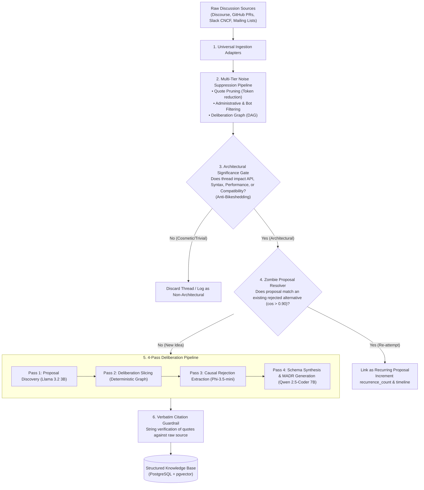

# Ingestion and Extraction Engine Specification

**Project:** Biscuit — Open Source Decision Intelligence and Knowledge Recovery  
**Team:** Chole Bhature (`@mriarc-08`, `@daksheshsharma2409`, `@utksh1`)  
**Scope:** Universal Ingestion, Multi-Tier Noise Stripping, Significance Gating, Zombie Deduplication, and 4-Pass Deliberation Mining.

---

## 1. High-Level Engine Architecture

The Ingestion and Extraction Engine is the analytical core of Biscuit. It transforms chaotic, multi-year open-source debates (stretching across 100+ comments with heavy quoting, side-tangents, and logistical noise) into structured, verifiable **Architectural Decision Records (MADRs)** using **lightweight open-source models**.



---

## 2. Universal Data Ingestion & Normalization

Discussions originate from diverse platforms with wildly different data schemas. The ingestion layer translates them into a single, language-agnostic data contract.

### Canonical Data Contract (Language-Agnostic Schema)

```
Structure: NormalizedComment
    comment_id        : String         (Platform unique ID, e.g. "post-48", "rev-912")
    author_handle     : String         (Username, e.g. "guido", "markshannon")
    raw_content       : String         (Full unedited text body)
    cleaned_content   : String         (Post-noise-stripped text body)
    reply_to_id       : String or Null (Direct parent comment ID)
    timestamp         : Timestamp      (ISO-8601 UTC)
    reactions_count   : Integer        (Count of upvotes, hearts, thumbs-up)
    has_code_block    : Boolean        (True if message contains code/syntax snippets)

Structure: NormalizedDiscussionThread
    source_platform   : Enum           (DISCOURSE, GITHUB_PR, GITHUB_ISSUE, SLACK, MAILING_LIST)
    external_id       : String         (e.g. "topic-1234", "pull-505")
    title             : String         (Title or subject line)
    canonical_url     : String         (Permanent URL to original discussion)
    comments          : List of NormalizedComment
```

### Source Platform Adapters

1. **Discourse Adapter (`discuss.python.org`, `internals.rust-lang.org`):**
   - Ingests via Discourse REST endpoint (`/t/{id}.json`).
   - Paginates through `post_stream.posts` extracting `post_number`, `raw`, `reply_to_post_number`, and `like_count`.
2. **GitHub PR Review Adapter:**
   - Ingests top-level issue comments and multi-turn inline review threads on code diffs via GitHub GraphQL/REST APIs (`/pulls/{id}/reviews` and `/pulls/{id}/comments`).
   - Links review comments to the specific AST code lines under discussion.
3. **Slack Working Group Adapter (CNCF, Python Discord, Rust Zulip):**
   - Ingests live via Switch or historical JSON exports.
   - Resolves thread parents using `thread_ts` and message replies.
4. **Mailing List Adapter (LKML, Python-dev, PostgreSQL Hackers):**
   - Parses RFC 822 / mbox / public-inbox email archives.
   - Reconstructs reply hierarchies using `In-Reply-To` and `References` email headers.

---

## 3. Multi-Tier Noise Suppression Pipeline

Raw open-source discussions are filled with noise that wastes model tokens and triggers hallucinations. Before any LLM analyzes a discussion, it passes through three deterministic noise-pruning tiers:

### Tier 1: Blockquote De-duplication
- **The Problem:** In Discourse and GitHub, users routinely quote 40 lines of earlier comments just to add a 2-line response. Across a 100-comment thread, this results in quadratic token explosion.
- **The Solution:** Strip nested markdown blockquotes (`> ...`) and replace them with a structural reference pointer:  
  `[Quoting post-12 by @guido]`  
- **Impact:** Reduces input token volume by **40% to 60%** with zero loss of semantic deliberation.

### Tier 2: Automated Bot & Machine Noise Elimination
Automatically prune messages from non-human actors:
- Authors ending in `[bot]`, `bot`, or known automated entities (`cla-assistant`, `stale[bot]`, `codecov`, `github-actions`).
- Automated CI build reports, test matrices, and automated merge notices.
- *Exception:* Benchmarking bots that report performance regressions (e.g., `pyperformance`, speed.python.org) are preserved.

### Tier 3: Operational & Administrative Noise Pruning
Open-source threads contain substantial logistical chatter. Messages matching the following patterns with no substantive technical argument attached are pruned:
1. **Assignment Requests:**  
   `\b(can\s+i\s+work\s+on\s+this|please\s+assign(\s+to\s+me)?|claiming\s+this\s+issue|taking\s+this\s+up)\b`
2. **Review Bumps & Status Pings:**  
   `\b(friendly\s+ping|any\s+updates?\??|bump|ptal|please\s+take\s+a\s+look|please\s+review)\b`
3. **Repository Hygiene Chatter:**  
   `\b(rebased\s+on\s+main|resolved\s+conflicts?|fixed\s+typo|lint\s+fixed|squashed\s+commits)\b`
4. **Low-Entropy Social Reactions:**  
   Messages $<20$ characters containing only affirmations or emojis (`"+1"`, `"me too"`, `"following"`, `"thanks!"`, `"LGTM"`).

### Tier 4: Deliberation Graph Reconstruction (DAG)
Converts the flat list of comments into a Directed Acyclic Graph based on `reply_to_id` and explicit user mentions (`@user`). This graph maps which comments represent direct counter-arguments to specific proposals.

---

## 4. The Architectural Significance Gate (Anti-Bikeshedding)

In open source, developers frequently spend hundreds of comments on **trivialities** (e.g., UI button colors, typo corrections, linter formatting) while barely debating critical infrastructure changes. This is known as **Bikeshedding** (Parkinson's Law of Triviality).

Biscuit must **not** store trivial changes as Architectural Decision Records.

```
┌────────────────────────────────────────────────────────┐
│           ARCHITECTURAL SIGNIFICANCE CRITERIA          │
├────────────────────────────────────────────────────────┤
│                                                        │
│  Category A: Architectural & Significant (RETAINED)    │
│  • Syntax / Grammar: Changes to compiler grammar,      │
│    operators, keywords, or language parsing.           │
│  • Public API / Interface: Adding/removing public      │
│    methods, breaking function signatures.              │
│  • Concurrency & Performance: Lock contention, GIL,    │
│    memory allocations, cache invalidation, latency.    │
│  • Compatibility: Breaking changes, deprecation cycles.│
│  • Security / Protocol: Threat model, authentication.  │
│                                                        │
│  Category B: Trivial & Cosmetic (DISCARDED)            │
│  • UI Colors & Layout styling ("Change button blue").  │
│  • Internal variable renames (foo ➔ bar).              │
│  • Formatting / Linter style choices (tabs vs spaces). │
│  • Documentation typos and grammar fixes.              │
│                                                        │
└────────────────────────────────────────────────────────┘
```

### Significance Evaluation Logic
Before deep extraction, discussions are scored across 4 impact dimensions:
1. $\text{Score}_{\text{API}}$: Does the discussion propose altering public APIs or language syntax?
2. $\text{Score}_{\text{Runtime}}$: Does it alter memory, latency, concurrency, or CPU execution?
3. $\text{Score}_{\text{Compat}}$: Does it break backward compatibility or introduce deprecations?
4. $\text{Score}_{\text{Security}}$: Does it alter safety, security boundaries, or threat models?

If a thread scores zero across all 4 dimensions, it is classified as **`COSMETIC_NON_ARCHITECTURAL`** and discarded.

---

## 5. The Zombie Proposal Resolver (Cross-Time Deduplication)

In open-source software, rejected ideas are repeatedly proposed by new contributors every 2 to 3 years.

### The Problem:
- *2019:* Developer proposes `?.` safe navigation $\rightarrow$ Rejected (grammar collision).
- *2021:* New developer proposes `?.` again $\rightarrow$ Rejected (same reason).
- *2024:* Another developer opens PR proposing `?.` $\rightarrow$ Rejected.
- Storing 3 separate records creates database bloat and fragments historical knowledge.

### The Solution: Semantic Deduplication & Recurrence Tracking
When Pass 1 discovers a candidate proposal:
1. Generate an embedding vector using `nomic-embed-text-v1.5`.
2. Query the existing `decision_alternatives` database using cosine similarity.
3. **If Cosine Similarity $\ge 0.90$ with an existing alternative:**
   - Flag as a **`RECURRING_PROPOSAL`**.
   - Do **not** create a new duplicate record.
   - **Update the canonical record:**
     - Increment `recurrence_count` (e.g. `recurrence_count = 3`).
     - Append the new discussion URL to `historical_debate_urls`.
     - Update `last_proposed_at` timestamp.
     - Append any novel counter-arguments to the existing rationale.

---

## 6. The 4-Pass Model Extraction Pipeline

Lightweight open-source models (3B to 7B parameters) excel when given **compact, isolated tasks** rather than massive 50,000-word raw transcripts. The work is divided into 4 sequential passes:

```
Pass 1: Proposal Discovery      (Llama 3.2 3B)  ➔ Extract [P1, P2, P3...]
Pass 2: Deliberation Slicing    (Deterministic)  ➔ Slice thread graph per proposal
Pass 3: Causal Rejection Mining (Phi-3.5-mini)   ➔ Extract fatal flaws & quotes
Pass 4: Schema & MADR Synthesis (Qwen 2.5 7B)    ➔ Output verified Pydantic MADR
```

---

### Pass 1: Proposal Discovery
* **Model:** `Llama 3.2-3B-Instruct`
* **Input:** Cleaned comments in chunks of 10–15 messages.
* **Objective:** Extract all candidate technical designs or alternative syntaxes under consideration.
* **System Prompt:**
  ```text
  You are an expert software architecture parser. Read this open-source discussion slice.
  Identify all distinct technical proposals, syntax alternatives, or architectural approaches proposed by participants.
  Ignore administrative chatter, bug reports, and conversational banter.
  Return a JSON array of proposals with: proposal_id, summary, proponent, initial_comment_id.
  ```
* **Output Example:**
  ```json
  [
    {
      "proposal_id": "P1",
      "summary": "Introduce unary '?' safe navigation operator (a?b)",
      "proponent": "dev_alex",
      "initial_comment_id": "post-12"
    },
    {
      "proposal_id": "P2",
      "summary": "Introduce functional coalesce(*args) built-in",
      "proponent": "dev_ben",
      "initial_comment_id": "post-35"
    }
  ]
  ```

---

### Pass 2: Deliberation Slicing (Deterministic Graph Filtering)
* **Execution:** Deterministic algorithm (Zero LLM Tokens).
* **Objective:** For each identified proposal ($P_1, P_2$), trace the Deliberation DAG to collect:
  1. The initiating comment where the proposal was introduced.
  2. All direct and indirect replies to that comment.
  3. All comments referencing the proposal's keywords or code symbols.
* **Result:** Isolates a compact, high-signal sub-thread of **5 to 15 comments** focused entirely on Proposal $P_i$ (~1,000 words).

---

### Pass 3: Causal Rejection Extraction
* **Model:** `Phi-3.5-mini-instruct` (128k context, specialized reasoning).
* **Input:** The targeted deliberation packet for Proposal $P_i$.
* **Objective:** Determine whether the proposal was accepted or rejected, and extract the exact fatal flaw.
* **System Prompt:**
  ```text
  You are an expert compiler and systems architect evaluating a technical debate.
  Analyze the deliberation packet for the proposal: "{proposal_summary}".

  Answer the following with strict causal accuracy:
  1. Status: Was this proposal ACCEPTED, REJECTED, or SUPERSEDED?
  2. If REJECTED:
     a. What was the exact fatal technical objection or constraint that caused its rejection?
     b. Classify the fatal flaw into: PERFORMANCE, SYNTAX_AMBIGUITY, BACKWARD_COMPAT, COMPLEXITY, SECURITY, or PHILOSOPHICAL.
     c. Who raised the fatal objection?
     d. Provide the EXACT verbatim quote from the comment where the fatal objection was stated.
     e. Provide the comment ID of the fatal objection.
  ```
* **Output Example:**
  ```json
  {
    "status": "REJECTED",
    "rejection_category": "SYNTAX_AMBIGUITY",
    "rejection_reason": "Creates lexical ambiguity with Python ternary expressions (x if y else z) when whitespace is omitted.",
    "fatal_objection_by": "Guido van Rossum",
    "fatal_comment_id": "post-48",
    "verbatim_quote": "If we allow a?b without a dot, the tokenizer cannot distinguish between conditional expressions and safe navigation without multi-token lookahead."
  }
  ```

---

### Pass 4: Structured Schema & MADR Synthesis
* **Model:** `Qwen 2.5-Coder-7B-Instruct`
* **Input:** The validated outputs from Pass 3 + Discussion Metadata.
* **Objective:** Produce the final, production-ready Markdown Architectural Decision Record (MADR) and compute vector embeddings for storage.
* **Output:** A strict, validated Pydantic object ready for insertion into the `decisions` and `decision_alternatives` tables.

---

## 7. Anti-Hallucination Guardrail (Verbatim Quote Verification)

To guarantee that no hallucinated quotes or fabricated citations ever enter the knowledge base, Biscuit enforces an automated **Source-Grounding Verification Check**:

```
[Extracted Quote from LLM] ──┐
                             ├──> [String Matcher / Substring Evaluator]
[Raw Original Comment Body] ──┘                 │
                                                ▼
                                    Does quote exist in source?
                                    • Exact Match (100%): APPROVED
                                    • Fuzzy Match (>= 92%): APPROVED (whitespace normalized)
                                    • Below 92%: REJECTED (Fallback to closest contiguous sentence)
```

### Verification Logic:
1. **Exact Substring Check:** Searches for the exact normalized quote inside the raw comment text of `fatal_comment_id`.
2. **Fuzzy Levenshtein / Longest Common Substring:** Allows minor differences in trailing punctuation, quotes, or markdown formatting, requiring a minimum $\ge 0.92$ similarity ratio.
3. **Automated Fallback:** If the model generated an imagined summary rather than a true quote, the system automatically replaces the quote with the highest-scoring sentence extracted directly from the author's comment.

---

## 8. End-to-End Walkthrough: The PEP-505 Evaluation Scenario

This scenario demonstrates how Biscuit passes the hackathon's core test:
> *"Given Python PEP public discussions without the corresponding PEP, evaluate whether the system recovers the ideas that were rejected and the reasons why."*

### Step 1: Input to Biscuit
- **Discussion Source:** `discuss.python.org/t/pep-505-none-aware-operators/1234`
- **Raw Content:** 230 comments debating syntax proposals across 4 months. The actual PEP document is **withheld**.

### Step 2: Processing
1. **Universal Ingestor:** Fetches 230 posts via Discourse API.
2. **Noise Filter:** Prunes 110 messages (blockquotes, "+1" comments, assignment pings, and CLA bot confirmations).
3. **Significance Gate:** Confirms changes impact Python's PEG parser and language grammar (High Architectural Significance).
4. **Pass 1 (Llama 3.2 3B):** Discovers 3 candidate proposals:
   - $P_1$: Unary `?` operator (`a?b`).
   - $P_2$: Safe navigation `?.` (`a?.b`).
   - $P_3$: Built-in `coalesce(*args)` function.
5. **Pass 2 (DAG Slicing):** Clusters comments into 3 isolated sub-threads.
6. **Pass 3 (Phi-3.5-mini):** Analyzes each sub-thread:
   - $P_1$: **REJECTED** $\rightarrow$ Ambiguity with ternary expressions (Guido van Rossum, post-48).
   - $P_3$: **REJECTED** $\rightarrow$ Eager evaluation defeats short-circuiting (Mark Shannon, post-112).
   - $P_2$: **DEFERRED/WITHDRAWN** $\rightarrow$ Lack of community consensus on operator proliferation.
7. **Anti-Hallucination Guardrail:** Confirms all quotes match raw post text with $>95\%$ string parity.
8. **Pass 4 (Qwen 2.5-Coder 7B):** Generates structured MADR records and persists them into PostgreSQL with `pgvector` embeddings.

### Step 3: Final Output (Recovered Without the PEP)
```yaml
decision_id: "PEP-505-RECOVERED"
topic: "None-aware operators (?. and ??)"
status: "REJECTED"
rejected_alternatives:
  - proposal: "Using `?` without a dot (e.g. `a?b`)"
    status: "REJECTED"
    category: "SYNTAX_AMBIGUITY"
    rejection_reason: "Lexical collision with ternary expression syntax when whitespace is omitted."
    fatal_objection_by: "Guido van Rossum"
    citation_quote: "If we allow a?b without a dot, the tokenizer cannot distinguish between conditional expressions and safe navigation without multi-token lookahead."
    citation_url: "https://discuss.python.org/t/pep-505-none-aware-operators/1234#post-48"

  - proposal: "Functional coalesce(*args) built-in"
    status: "REJECTED"
    category: "PERFORMANCE"
    rejection_reason: "Eager argument evaluation evaluates fallbacks before calling, defeating short-circuiting semantics."
    fatal_objection_by: "Mark Shannon"
    citation_quote: "coalesce(a, expensive_fallback()) would always evaluate the fallback, which breaks the primary use case."
    citation_url: "https://discuss.python.org/t/pep-505-none-aware-operators/1234#post-112"
```

The system recovers the exact rejected ideas and technical reasons documented in the PEP without ever having seen the PEP itself.
