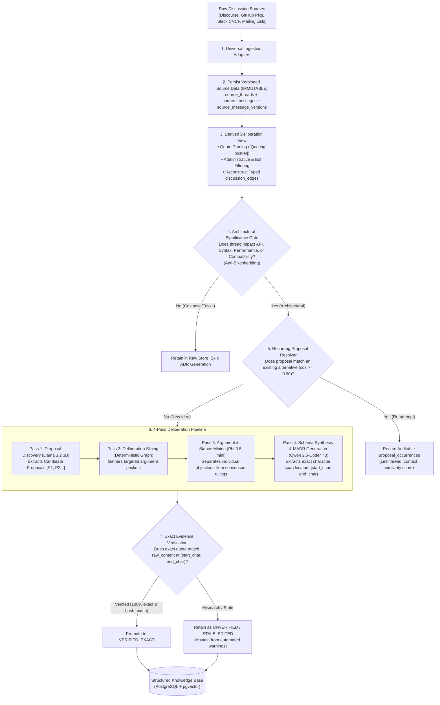
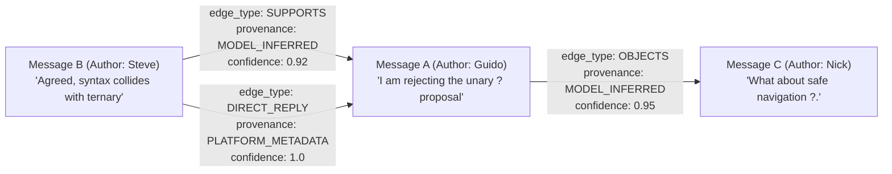

# Ingestion and Extraction Engine Specification

**Project:** Biscuit — Open Source Decision Intelligence and Knowledge Recovery  
**Team:** Chole Bhature (`@mriarc-08`, `@daksheshsharma2409`, `@utksh1`)  
**Scope:** Universal Ingestion, Versioned Source Provenance, Typed Deliberation Graph, Architectural Gating, 4-Pass Argument Mining, and Proposal-Occurrence Tracking.  
**Specification Level:** Implementation Contract (Consolidated with Issue #5 and PR #7 review requirements).

---

## 1. High-Level Engine Architecture

The Ingestion and Extraction Engine processes open-source discussions across Discourse, GitHub, mailing lists, and chat into structured **Architectural Decision Records (MADRs)** without losing evidentiary provenance.



---

## 2. Universal Data Ingestion & Versioned Source Storage

Per **Issue #5 (A1, C1)** and **PR #7 Review (1.1, 1.2)**:
- Raw content is **never mutated, truncated, or overwritten**.
- All content captures live in `source_message_versions` with SHA-256 digests. If a post is later edited or deleted remotely, a new version record is appended with `edit_state = 'EDITED'` or `'DELETED'`, preserving the historical version that past evidence spans point to.
- Cleaned content used for token reduction is stored strictly as a derived secondary view.

### Canonical Data Contract: Ingested Source Message & Versions

```
Structure: IngestedMessageIdentity
    thread_id           : UUID           (Foreign Key to source_threads)
    external_message_id : String         (Platform unique ID, e.g. "post-48", "rev-912")
    parent_message_id   : String or Null (Direct parent comment ID)
    author_id           : UUID           (Foreign Key to contributors)
    original_timestamp  : Timestamp      (ISO-8601 UTC)
    canonical_permalink : String         (Permanent URL to message)

Structure: IngestedMessageVersion
    message_id          : UUID           (Foreign Key to source_messages)
    version_number      : Integer        (Monotonically increasing version: 1, 2, ...)
    raw_content         : String         (IMMUTABLE: Exactly as received from API)
    content_hash        : String         (SHA-256 of raw_content)
    captured_at         : Timestamp      (ISO-8601 UTC capture timestamp)
    is_current          : Boolean        (True if latest active version)
    edit_state          : Enum           (ORIGINAL, EDITED, DELETED, UNAVAILABLE)
    edit_reason         : String or Null
    derived_cleaned     : String         (Derived text post-noise-filtering)
```

---

## 3. Deliberation Graph Reconstruction & Typed Edges

Per **PR #7 Review (3)**:
The system reconstructs conversational structure into the `discussion_edges` table with explicit technical edge types and provenance:



### Complete Edge Taxonomy (`discussion_edges`)
| Edge Type | Definition | Source Provenance |
|---|---|---|
| `PROPOSES` | Introduces a novel technical alternative or syntax | `MODEL_INFERRED` (Pass 1) |
| `SUPPORTS` | Advances supporting arguments or benchmarks for a proposal | `MODEL_INFERRED` (Pass 3) |
| `OBJECTS` | Raises a specific technical, performance, or compatibility critique | `MODEL_INFERRED` (Pass 3) |
| `REBUTS` | Directly counters or answers a previously raised objection | `MODEL_INFERRED` (Pass 3) |
| `RESOLVES` | Authoritative maintainer ruling accepting or rejecting a proposal | `MODEL_INFERRED` + Maintainer Role |
| `REFERENCES` | Mentions another PEP, commit, or issue identifier | `DETERMINISTIC_RULE` (Regex) |
| `DIRECT_REPLY` | Explicit platform reply thread relation | `PLATFORM_METADATA` (API payload) |
| `QUOTE_REFERENCE` | Quoting a specific passage from an earlier message | `DETERMINISTIC_RULE` (Blockquote parsing) |
| `MENTION` | User `@` handle mention | `PLATFORM_METADATA` |

> [!CRITICAL]
> **Deliberation Edge Invariant:** A platform `MENTION` or `DIRECT_REPLY` must **never** be interpreted as an objection, rebuttal, or resolution without explicit semantic evidence in `evidence_spans`.

---

## 4. Multi-Tier Noise Suppression Pipeline

Per **Issue #5 (C2, C3)**, noise suppression operates on a **derived deliberation view**—it does not alter raw records in `source_message_versions`:

1. **Tier 1: Blockquote De-duplication:** Markdown blockquotes (`> ...`) are replaced with structural reference pointers (`[Quoting post-12 by @guido]`).
2. **Tier 2: Automated Bot Pruning:** Prunes automated machine messages (`[bot]`, `stale[bot]`, `codecov`). Runtime performance benchmarking bots (e.g. `pyperformance`) are preserved.
3. **Tier 3: Administrative Chatter Pruning:** Prunes assignment claims (`"can I work on this"`), status bumps (`"friendly ping"`, `"PTAL"`), and trivial affirmations (`"+1"`, `"LGTM"`).
4. **Tier 4: Deliberation Slicing:** Extracts targeted subgraphs of messages connected by `PROPOSES`, `OBJECTS`, and `RESOLVES` edges for Pass 3 argument mining.

---

## 5. Architectural Significance Gate & Proposal-Occurrence Tracking

### Architectural Significance Gate (Anti-Bikeshedding)
Filters trivial discussions (e.g. documentation typos, cosmetic variable names) to ensure only decisions impacting syntax, architecture, performance, or public APIs produce ADRs.

### Proposal-Occurrence Tracking (Cross-Time Recurrence)
Per **PR #7 Review (2)**:
When a proposal is discovered in a thread:
1. Generate an embedding using `nomic-embed-text-v1.5`.
2. Compute cosine similarity against existing alternatives in `decision_alternatives`.
3. **If Cosine Similarity $\ge 0.90$ with an existing alternative:**
   - Do **NOT** silently merge the records or overwrite the historical proposal.
   - Insert an auditable record into `proposal_occurrences`:
     - `alternative_id`: Link to canonical alternative.
     - `source_thread_id`: New discussion thread.
     - `initiating_message_id`: Message where proposal was raised again.
     - `proposal_wording_version`: Exact wording used in this specific debate.
     - `occurrence_context`: Contextual rationale for recurrence (e.g. "Triggered by PR #412").
     - `occurrence_outcome`: Status in this thread (e.g. `DISMISSED_AS_DUPLICATE`, `REOPENED`).
     - `linkage_similarity`: Exact cosine score.
     - `linkage_status`: `PROPOSED_RECURRENCE` (flagged for review; does not auto-merge).
   - Log recurrence in `decision_event_log`.

---

## 6. The 4-Pass Deliberation Pipeline

Per **Issue #5 (B1, B2)** and **PR #7 Review (1.4)**:

```
Pass 1: Proposal Discovery         (Llama 3.2 3B)  ➔ Candidate Proposals [P1, P2...]
Pass 2: Deliberation Slicing       (Deterministic) ➔ Subgraph Slicing via discussion_edges
Pass 3: Argument & Stance Mining   (Phi-3.5-mini)  ➔ Objections vs. Rulings vs. Concessions
Pass 4: Schema & MADR Synthesis    (Qwen 2.5 7B)   ➔ Zero-based Spans [start_char, end_char)
```

### Pass 1: Proposal Discovery (`Llama 3.2-3B-Instruct`)
Extracts distinct technical proposals from thread chunks. Emits proposal summaries and alternative candidates.

### Pass 2: Deliberation Slicing (Deterministic DAG Slicer)
Extracts directed subgraphs around each alternative using `discussion_edges`, passing only relevant messages to Pass 3.

### Pass 3: Argument & Stance Mining (`Phi-3.5-mini-instruct`)
Separates individual member objections from consensus rulings:
* **Objection:** Recorded as an `arguments` row. Does NOT change proposal status to `REJECTED`.
* **Ruling:** Recorded only when signed by an authority (`BDFL`, `CORE_MAINTAINER_CONSENSUS`). Links to `ruling_evidence_id`.

### Pass 4: Schema & MADR Synthesis (`Qwen 2.5-Coder-7B-Instruct`)
Synthesizes the complete MADR record and extracts exact character offsets `[start_char, end_char)` for all evidence quotes.
* Evidence spans are created with default status `UNVERIFIED`.
* The verification engine extracts `raw_content[start_char:end_char]` from `source_message_versions`. If 100% byte-for-byte match, promoted to `VERIFIED_EXACT`.

---

## 7. Extraction Run Auditability Contract

Per **PR #7 Review (7)**:
Every extraction execution writes a permanent audit record into `extraction_runs`:
* `pipeline_version`: Version string of extraction pipeline code.
* `model_pass1_name` & `model_pass1_revision`: Exact HuggingFace / Ollama model tag.
* `model_pass3_name` & `model_pass3_revision`
* `model_pass4_name` & `model_pass4_revision`
* `embedding_model_name` & `embedding_model_revision`
* `prompt_templates_hash`: SHA-256 of all prompt templates used.
* `source_thread_snapshot_sha256`: Digest of raw thread snapshot.
* `run_status`: `SUCCESS`, `FAILED`, or `PARTIAL`.
