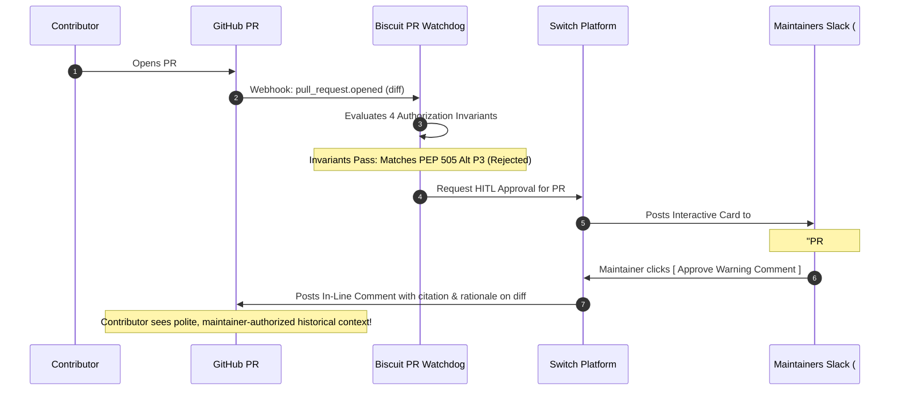

# Living Decision Intelligence and Switch Integration Specification (Day 1+)

**Project:** Biscuit — Open Source Decision Intelligence and Knowledge Recovery  
**Team:** Chole Bhature (`@mriarc-08`, `@daksheshsharma2409`, `@utksh1`)  
**Scope:** Day 1+ Real-Time Deliberation, CNCF Slack/Discord Live Interception, Switch FastMCP Architecture, Human-in-the-Loop (HITL) Governance Cards, and Proactive PR Routing.  
**Specification Level:** Implementation Contract (Consolidated Pillar 2 Design).

---

## 1. The Day 1+ Problem: Capturing Decisions Before Code is Committed

While **Pillar 1 (The Past)** recovers historical knowledge buried across 10 years of archives, **Pillar 2 (Day 1+)** solves the modern reality of open-source engineering:

### The Reality Today:
1. **The Chat Shift:** Major open-source decisions no longer wait for official PEPs or RFCs. Over **150,000 developers on CNCF Slack** hash out Kubernetes Enhancement Proposals (KEPs) in channels like `#sig-architecture` and `#sig-node`. Python core teams deliberate in the Python Discord; Rust working groups deliberate in Zulip and Discord.
2. **The Ephemeral Loss:** Architectural alternatives, trade-offs, and rejections are voiced live in chat and **vanish into scrollback history**. When an outside contributor opens a PR weeks later trying the rejected approach, they have no visibility that maintainers already debated and dismissed it.
3. **The Bot Spam Dilemma:** Traditional PR bots that blindly post automated rejection comments annoy maintainers and demoralize contributors with false alarms.

### Biscuit's Day 1+ Solution Powered by Switch:
Biscuit integrates with **`sandbox-quantum/switch`** to turn ephemeral chat into verifiable architectural intelligence through three live workflows:
1. **Autonomous Live Consensus & MADR Drafting:** Listens to Slack/Discord architectural threads, detects consensus, and presents structured approval cards.
2. **Conversational Organizational Brain in Chat:** Allows maintainers to query past decisions in plain English directly inside Slack/Discord (`@biscuit did we ever consider X?`).
3. **Human-in-the-Loop (HITL) PR Guardrail Routing:** Routes PR diff collision warnings to maintainers in Slack for interactive confirmation before commenting on GitHub.

```mermaid
flowchart TD
    subgraph S1["STREAM 1: LIVE CHAT DELIBERATION (CNCF Slack / Discord)"]
        Chat["Maintainers debate Approach X in #sig-node"] --> SwitchHook["Switch Event Gateway"]
        SwitchHook --> Buff["Session Windowing Buffer"]
        Buff --> ConsensusDetect{"Consensus Detected or<br/>@biscuit record-decision"}
        ConsensusDetect --> DraftEngine["Biscuit Draft Engine<br/>(Extracts proposal, trade-offs, author)"]
        DraftEngine --> HITL1["Switch Approval Request Card<br/>(Slack Block Kit / Discord Modal)"]
        HITL1 --> MaintainerAction{"Maintainer Action"}
        MaintainerAction -- Approve --> CommitADR["Commit Living MADR to PostgreSQL<br/>+ Generate AST Code Anchors"]
        MaintainerAction -- Edit/Dismiss --> Discard["Discard / Update Draft"]
    end

    subgraph S2["STREAM 2: CONVERSATIONAL QUERY IN CHAT"]
        MaintainerQuery["Maintainer in Slack:<br/>'@biscuit did we ever consider unary ?'"] --> FastMCP_Q["FastMCP: query_decisions()"]
        FastMCP_Q --> HybridSearch["Hybrid HNSW + AST Retrieval"]
        HybridSearch --> FormattedReply["In-Thread Slack Reply:<br/>'Yes, rejected by Guido in PEP 505 post-48<br/>Reason: Lexical ambiguity with ternary'"]
    end

    subgraph S3["STREAM 3: ACTIVE PR INTERCEPTION & HITL ROUTING"]
        PR["Contributor opens PR on GitHub"] --> PRWatchdog["Biscuit PR Watchdog"]
        PRWatchdog --> InvariantCheck{"4 Authorization Invariants Pass?"}
        InvariantCheck -- Yes --> HITL2["Switch PR Warning Approval Card<br/>Posted to Slack #maintainers"]
        InvariantCheck -- Uncertain --> SilentAudit["Audit Log Only (Abstain)"]
        HITL2 --> MaintainerChoice{"Maintainer Action"}
        MaintainerChoice -- "Post to PR" --> GitHubPost["Post In-Line GitHub Review Comment"]
        MaintainerChoice -- "Silence" --> DismissAudit["Log as Maintainer Dismissed"]
    end
```



---

## 2. Switch Integration Architecture (FastMCP & Native Bridges)

Inspection of [`sandbox-quantum/switch`](file:///Users/adarshchauhan/Downloads/hacktober%20/switch/core/pyproject.toml) reveals that Switch's core platform is built directly on **Python 3.12, FastAPI, Pydantic v2, and FastMCP**. 

Biscuit connects to Switch via the official **FastMCP (Model Context Protocol)** server protocol:

```
┌────────────────────────────────────────────────────────────────────────┐
│                   SWITCH <-> BISCUIT INTERACTION ARCHITECTURE          │
├────────────────────────────────────────────────────────────────────────┤
│                                                                        │
│   ┌─────────────────────┐                 ┌────────────────────────┐   │
│   │   SWITCH PLATFORM   │                 │     BISCUIT ENGINE     │   │
│   │ • Slack Connector   │  FastMCP Tool   │ • Hybrid pgvector KNN  │   │
│   │ • Discord Connector │ ──────────────> │ • Tree-sitter Anchors  │   │
│   │ • GitHub Connector  │  RPC Invocations│ • 4-Pass LLM Pipeline  │   │
│   │ • Approval Router   │ <────────────── │ • Provenance Verifier  │   │
│   └─────────────────────┘   Async Events  └────────────────────────┘   │
│                                                                        │
└────────────────────────────────────────────────────────────────────────┘
```

### The FastMCP Tool Contract (`biscuit.switch_agent.mcp_server`)
Biscuit exposes three primary FastMCP tools to Switch:

```python
from fastmcp import FastMCP
from pydantic import BaseModel, Field

mcp = FastMCP("biscuit-intelligence")

class QueryDecisionsInput(BaseModel):
    query_text: str = Field(description="Natural language question about past decisions")
    repository_context: str = Field(default="python/cpython", description="Target repo")
    top_k: int = Field(default=3, description="Number of decisions to retrieve")

@mcp.tool()
async def query_decisions(params: QueryDecisionsInput) -> dict:
    """Queries Biscuit's historical and living decision base using hybrid HNSW vector search."""
    ...

class DraftLivingDecisionInput(BaseModel):
    session_id: str
    channel_id: str
    thread_ts: str
    initiating_author: str
    raw_transcript: list[dict]

@mcp.tool()
async def draft_living_decision(params: DraftLivingDecisionInput) -> dict:
    """Analyzes a Slack/Discord discussion thread and synthesizes a candidate living MADR."""
    ...

class CheckPRDiffInput(BaseModel):
    repository_url: str
    pr_number: int
    diff_text: str

@mcp.tool()
async def check_pr_diff(params: CheckPRDiffInput) -> dict:
    """Checks an incoming PR diff against historical rejections and living decisions."""
    ...
```

---

## 3. Stream 1: Real-Time Deliberation Interception & HITL Cards

### A. Conversation Windowing & Consensus Trigger
When maintainers discuss architectural changes in a registered Slack channel (`#sig-architecture`, `#python-dev`), Switch streams thread messages to Biscuit:
1. **Thread Windowing:** Messages sharing the same `thread_ts` are accumulated in a rolling buffer.
2. **Trigger Modes:**
   - **Explicit Command:** Any maintainer types `@biscuit record-decision` or `/biscuit record`.
   - **Autonomous Consensus Trigger:** Phi-3.5-mini detects an agreement pattern (`"let's go with approach A"`, `"agreed, approach B won't work due to X"`) with high confidence ($\ge 0.88$).

### B. Interactive Human-in-the-Loop (HITL) Approval Card
Switch formats Biscuit's drafted decision into an interactive Block Kit card rendered directly in the Slack thread:

```
┌────────────────────────────────────────────────────────────────────────┐
│  📝 BISCUIT LIVING DECISION DRAFT                                      │
├────────────────────────────────────────────────────────────────────────┤
│  Topic:       Disallow synchronous disk I/O in worker thread pool      │
│  Status:      ACCEPTED_CONSENSUS                                       │
│  Decision By: @timothysc (Core Maintainer)                             │
│  Thread Link: slack.com/archives/C0123/p1620000000                     │
│                                                                        │
│  Rejected Alternative:                                                 │
│  • Direct POSIX read() in worker threads                               │
│  • Fatal Reason: Thread starvation during high I/O burst latency       │
│                                                                        │
│  Target Subsystem: pkg/kubelet/volumemanager                           │
│                                                                        │
│  [ ✅ Approve & Publish MADR ]   [ ✏️ Edit Rationale ]   [ ❌ Dismiss ]  │
└────────────────────────────────────────────────────────────────────────┘
```

* **When Approved:** Switch invokes `answer_approval(status="APPROVED")`. Biscuit persists the decision to `decisions`, sets `resolution_status = 'RESOLVED'`, creates `code_anchors`, and commits a new Markdown ADR to the repository's `.adr/` directory.

---

## 4. Stream 2: Conversational Organizational Brain in Chat

Maintainers can query the collective knowledge base without leaving their communication workflow:

```
Maintainer:
  @biscuit did we ever consider adding unary '?' without a dot in Python?

Biscuit (via Switch):
  🔍 Yes, the unary '?' syntax (e.g. `a?b`) was formally REJECTED during 
  PEP 505 deliberation by Guido van Rossum (post-48).

  Fatal Rationale:
  "Lexical ambiguity: conflicts with ternary conditional expressions 
  (x if y else z) when whitespace is omitted."

  Evidence Citation:
  > "If we allow a?b, the tokenizer cannot distinguish between conditional 
  > expressions and safe navigation."
  Source: https://discuss.python.org/t/pep-505-none-aware-operators/post-48
```

---

## 5. Stream 3: PR Guardrail Routing via Interactive Slack Cards

To prevent open-source contributors from facing cold automated bot rejections, Biscuit introduces **Maintainer-Gated PR Routing**:



If the maintainer clicks `[ Silence (Valid Refactor) ]`:
- The warning is suppressed.
- The reason is recorded in `pr_watchdog_audit_log` as `MAINTAINER_SILENCED`.
- The contributor is never spammed.

---

## 6. Day 1+ Relational Schema Extensions

To support Switch sessions, living drafts, and HITL approvals, Biscuit adds the following relational tables to `docs/STORAGE_AND_RETRIEVAL.md`:

```sql
-- ─────────────────────────────────────────────────────────────
-- DAY 1+ LIVING DELIBERATION & SWITCH INTERACTION CONTRACTS
-- ─────────────────────────────────────────────────────────────

CREATE TYPE living_decision_state AS ENUM (
    'DRAFT_PENDING_APPROVAL',
    'MAINTAINER_APPROVED',
    'MAINTAINER_REJECTED',
    'EDIT_REQUESTED'
);

CREATE TABLE living_decision_drafts (
    id UUID PRIMARY KEY DEFAULT uuid_generate_v4(),
    switch_session_id TEXT NOT NULL,
    source_platform VARCHAR(32) NOT NULL,  -- 'slack', 'discord', 'mattermost'
    channel_id TEXT NOT NULL,
    thread_ts TEXT NOT NULL,
    initiating_author_handle TEXT NOT NULL,
    topic TEXT NOT NULL,
    draft_status living_decision_state NOT NULL DEFAULT 'DRAFT_PENDING_APPROVAL',
    proposed_lifecycle proposal_lifecycle NOT NULL DEFAULT 'PROPOSED',
    proposal_text TEXT NOT NULL,
    rejection_summary TEXT,
    target_subsystem TEXT,
    raw_transcript_json JSONB NOT NULL,
    created_at TIMESTAMPTZ DEFAULT NOW(),
    resolved_at TIMESTAMPTZ
);

CREATE TYPE hitl_action_type AS ENUM (
    'APPROVE_LIVING_DECISION',
    'AUTHORIZE_PR_WARNING',
    'DISMISS_PR_WARNING'
);

CREATE TABLE hitl_approval_requests (
    id UUID PRIMARY KEY DEFAULT uuid_generate_v4(),
    switch_approval_id TEXT NOT NULL UNIQUE, -- Switch host-side approval request ID
    action_type hitl_action_type NOT NULL,
    target_pr_number INT,
    target_repository TEXT,
    living_draft_id UUID REFERENCES living_decision_drafts(id),
    decision_alternative_id UUID REFERENCES decision_alternatives(id),
    card_rendered_payload JSONB NOT NULL,
    maintainer_decision VARCHAR(32),        -- 'APPROVED', 'REJECTED', 'DISMISSED'
    maintainer_user_id TEXT,
    decided_at TIMESTAMPTZ,
    created_at TIMESTAMPTZ DEFAULT NOW()
);

CREATE INDEX idx_hitl_approval_switch ON hitl_approval_requests(switch_approval_id);
```

---

## 7. Hackathon Live Winning Demo: The Two-Pillar Pitch

During pitch day, this architecture enables the ultimate dual demo:

1. **The Historical Proof (Pillar 1):**
   - Run `python -m biscuit.evaluate --benchmark pep-505`.
   - Show the 100% exact character offset match, zero hallucinations, and the withheld ground-truth scorecard.
2. **The Living CNCF Slack $\rightarrow$ GitHub Moat (Pillar 2):**
   - Live Slack channel: A team member posts an architectural debate in Slack: *"Let's reject sync disk I/O in worker threads because of thread starvation."*
   - Show Switch triggering Biscuit, which instantly posts a Block Kit **Approval Card** in Slack. Maintainer clicks **[Approve]**.
   - Live GitHub PR: A team member opens a PR on GitHub touching the worker thread code.
   - Show Biscuit alerting the maintainer channel, and posting the verifiable warning on the PR diff within seconds.
