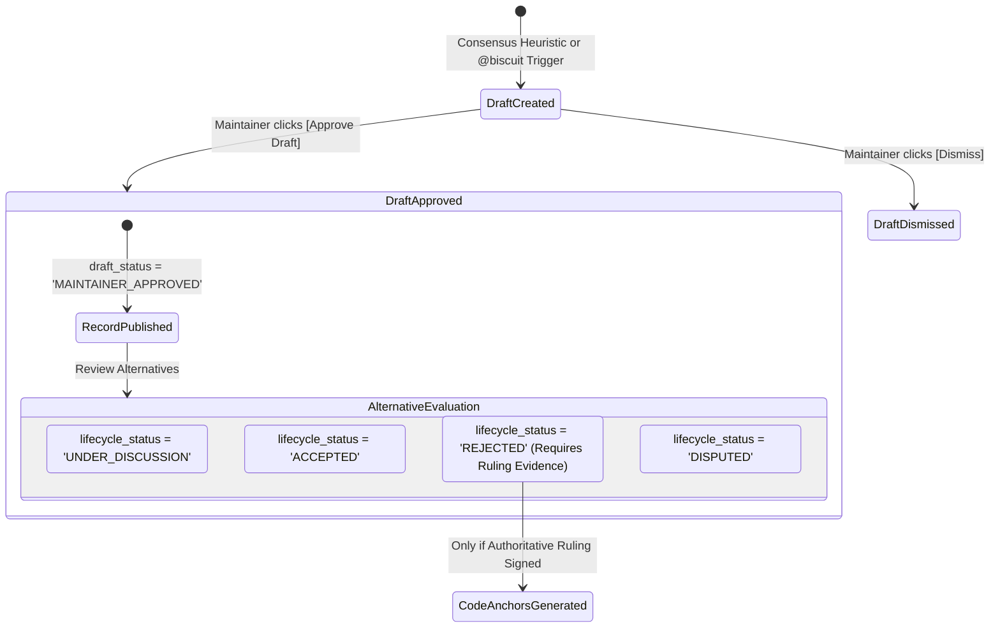

# Living Decision Intelligence and Switch Integration Specification (Day 1+)

**Project:** Biscuit — Open Source Decision Intelligence and Knowledge Recovery  
**Team:** Chole Bhature (`@mriarc-08`, `@daksheshsharma2409`, `@utksh1`)  
**Scope:** Day 1+ Real-Time Deliberation, CNCF Slack/Discord Live Interception, Switch MCP Architecture, Human-in-the-Loop (HITL) Governance Cards, and Proactive PR Routing.  
**Specification Level:** Implementation Contract (Consolidated Pillar 2 Design).

---

## 1. The Day 1+ Problem: Capturing Decisions Before Code is Committed

While **Pillar 1 (The Past)** recovers historical knowledge buried across 10 years of archives, **Pillar 2 (Day 1+)** solves the modern reality of open-source engineering:

### The Reality Today:
1. **The Chat Shift:** Major open-source decisions no longer wait for official PEPs or RFCs. Over **150,000 developers on CNCF Slack** hash out Kubernetes Enhancement Proposals (KEPs) in channels like `#sig-architecture` and `#sig-node`. Python core teams deliberate in the Python Discord; Rust working groups deliberate in Zulip and Discord.
2. **The Ephemeral Loss:** Architectural alternatives, trade-offs, and rejections are voiced live in chat and **vanish into scrollback history**. When an outside contributor opens a PR weeks later trying the rejected approach, they have no visibility that maintainers already debated and dismissed it.
3. **The Bot Spam Dilemma:** Traditional PR bots that blindly post automated rejection comments annoy maintainers and demoralize contributors with false alarms.

### Biscuit's Day 1+ Solution Powered by Switch:
Biscuit integrates with [**`sandbox-quantum/switch`** (v0.31.0)](https://github.com/sandbox-quantum/switch) to turn ephemeral chat into verifiable architectural intelligence through three live workflows:
1. **Autonomous Live Deliberation & MADR Drafting:** Listens to Slack/Discord architectural threads, detects potential consensus, and presents structured approval suggestion cards.
2. **Conversational Organizational Brain in Chat:** Allows maintainers to query past decisions in plain English directly inside Slack/Discord (`@biscuit did we ever consider X?`).
3. **Human-in-the-Loop (HITL) PR Guardrail Routing:** Routes PR diff collision warnings to maintainers in Slack for interactive confirmation before commenting on GitHub.

```mermaid
flowchart TD
    subgraph S1["STREAM 1: LIVE CHAT DELIBERATION (CNCF Slack / Discord)"]
        Chat["Maintainers debate Approach X in #sig-node"] --> SwitchHook["Switch Event Gateway (v0.31.0)"]
        SwitchHook --> Buff["Session Windowing Buffer"]
        Buff --> PersistMsg["Write to source_threads, source_messages,<br/>source_message_versions (SHA-256)"]
        PersistMsg --> ConsensusDetect{"Consensus Heuristic or<br/>@biscuit record-decision"}
        ConsensusDetect --> DraftEngine["Biscuit Draft Engine<br/>(Extracts proposal, trade-offs, author)"]
        DraftEngine --> HITL1["Switch Approval Request Card<br/>(Slack Block Kit / Discord Modal)"]
        HITL1 --> MaintainerAction{"Maintainer Action"}
        MaintainerAction -- Approve --> CommitADR["Publish Living MADR<br/>(Assign alternative outcomes explicitly)"]
        MaintainerAction -- Edit/Dismiss --> Discard["Discard / Update Draft"]
    end

    subgraph S2["STREAM 2: CONVERSATIONAL QUERY IN CHAT"]
        MaintainerQuery["Maintainer in Slack:<br/>'@biscuit did we ever consider unary ?'"] --> MCP_Q["MCP Tool: query_decisions()"]
        MCP_Q --> HybridSearch["Hybrid HNSW + AST Retrieval"]
        HybridSearch --> FormattedReply["In-Thread Slack Reply:<br/>'Yes, rejected by Guido in PEP 505 post-48<br/>Reason: Lexical ambiguity with ternary'"]
    end

    subgraph S3["STREAM 3: ACTIVE PR INTERCEPTION & HITL ROUTING"]
        PR["Contributor opens PR on GitHub"] --> PRWatchdog["Biscuit PR Watchdog"]
        PRWatchdog --> InvariantCheck{"4 Authorization Invariants Pass?"}
        InvariantCheck -- Yes --> HITL2["Switch PR Warning Approval Card<br/>Posted to Slack #maintainers"]
        InvariantCheck -- Uncertain --> SilentAudit["Audit Log Only (Abstain)"]
        HITL2 --> MaintainerChoice{"Maintainer Action"}
        MaintainerChoice -- "Post to PR" --> GitHubPost["Post In-Line GitHub Review Comment"]
        MaintainerChoice -- "Silence" --> DismissAudit["Log as Maintainer Dismissed"]
    end
```



---

## 2. Switch Integration Architecture (MCP & FastMCP SDK)

The [Switch platform](https://github.com/sandbox-quantum/switch) (pinned to `v0.31.0`) provides multi-platform chat connectors (Slack, Discord, Mattermost), agent session activity routes (`/agent-sessions/{session}/approvals`), and native support for the open **Model Context Protocol (MCP)** specification (2024-11-05).

Biscuit implements an MCP server using the Python **FastMCP SDK** (`fastmcp>=3.2.0,<4`), exposing three tools to Switch:

```
┌────────────────────────────────────────────────────────────────────────┐
│                   SWITCH <-> BISCUIT INTERACTION ARCHITECTURE          │
├────────────────────────────────────────────────────────────────────────┤
│                                                                        │
│   ┌────────────────────────┐              ┌────────────────────────┐   │
│   │   SWITCH PLATFORM      │              │     BISCUIT ENGINE     │   │
│   │ • Slack Connector      │   MCP Tool   │ • Hybrid pgvector KNN  │   │
│   │ • Discord Connector    │ ───────────> │ • Tree-sitter Anchors  │   │
│   │ • GitHub App Connector │   Invocations│ • 4-Pass LLM Pipeline  │   │
│   │ • Approval Activity API│ <─────────── │ • Provenance Verifier  │   │
│   │   (v0.31.0)            │  HMAC Events │ • FastMCP Server SDK   │   │
│   └────────────────────────┘              └────────────────────────┘   │
│                                                                        │
└────────────────────────────────────────────────────────────────────────┘
```

### The FastMCP Tool Contract (`biscuit.switch_agent.mcp_server`)

```python
from fastmcp import FastMCP
from pydantic import BaseModel, Field

mcp = FastMCP("biscuit-intelligence")

class QueryDecisionsInput(BaseModel):
    query_text: str = Field(description="Natural language question about past decisions")
    repository_context: str = Field(default="python/cpython", description="Target repo")
    top_k: int = Field(default=3, description="Number of decisions to retrieve")

@mcp.tool()
async def query_decisions(params: QueryDecisionsInput) -> dict:
    """Queries Biscuit's historical and living decision base using hybrid HNSW vector search."""
    ...

class LiveMessagePayload(BaseModel):
    external_message_id: str
    parent_message_id: str | None = None
    author_platform_id: str
    author_handle: str
    timestamp: str
    raw_content: str

class DraftLivingDecisionInput(BaseModel):
    switch_session_id: str
    source_platform: str  # 'slack', 'discord'
    channel_id: str
    thread_ts: str
    initiating_author_handle: str
    messages: list[LiveMessagePayload]

@mcp.tool()
async def draft_living_decision(params: DraftLivingDecisionInput) -> dict:
    """Ingests live transcript into canonical tables, runs consensus extraction,
    and returns a draft living MADR with exact evidence spans."""
    ...

class CheckPRDiffInput(BaseModel):
    repository_url: str
    pr_number: int
    diff_text: str

@mcp.tool()
async def check_pr_diff(params: CheckPRDiffInput) -> dict:
    """Checks an incoming PR diff against historical rejections and living decisions."""
    ...
```

---

## 3. Live Transcript Provenance & Evidentiary Parity

Per review requirement: **Live transcript provenance is directly bound to the canonical evidence model.**

When Switch streams chat messages for decision drafting:
1. **Thread Registration:** Biscuit creates or updates a record in `source_threads`:
   - `source_platform = params.source_platform` (e.g. `'slack'`)
   - `external_thread_id = f"{params.channel_id}:{params.thread_ts}"`
   - `canonical_url = f"https://slack.com/archives/{params.channel_id}/p{params.thread_ts.replace('.', '')}"`
2. **Versioned Message Persistence:** Each message in `params.messages` is persisted into `source_messages` and `source_message_versions`:
   - Assign a monotonic `version_number`; rotate `is_current` transactionally so at most one version is current for a message.
   - Persist the exact decoded message-content string without line-ending, whitespace, punctuation, or Unicode normalization.
   - Compute `content_hash` as SHA-256 over UTF-8 bytes of exact `raw_content`. Normalized/cleaned data belongs only in derived fields and never supplies evidence offsets.
3. **Exact Evidence Spans:** All quotes cited in the drafted decision are stored in `evidence_spans` referencing `source_message_version_id` with exact zero-based character offsets `[start_char, end_char)`:
   - Default status: `UNVERIFIED`.
   - Promoted to `VERIFIED_EXACT` upon 100% byte-for-byte substring verification.
4. **Draft Linkage:** The record in `living_decision_drafts` stores:
   - `source_thread_id`: Foreign key to `source_threads(id)`.
   - `initiating_message_id` and `initiating_message_version_id`: Composite foreign keys prove the version belongs to the initiating message and that message belongs to the declared thread.
   - `initiating_author_id`: Resolved contributor identity for the initiating message.
   - Claim evidence is stored one row per span in `living_decision_draft_evidence`, with foreign keys rather than an unenforced JSON UUID array.

> [!IMPORTANT]
> **Evidentiary Parity Invariant:** A living decision drafted from Slack or Discord possesses the exact same tamper-proof, auditable provenance as a historical decision mined from a PEP mailing list.

---

## 4. Deconflating HITL Approval from Decision Resolution

> [!CAUTION]
> **Critical State Separation:** Approving a Slack draft card is **NOT** an authoritative ruling that an alternative was rejected or that the decision is resolved.

Biscuit enforces **three distinct state transitions**:



1. **Transition A: Draft Publication Approval (`living_decision_drafts`):**
   - Maintainer clicks `[Approve Draft]`.
   - Updates `draft_status = 'MAINTAINER_APPROVED'`.
   - Publishes the discussion summary to the repository's living record catalog.
   - **Does NOT mark the overarching decision `RESOLVED` and does NOT authorize PR warnings.**
2. **Transition B: Alternative Lifecycle Assignment (`decision_alternatives`):**
   - Maintainers explicitly confirm the outcome for each alternative: `ACCEPTED`, `UNDER_DISCUSSION`, `DISPUTED`, `REJECTED`, or `DEFERRED`.
   - If maintainers express differing views without consensus, the alternative is assigned `DISPUTED` or `UNRESOLVED`.
   - Draft publication approval does not create a ruling sign-off and cannot change an alternative's lifecycle state.
3. **Transition C: Authoritative Ruling & Rejection Anchor Authorization:**
   - An alternative is marked `REJECTED` only when a `VERIFIED_EXACT` `RULING` span is linked to that exact alternative and authored by the identified authorized ruling actor. Core Maintainer consensus requires the ruling author plus at least one other distinct verified Core Maintainer sign-off; Working Group authority requires a Working Group Chair ruling plus at least one other distinct verified group-member sign-off.
   - Only alternatives reaching `lifecycle_status = 'REJECTED'` with a `VERIFIED_EXACT` ruling authorize PR watchdog warnings.

---

## 5. Approval Callback, Authentication & Append-Only Audit Contract

To prevent unauthenticated webhooks, replayed actions, or tampered approvals, Switch callbacks adhere to strict security invariants:

### A. Callback Authentication & Idempotency
1. **HMAC-SHA256 Signature:** Incoming callbacks from Switch must include the `X-Switch-Signature: sha256=<hex>` header computed over the raw callback body using a pre-shared secret.
2. **Idempotency Key:** Each approval card carries a unique `idempotency_key` (UUIDv4). If a callback is received for a request with `status != 'PENDING'`, Biscuit returns `409 Conflict` and discards the duplicate.
3. **TTL / Expiration:** Approval cards carry `expires_at = NOW() + INTERVAL '72 hours'`. Expired requests are automatically marked `EXPIRED` and cannot be approved.
4. **Role-Based Authorization:** Biscuit verifies that the deciding user's platform identity maps to an authorized contributor in `contributors` with `project_role IN ('BDFL', 'Core Maintainer')`.

### B. Append-Only Approval Event Log (`hitl_approval_events`)
Every action taken on an approval request writes an immutable, append-only row:
- `approval_request_id`: FK to `hitl_approval_requests`.
- `actor_platform_id`: User platform handle.
- `actor_contributor_id`: FK to `contributors(id)`.
- `action_taken`: `'APPROVE_DRAFT'`, `'REJECT_DRAFT'`, `'AUTHORIZE_PR_COMMENT'`, `'DISMISS_PR_COMMENT'`.
- `payload_signature`: Recorded cryptographic signature.
- `recorded_at`: Immutable timestamp.

---

## 6. The Autonomous Consensus Trigger: Suggestion Heuristic Only

> [!WARNING]
> **Authority Boundary Invariant:** A local model (Phi-3.5-mini) confidence score $\ge 0.88$ is strictly an internal threshold to **draft a suggestion card for human review**. Model confidence **never** establishes consensus, never assigns `REJECTED`, and never alters lifecycle state autonomously.

### Autonomous Drafting Pre-Conditions:
Before Biscuit generates a living decision suggestion card:
1. **Active Objection Check:** Biscuit queries `discussion_edges` for active `OBJECTS` edges in the thread. If any participant raised an objection that has not been countered by a subsequent `RESOLVES` or `REBUTS` edge, Biscuit flags the proposal as `DISPUTED` and suppresses consensus suggestions.
2. **Multi-Party Quorum:** Requires participation from at least **two distinct maintainers** with verified identities in `contributors`.
3. **Explicit Trigger Alternative:** Maintainers can always bypass heuristic drafting by typing `@biscuit record-decision` in the Slack/Discord thread.

---

## 7. Canonical Database Schema (Single Source of Truth)

All database DDL for Day 1+ is consolidated in [**`docs/STORAGE_AND_RETRIEVAL.md`**](./STORAGE_AND_RETRIEVAL.md):
* **Section 12:** `living_decision_drafts` (captures live sessions, thread/message identities and versions, and normalized evidence-span links).
* **Section 13:** `hitl_approval_requests` (captures Switch approval IDs, idempotency keys, role checks, and 72h expiry).
* **Section 14:** `hitl_approval_events` (immutable, append-only audit trail of all maintainer approvals).
* **Section 15:** Cross-table provenance, ruling-authority, edge-evidence, and append-only audit triggers. `living_decision_draft_evidence` is the normalized draft-claim evidence relation.

---

## 8. Hackathon Live Winning Demo: The Two-Pillar Pitch

During pitch day, this architecture enables the ultimate dual demo:

1. **The Historical Proof (Pillar 1):**
   - Run `python -m biscuit.evaluate --benchmark pep-505`.
   - Show the 100% exact character offset match, zero hallucinations, and the withheld ground-truth scorecard.
2. **The Living CNCF Slack $\rightarrow$ GitHub Moat (Pillar 2):**
   - **Step 1:** Live Slack channel: Maintainers debate in `#sig-node`: *"Let's reject sync disk I/O in worker threads because of thread starvation."*
   - **Step 2:** Switch triggers Biscuit, which posts an interactive **Approval Card** in Slack. Maintainer clicks **[Approve Draft]** and sets Approach B to `REJECTED`.
   - **Step 3:** Live GitHub PR: A team member opens PR #412 touching the worker thread code.
   - **Step 4:** Biscuit evaluates the 4 authorization invariants, routes an approval card to maintainers, and upon click, posts the verifiable warning on the PR diff within seconds.
