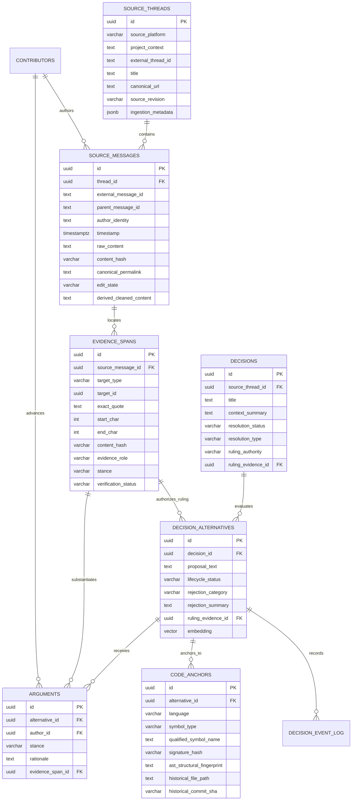
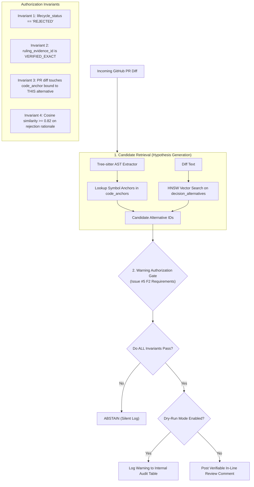

# Storage, Database Schema, and Retrieval Architecture

**Project:** Biscuit — Open Source Decision Intelligence and Knowledge Recovery  
**Team:** Chole Bhature (`@mriarc-08`, `@daksheshsharma2409`, `@utksh1`)  
**Scope:** Canonical Data Contracts, Immutable Evidence Provenance, Decision Lifecycle & Argument Separation, AST Code Anchoring, and Retrieval Guardrails.  
**Specification Level:** Implementation Contract (Consolidated with Issue #5 fixes).

---

## 1. Storage Engine Infrastructure

The storage infrastructure combines relational integrity, immutable evidence storage, and vector similarity search in a containerized environment.

```
┌────────────────────────────────────────────────────────┐
│             STORAGE & RETRIEVAL INFRASTRUCTURE         │
├────────────────────────────────────────────────────────┤
│                                                        │
│  Primary Engine: Containerized PostgreSQL 16 + pgvector │
│  • Image: pgvector/pgvector:pg16                       │
│  • ACID Relational Store for Immutable Provenance      │
│  • HNSW Index for 768-dim Vector KNN                   │
│  • Bootstrapped via docker-compose.yml + init.sql      │
│                                                        │
│  Local Test Fallback (CI / Unit Test Matrix):          │
│  • SQLite for relational tables                        │
│  • ChromaDB / In-Memory Vector Index for embeddings    │
│  • Parity-verified against PostgreSQL schema in CI     │
│                                                        │
└────────────────────────────────────────────────────────┘
```

---

## 2. Canonical Relational & Evidence Schema

Per **Issue #5 (A1, B1, E1)**, this schema enforces three non-negotiable architectural invariants:
1. **Raw Source Content is Immutable:** `source_messages.raw_content` is permanently preserved with SHA-256 hashes. Cleaned/noise-stripped text is stored only as a derived view.
2. **Objections are Decoupled from Rejections:** An individual objection in `arguments` does not change an alternative's status to `REJECTED` unless supported by an authoritative ruling in `evidence_spans`.
3. **Code Anchors Attach to Specific Alternatives:** `code_anchors` links to `decision_alternatives(id)`, ensuring alternatives in the same debate (e.g. parser operator vs. runtime built-in) anchor to their distinct codebase locations.



---

## 3. Detailed SQL DDL Specification

```sql
CREATE EXTENSION IF NOT EXISTS vector;
CREATE EXTENSION IF NOT EXISTS "uuid-ossp";

-- ─────────────────────────────────────────────────────────────
-- 1. SOURCE PROVENANCE (FIRST-CLASS & IMMUTABLE)
-- ─────────────────────────────────────────────────────────────

CREATE TABLE source_threads (
    id UUID PRIMARY KEY DEFAULT uuid_generate_v4(),
    source_platform VARCHAR(32) NOT NULL, -- 'discourse', 'github_pr', 'github_issue', 'slack', 'mailing_list'
    project_context TEXT NOT NULL,         -- 'python/cpython', 'kubernetes/kubernetes'
    external_thread_id TEXT NOT NULL,      -- 'topic_1234', 'pull_505'
    title TEXT NOT NULL,
    canonical_url TEXT NOT NULL,
    source_revision VARCHAR(64) DEFAULT 'v1',
    ingestion_metadata JSONB DEFAULT '{}'::jsonb,
    created_at TIMESTAMPTZ DEFAULT NOW(),
    CONSTRAINT uq_source_thread UNIQUE (source_platform, project_context, external_thread_id)
);

CREATE TYPE message_edit_state AS ENUM ('ORIGINAL', 'EDITED', 'DELETED', 'UNAVAILABLE');

CREATE TABLE source_messages (
    id UUID PRIMARY KEY DEFAULT uuid_generate_v4(),
    thread_id UUID NOT NULL REFERENCES source_threads(id) ON DELETE CASCADE,
    external_message_id TEXT NOT NULL,
    parent_message_id TEXT,
    author_identity TEXT NOT NULL,
    timestamp TIMESTAMPTZ NOT NULL,
    raw_content TEXT NOT NULL,             -- IMMUTABLE: Never overwritten
    content_hash VARCHAR(64) NOT NULL,     -- SHA-256 of raw_content
    canonical_permalink TEXT NOT NULL,
    edit_state message_edit_state DEFAULT 'ORIGINAL',
    derived_cleaned_content TEXT,          -- Derived representation post-noise-filtering
    created_at TIMESTAMPTZ DEFAULT NOW(),
    CONSTRAINT uq_source_message UNIQUE (thread_id, external_message_id)
);

CREATE INDEX idx_source_messages_thread ON source_messages(thread_id);
CREATE INDEX idx_source_messages_parent ON source_messages(parent_message_id);

-- ─────────────────────────────────────────────────────────────
-- 2. EXACT EVIDENCE SPANS (ANTI-HALLUCINATION PROOF)
-- ─────────────────────────────────────────────────────────────

CREATE TYPE evidence_role AS ENUM (
    'PROPOSAL',
    'OBJECTION',
    'REBUTTAL',
    'RULING',
    'CONCESSION',
    'BENCHMARK_REPORT'
);

CREATE TYPE evidence_stance AS ENUM ('SUPPORT', 'OBJECT', 'NEUTRAL');
CREATE TYPE verification_status AS ENUM ('VERIFIED_EXACT', 'STALE_EDITED', 'UNVERIFIED', 'UNAVAILABLE');

CREATE TABLE evidence_spans (
    id UUID PRIMARY KEY DEFAULT uuid_generate_v4(),
    source_message_id UUID NOT NULL REFERENCES source_messages(id) ON DELETE CASCADE,
    target_type VARCHAR(32) NOT NULL,      -- 'ALTERNATIVE', 'ARGUMENT', 'DECISION'
    target_id UUID NOT NULL,               -- Foreign ID of substantiated entity
    exact_quote TEXT NOT NULL,             -- Must match substring in source_messages(raw_content)
    start_char INT NOT NULL,               -- Exact character offset start
    end_char INT NOT NULL,                 -- Exact character offset end
    content_hash VARCHAR(64) NOT NULL,     -- Hash of exact_quote
    evidence_role evidence_role NOT NULL,
    stance evidence_stance NOT NULL,
    verification_status verification_status DEFAULT 'VERIFIED_EXACT',
    created_at TIMESTAMPTZ DEFAULT NOW()
);

CREATE INDEX idx_evidence_target ON evidence_spans(target_type, target_id);

-- ─────────────────────────────────────────────────────────────
-- 3. CONTRIBUTORS & IDENTITY RESOLUTION
-- ─────────────────────────────────────────────────────────────

CREATE TABLE contributors (
    id UUID PRIMARY KEY DEFAULT uuid_generate_v4(),
    canonical_name TEXT NOT NULL,
    github_handle TEXT,
    discourse_username TEXT,
    slack_user_id TEXT,
    email_prefix TEXT,
    project_role TEXT,                     -- 'BDFL', 'Core Maintainer', 'Contributor'
    created_at TIMESTAMPTZ DEFAULT NOW(),
    CONSTRAINT uq_contributor_name UNIQUE (canonical_name)
);

-- ─────────────────────────────────────────────────────────────
-- 4. DECISIONS & ALTERNATIVE LIFECYCLES
-- ─────────────────────────────────────────────────────────────

CREATE TYPE decision_resolution AS ENUM ('RESOLVED', 'UNRESOLVED', 'DISPUTED');
CREATE TYPE resolution_type AS ENUM ('ACCEPTED', 'REJECTED', 'DEFERRED', 'WITHDRAWN', 'SUPERSEDED');
CREATE TYPE ruling_authority AS ENUM ('BDFL', 'CORE_MAINTAINER_CONSENSUS', 'WORKING_GROUP', 'MODEL_INFERRED');

CREATE TABLE decisions (
    id UUID PRIMARY KEY DEFAULT uuid_generate_v4(),
    source_thread_id UUID NOT NULL REFERENCES source_threads(id) ON DELETE CASCADE,
    title TEXT NOT NULL,
    context_summary TEXT NOT NULL,
    resolution_status decision_resolution NOT NULL DEFAULT 'UNRESOLVED',
    resolution_type resolution_type,
    ruling_authority ruling_authority,
    ruling_evidence_id UUID REFERENCES evidence_spans(id),
    created_at TIMESTAMPTZ DEFAULT NOW(),
    updated_at TIMESTAMPTZ DEFAULT NOW()
);

CREATE TYPE proposal_lifecycle AS ENUM (
    'PROPOSED',
    'UNDER_DISCUSSION',
    'ACCEPTED',
    'REJECTED',
    'WITHDRAWN',
    'DEFERRED',
    'SUPERSEDED',
    'UNRESOLVED',
    'DISPUTED',
    'ACCEPTED_WITH_MODIFICATION'
);

CREATE TYPE rejection_category AS ENUM (
    'PERFORMANCE',
    'SYNTAX_AMBIGUITY',
    'BACKWARD_COMPAT',
    'COMPLEXITY',
    'SECURITY',
    'PHILOSOPHICAL'
);

CREATE TABLE decision_alternatives (
    id UUID PRIMARY KEY DEFAULT uuid_generate_v4(),
    decision_id UUID NOT NULL REFERENCES decisions(id) ON DELETE CASCADE,
    proposal_text TEXT NOT NULL,
    lifecycle_status proposal_lifecycle NOT NULL DEFAULT 'PROPOSED',
    rejection_category rejection_category,
    rejection_summary TEXT,
    proposed_by_id UUID REFERENCES contributors(id),
    ruling_evidence_id UUID REFERENCES evidence_spans(id),
    embedding vector(768),                 -- nomic-embed-text-v1.5
    created_at TIMESTAMPTZ DEFAULT NOW(),
    CONSTRAINT uq_alt_proposal UNIQUE (decision_id, proposal_text)
);

-- HNSW Vector Index for Instant Semantic Matching
CREATE INDEX idx_alternatives_embedding 
ON decision_alternatives 
USING hnsw (embedding vector_cosine_ops)
WITH (m = 16, ef_construction = 64);

-- ─────────────────────────────────────────────────────────────
-- 5. ARGUMENTS (DECOUPLED OBJECTIONS VS DECISIONS)
-- ─────────────────────────────────────────────────────────────

CREATE TABLE arguments (
    id UUID PRIMARY KEY DEFAULT uuid_generate_v4(),
    alternative_id UUID NOT NULL REFERENCES decision_alternatives(id) ON DELETE CASCADE,
    author_id UUID REFERENCES contributors(id),
    stance evidence_stance NOT NULL,
    rationale TEXT NOT NULL,
    evidence_span_id UUID REFERENCES evidence_spans(id),
    created_at TIMESTAMPTZ DEFAULT NOW()
);

-- ─────────────────────────────────────────────────────────────
-- 6. CODE ANCHORS (ATTACHED TO SPECIFIC ALTERNATIVES)
-- ─────────────────────────────────────────────────────────────

CREATE TYPE code_symbol_type AS ENUM (
    'function',
    'class',
    'method',
    'grammar_rule',
    'ast_node',
    'interface',
    'module'
);

CREATE TABLE code_anchors (
    id UUID PRIMARY KEY DEFAULT uuid_generate_v4(),
    alternative_id UUID NOT NULL REFERENCES decision_alternatives(id) ON DELETE CASCADE,
    language VARCHAR(32) NOT NULL,          -- 'python', 'c', 'rust'
    symbol_type code_symbol_type NOT NULL,
    qualified_symbol_name TEXT NOT NULL,    -- 'cpython.Parser.Tokenizer.get_next_token'
    signature_hash VARCHAR(64),            -- Normalization of parameter signature
    ast_structural_fingerprint VARCHAR(64), -- SHA-256 of identifier-masked AST
    historical_file_path TEXT NOT NULL,
    historical_commit_sha VARCHAR(40) NOT NULL,
    created_at TIMESTAMPTZ DEFAULT NOW()
);

CREATE INDEX idx_code_anchors_alt ON code_anchors(alternative_id);
CREATE INDEX idx_code_anchors_sym ON code_anchors(qualified_symbol_name);

-- ─────────────────────────────────────────────────────────────
-- 7. AUDITABLE DECISION EVENT LOG
-- ─────────────────────────────────────────────────────────────

CREATE TABLE decision_event_log (
    id UUID PRIMARY KEY DEFAULT uuid_generate_v4(),
    alternative_id UUID NOT NULL REFERENCES decision_alternatives(id) ON DELETE CASCADE,
    event_type VARCHAR(32) NOT NULL,        -- 'STATUS_CHANGE', 'RULING_OVERTURNED'
    previous_status proposal_lifecycle,
    new_status proposal_lifecycle NOT NULL,
    reason TEXT NOT NULL,
    evidence_span_id UUID REFERENCES evidence_spans(id),
    recorded_at TIMESTAMPTZ DEFAULT NOW()
);
```

---

## 4. Evidence Verification & Abstention Rules

Per **Issue #5 (A2, B2, F2)**:
1. **Zero Fuzzy Quote Approximation:**  
   The `verify_evidence_span` procedure loads `source_messages.raw_content` and extracts `substring(raw_content from start_char for (end_char - start_char))`.  
   - If the extracted substring exactly matches `exact_quote`, status is `VERIFIED_EXACT`.
   - If the message was edited and offsets mismatch, status is marked `STALE_EDITED`.
   - **Biscuit never silently substitutes alternative sentences.** If evidence cannot be proven, status is `UNVERIFIED`.
2. **Rejection Rule Invariant:**  
   An alternative can only be marked `REJECTED` if it has a non-null `ruling_evidence_id` pointing to an evidence span with `evidence_role = 'RULING'` or `'CONCESSION'` signed by an identified authority or consensus.
   - If only negative `arguments` exist with no authoritative ruling, status must be set to `DISPUTED` or `UNRESOLVED`.
   - **Biscuit abstains from issuing PR warnings for `DISPUTED` or `UNRESOLVED` proposals.**

---

## 5. Dual-Mode Retrieval & Warning Authorization Gate



### Warning Authorization Invariants:
A PR warning comment is **authorized if and only if**:
1. The matched alternative has `lifecycle_status = 'REJECTED'`.
2. The alternative's `ruling_evidence_id` has `verification_status = 'VERIFIED_EXACT'`.
3. The modified code in the PR matches an active `code_anchor` linked directly to that specific alternative.
4. Semantic similarity between the modified code hunk and the rejection rationale meets or exceeds `0.82`.
5. **Dry-Run Rule:** By default, automated PR comments remain in **Audit/Dry-Run Mode** until held-out test benchmarks pass.
