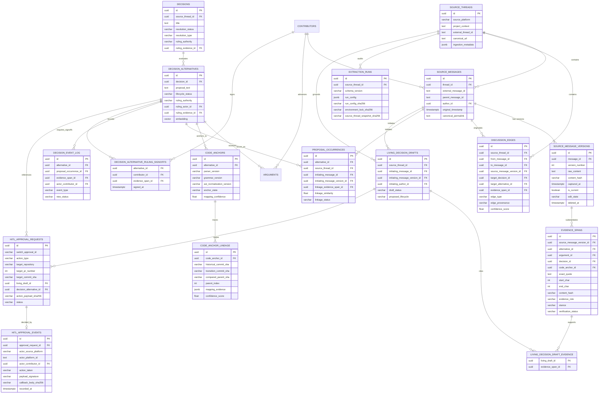

# Storage, Database Schema, and Retrieval Architecture

**Project:** Biscuit — Open Source Decision Intelligence and Knowledge Recovery  
**Team:** Chole Bhature (`@mriarc-08`, `@daksheshsharma2409`, `@utksh1`)  
**Scope:** Canonical Data Contracts, Immutable Evidence Provenance, Decision Lifecycle & Argument Separation, AST Code Anchoring, and Retrieval Guardrails.  
**Specification Level:** Implementation Contract (Consolidated with Issue #5 and PR #7 review requirements).

---

## 1. Storage Engine Infrastructure

The storage infrastructure combines relational integrity, immutable evidence versioning, and vector similarity search in a containerized environment.

```
┌────────────────────────────────────────────────────────────────────────┐
│                   STORAGE & RETRIEVAL INFRASTRUCTURE                   │
├────────────────────────────────────────────────────────────────────────┤
│                                                                        │
│  Primary Engine: Containerized PostgreSQL 16 + pgvector                │
│  • Image: pgvector/pgvector:pg16                                       │
│  • Relational Schema with Full Referential Integrity (No Orphan Spans) │
│  • Immutable Message Versions with SHA-256 Checksums                   │
│  • HNSW Index for 768-dim Vector KNN (nomic-embed-text-v1.5)           │
│  • Bootstrapped via docker-compose.yml + init.sql                      │
│                                                                        │
│  Local Test Fallback (CI / Unit Test Matrix):                          │
│  • SQLite for relational tables                                        │
│  • ChromaDB / In-Memory Vector Index for embeddings                    │
│  • Parity-verified against PostgreSQL schema in CI                     │
│                                                                        │
└────────────────────────────────────────────────────────────────────────┘
```

---

## 2. Canonical Relational & Evidence Architecture

Per **Issue #5** and the **PR #7 Review Contract**:
1. **Source Versioning & Immutability:** Preserve the exact decoded message-content string in append-only `source_message_versions.raw_content`; SHA-256 covers its UTF-8 encoding. CRLF/LF and Unicode are preserved; normalized text is a derived view only.
2. **Explicit Offset Convention:** Offsets count Python Unicode code points in that exact string and are **zero-based, start-inclusive, end-exclusive `[start_char, end_char)`**. PostgreSQL substring queries use the equivalent 1-based start and length.
3. **Default Unverified Status:** Evidence spans initialize as `UNVERIFIED`. A database trigger verifies the source slice and SHA-256 before allowing `VERIFIED_EXACT`.
4. **Typed Evidence Relationships:** Composite foreign keys bind evidence to the exact source message version, thread, and target alternative.
5. **Authoritative Rejection Enforcement:** A database trigger requires verified `RULING` evidence for the exact alternative, an authorized human author, and the required consensus sign-offs. Model inference is never ruling authority.
6. **Audit Retention:** Source versions, evidence spans, occurrences, decision events, and HITL events are retained; deletion is restricted and updates are append-only except for explicitly mutable state fields.
7. **Candidate/Authorization Separation:** Vector thresholds retrieve candidates only. Independent AST/CST structural verification and authoritative evidence govern warning eligibility.



---

## 3. Complete Relational DDL Specification

```sql
CREATE EXTENSION IF NOT EXISTS vector;
CREATE EXTENSION IF NOT EXISTS "uuid-ossp";
CREATE EXTENSION IF NOT EXISTS pgcrypto;

-- ─────────────────────────────────────────────────────────────
-- 1. CONTRIBUTORS & IDENTITY RESOLUTION
-- ─────────────────────────────────────────────────────────────

CREATE TABLE contributors (
    id UUID PRIMARY KEY DEFAULT uuid_generate_v4(),
    source_platform VARCHAR(32) NOT NULL,  -- 'discourse', 'github', 'slack', 'mailing_list'
    platform_user_id TEXT NOT NULL,        -- Platform unique user id
    canonical_name TEXT NOT NULL,
    author_handle TEXT NOT NULL,           -- e.g. 'gvanrossum', 'markshannon'
    email_prefix TEXT,                     -- Sanitized email identifier for mailing lists
    project_role TEXT,                     -- 'BDFL', 'Core Maintainer', 'Contributor'
    created_at TIMESTAMPTZ DEFAULT NOW(),
    CONSTRAINT uq_contributor_platform UNIQUE (source_platform, platform_user_id)
);

CREATE INDEX idx_contributors_handle ON contributors(author_handle);

-- ─────────────────────────────────────────────────────────────
-- 2. SOURCE PROVENANCE & VERSIONED MESSAGES (IMMUTABLE)
-- ─────────────────────────────────────────────────────────────

CREATE TABLE source_threads (
    id UUID PRIMARY KEY DEFAULT uuid_generate_v4(),
    source_platform VARCHAR(32) NOT NULL, -- 'discourse', 'github_pr', 'github_issue', 'slack', 'mailing_list'
    project_context TEXT NOT NULL,         -- 'python/cpython', 'kubernetes/kubernetes'
    external_thread_id TEXT NOT NULL,      -- 'topic_1234', 'pull_505'
    title TEXT NOT NULL,
    canonical_url TEXT NOT NULL,
    source_revision VARCHAR(64) DEFAULT 'v1',
    ingestion_metadata JSONB DEFAULT '{}'::jsonb,
    created_at TIMESTAMPTZ DEFAULT NOW(),
    CONSTRAINT uq_source_thread UNIQUE (source_platform, project_context, external_thread_id)
);

CREATE TABLE source_messages (
    id UUID PRIMARY KEY DEFAULT uuid_generate_v4(),
    thread_id UUID NOT NULL REFERENCES source_threads(id) ON DELETE RESTRICT,
    external_message_id TEXT NOT NULL,
    parent_message_id TEXT,
    author_id UUID REFERENCES contributors(id),
    original_timestamp TIMESTAMPTZ NOT NULL,
    canonical_permalink TEXT NOT NULL,
    created_at TIMESTAMPTZ DEFAULT NOW(),
    CONSTRAINT uq_source_message UNIQUE (thread_id, external_message_id),
    CONSTRAINT uq_source_message_id_thread UNIQUE (id, thread_id),
    CONSTRAINT uq_source_message_author_thread UNIQUE (id, thread_id, author_id)
);

CREATE INDEX idx_source_messages_thread ON source_messages(thread_id);
CREATE INDEX idx_source_messages_parent ON source_messages(parent_message_id);

CREATE TYPE message_edit_state AS ENUM ('ORIGINAL', 'EDITED', 'DELETED', 'UNAVAILABLE');

CREATE TABLE source_message_versions (
    id UUID PRIMARY KEY DEFAULT uuid_generate_v4(),
    message_id UUID NOT NULL REFERENCES source_messages(id) ON DELETE RESTRICT,
    version_number INT NOT NULL,
    raw_content TEXT NOT NULL,             -- Exact decoded content field returned by source API; never normalized
    content_hash VARCHAR(64) NOT NULL,     -- SHA-256 of UTF-8 bytes of exact raw_content
    captured_at TIMESTAMPTZ NOT NULL DEFAULT NOW(),
    is_current BOOLEAN NOT NULL DEFAULT TRUE,
    edit_state message_edit_state NOT NULL DEFAULT 'ORIGINAL',
    edit_reason TEXT,
    deleted_at TIMESTAMPTZ,                -- Remote deletion is a tombstone; captured text is retained
    derived_normalized_content TEXT,       -- Optional normalized retrieval view; never used for evidence
    derived_cleaned_content TEXT,          -- Noise-filtered view; never used for evidence
    CONSTRAINT uq_message_version UNIQUE (message_id, version_number),
    CONSTRAINT uq_message_version_id_message UNIQUE (id, message_id),
    CONSTRAINT chk_message_version_number CHECK (version_number >= 1),
    CONSTRAINT chk_message_content_hash CHECK (content_hash ~ '^[0-9a-fA-F]{64}$')
);

-- At most one version may be current for a message; rotate it transactionally.
-- At most one version is current; a deferred trigger below also requires exactly one at commit.
CREATE UNIQUE INDEX uq_message_single_current ON source_message_versions(message_id) WHERE is_current = TRUE;

-- ─────────────────────────────────────────────────────────────
-- 3. TYPED DELIBERATION EDGES (GRAPH MODEL)
-- ─────────────────────────────────────────────────────────────

CREATE TYPE discussion_edge_type AS ENUM (
    'PROPOSES',
    'SUPPORTS',
    'OBJECTS',
    'REBUTS',
    'RESOLVES',
    'REFERENCES',
    'DIRECT_REPLY',
    'QUOTE_REFERENCE',
    'MENTION'
);

CREATE TYPE edge_provenance AS ENUM (
    'PLATFORM_METADATA',
    'DETERMINISTIC_RULE',
    'MODEL_INFERRED'
);

CREATE TABLE discussion_edges (
    id UUID PRIMARY KEY DEFAULT uuid_generate_v4(),
    source_thread_id UUID NOT NULL REFERENCES source_threads(id) ON DELETE RESTRICT,
    from_message_id UUID NOT NULL,
    to_message_id UUID NOT NULL,
    source_message_version_id UUID,
    evidence_span_id UUID,
    target_decision_id UUID,
    target_alternative_id UUID,
    edge_type discussion_edge_type NOT NULL,
    edge_provenance edge_provenance NOT NULL,
    confidence_score FLOAT NOT NULL,
    created_at TIMESTAMPTZ NOT NULL DEFAULT NOW(),
    CONSTRAINT chk_edge_confidence CHECK (confidence_score >= 0.0 AND confidence_score <= 1.0),
    CONSTRAINT chk_edge_target_shape CHECK (
        (
          edge_type IN ('PROPOSES', 'SUPPORTS', 'OBJECTS', 'REBUTS', 'RESOLVES')
          AND target_alternative_id IS NOT NULL
          AND target_decision_id IS NULL
          AND source_message_version_id IS NOT NULL
          AND evidence_span_id IS NOT NULL
        )
        OR (edge_type = 'REFERENCES' AND num_nonnulls(target_decision_id, target_alternative_id) = 1)
        OR (
          edge_type IN ('DIRECT_REPLY', 'QUOTE_REFERENCE', 'MENTION')
          AND target_decision_id IS NULL AND target_alternative_id IS NULL
        )
    )
);

CREATE INDEX idx_edges_thread ON discussion_edges(source_thread_id);
CREATE INDEX idx_edges_nodes ON discussion_edges(from_message_id, to_message_id);
CREATE INDEX idx_edges_alt ON discussion_edges(target_alternative_id);

-- ─────────────────────────────────────────────────────────────
-- 4. DECISIONS & ALTERNATIVE LIFECYCLES
-- ─────────────────────────────────────────────────────────────

CREATE TYPE decision_resolution AS ENUM ('RESOLVED', 'UNRESOLVED', 'DISPUTED');
CREATE TYPE resolution_type AS ENUM ('ACCEPTED', 'REJECTED', 'DEFERRED', 'WITHDRAWN', 'SUPERSEDED');
CREATE TYPE ruling_authority AS ENUM ('BDFL', 'CORE_MAINTAINER_CONSENSUS', 'WORKING_GROUP');

CREATE TABLE decisions (
    id UUID PRIMARY KEY DEFAULT uuid_generate_v4(),
    source_thread_id UUID NOT NULL REFERENCES source_threads(id) ON DELETE RESTRICT,
    title TEXT NOT NULL,
    context_summary TEXT NOT NULL,
    resolution_status decision_resolution NOT NULL DEFAULT 'UNRESOLVED',
    resolution_type resolution_type,
    ruling_authority ruling_authority,
    ruling_evidence_id UUID,               -- Foreign key linked below
    created_at TIMESTAMPTZ DEFAULT NOW(),
    updated_at TIMESTAMPTZ DEFAULT NOW()
);

CREATE TYPE proposal_lifecycle AS ENUM (
    'PROPOSED',
    'UNDER_DISCUSSION',
    'ACCEPTED',
    'REJECTED',
    'WITHDRAWN',
    'DEFERRED',
    'SUPERSEDED',
    'UNRESOLVED',
    'DISPUTED',
    'ACCEPTED_WITH_MODIFICATION'
);

CREATE TYPE rejection_category AS ENUM (
    'PERFORMANCE',
    'SYNTAX_AMBIGUITY',
    'BACKWARD_COMPAT',
    'COMPLEXITY',
    'SECURITY',
    'PHILOSOPHICAL'
);

CREATE TABLE decision_alternatives (
    id UUID PRIMARY KEY DEFAULT uuid_generate_v4(),
    decision_id UUID NOT NULL REFERENCES decisions(id) ON DELETE RESTRICT,
    proposal_text TEXT NOT NULL,
    lifecycle_status proposal_lifecycle NOT NULL DEFAULT 'PROPOSED',
    rejection_category rejection_category,
    rejection_summary TEXT,
    proposed_by_id UUID REFERENCES contributors(id),
    ruling_evidence_id UUID,               -- Composite FK linked below
    ruling_authority ruling_authority,
    ruling_actor_id UUID REFERENCES contributors(id) ON DELETE RESTRICT,
    embedding vector(768),                 -- nomic-embed-text-v1.5; candidate retrieval only
    created_at TIMESTAMPTZ NOT NULL DEFAULT NOW(),
    CONSTRAINT uq_alt_proposal UNIQUE (decision_id, proposal_text),
    CONSTRAINT chk_rejected_requires_ruling CHECK (
        lifecycle_status <> 'REJECTED'
        OR (ruling_evidence_id IS NOT NULL AND ruling_authority IS NOT NULL AND ruling_actor_id IS NOT NULL)
    )
);

-- HNSW Vector Index for Instant Semantic Matching
CREATE INDEX idx_alternatives_embedding 
ON decision_alternatives 
USING hnsw (embedding vector_cosine_ops)
WITH (m = 16, ef_construction = 64);

-- ─────────────────────────────────────────────────────────────
-- 5. ARGUMENTS (DECOUPLED OBJECTIONS VS DECISIONS)
-- ─────────────────────────────────────────────────────────────

CREATE TYPE evidence_stance AS ENUM ('SUPPORT', 'OBJECT', 'NEUTRAL');

CREATE TABLE arguments (
    id UUID PRIMARY KEY DEFAULT uuid_generate_v4(),
    alternative_id UUID NOT NULL REFERENCES decision_alternatives(id) ON DELETE RESTRICT,
    author_id UUID REFERENCES contributors(id),
    stance evidence_stance NOT NULL,
    rationale TEXT NOT NULL,
    evidence_span_id UUID,                 -- Foreign key linked below
    created_at TIMESTAMPTZ DEFAULT NOW()
);

CREATE INDEX idx_arguments_alt ON arguments(alternative_id);

-- ─────────────────────────────────────────────────────────────
-- 6. CODE ANCHORS & LINEAGE (ALTERNATIVE-SPECIFIC)
-- ─────────────────────────────────────────────────────────────

CREATE TYPE code_symbol_type AS ENUM (
    'function',
    'class',
    'method',
    'grammar_rule',
    'ast_node',
    'interface',
    'module'
);

CREATE TYPE anchor_state AS ENUM (
    'HISTORICAL',
    'CURRENT',
    'MIGRATED',
    'SPLIT',
    'MERGED',
    'DELETED',
    'AMBIGUOUS'
);

CREATE TABLE code_anchors (
    id UUID PRIMARY KEY DEFAULT uuid_generate_v4(),
    alternative_id UUID NOT NULL REFERENCES decision_alternatives(id) ON DELETE RESTRICT,
    repository_url TEXT NOT NULL DEFAULT 'https://github.com/python/cpython',
    language VARCHAR(32) NOT NULL,          -- 'python', 'c', 'rust', 'go'
    symbol_type code_symbol_type NOT NULL,
    qualified_symbol_name TEXT NOT NULL,    -- 'cpython.Parser.Tokenizer.get_next_token'
    source_locator_type VARCHAR(32) NOT NULL DEFAULT 'AST_NODE_QUERY', -- 'FILE_BYTE_RANGE', 'FILE_LINE_RANGE', 'AST_NODE_QUERY'
    start_line INT,
    end_line INT,
    start_byte INT,
    end_byte INT,
    parser_name VARCHAR(64) NOT NULL,
    parser_version VARCHAR(32) NOT NULL,
    grammar_version VARCHAR(32) NOT NULL,
    fingerprint_algorithm VARCHAR(32) NOT NULL,
    ast_normalization_version VARCHAR(32) NOT NULL,
    ast_structural_fingerprint VARCHAR(64),
    signature_hash VARCHAR(64),
    anchor_state anchor_state NOT NULL DEFAULT 'HISTORICAL',
    historical_file_path TEXT NOT NULL,
    historical_commit_sha VARCHAR(64) NOT NULL,
    head_commit_sha VARCHAR(64),
    mapping_confidence FLOAT,              -- Explicitly computed; never defaulted to 1.0
    created_at TIMESTAMPTZ DEFAULT NOW(),
    CONSTRAINT chk_anchor_confidence CHECK (mapping_confidence IS NULL OR (mapping_confidence >= 0.0 AND mapping_confidence <= 1.0))
);

CREATE INDEX idx_code_anchors_alt ON code_anchors(alternative_id);
CREATE INDEX idx_code_anchors_sym ON code_anchors(qualified_symbol_name);

CREATE TABLE code_anchor_lineage (
    id UUID PRIMARY KEY DEFAULT uuid_generate_v4(),
    code_anchor_id UUID NOT NULL REFERENCES code_anchors(id) ON DELETE RESTRICT,
    historical_commit_sha VARCHAR(64) NOT NULL,
    transition_commit_sha VARCHAR(64) NOT NULL,
    compared_parent_sha VARCHAR(64) NOT NULL,
    parent_index INT NOT NULL,
    target_commit_sha VARCHAR(64) NOT NULL,
    traversal_strategy VARCHAR(50) NOT NULL,
    historical_path TEXT NOT NULL,
    migrated_path TEXT,
    transition_type VARCHAR(32) NOT NULL,
    mapping_evidence JSONB NOT NULL, -- Patch/tree digest, method, matched symbols and parser/grammar/normalizer versions
    confidence_score FLOAT,
    recorded_at TIMESTAMPTZ NOT NULL DEFAULT NOW(),
    CONSTRAINT chk_lineage_parent_index CHECK (parent_index >= 0),
    CONSTRAINT chk_lineage_confidence CHECK (confidence_score IS NULL OR (confidence_score >= 0.0 AND confidence_score <= 1.0)),
    CONSTRAINT chk_lineage_evidence_object CHECK (jsonb_typeof(mapping_evidence) = 'object' AND mapping_evidence <> '{}'::jsonb),
    CONSTRAINT uq_anchor_lineage_transition UNIQUE (code_anchor_id, transition_commit_sha, compared_parent_sha, historical_path)
);

-- ─────────────────────────────────────────────────────────────
-- 7. EXACT EVIDENCE SPANS (ANTI-HALLUCINATION PROOF)
-- ─────────────────────────────────────────────────────────────

CREATE TYPE evidence_role AS ENUM (
    'PROPOSAL',
    'OBJECTION',
    'REBUTTAL',
    'RULING',
    'CONCESSION',
    'BENCHMARK_REPORT'
);

CREATE TYPE verification_status AS ENUM ('VERIFIED_EXACT', 'STALE_EDITED', 'UNVERIFIED', 'UNAVAILABLE');

CREATE TABLE evidence_spans (
    id UUID PRIMARY KEY DEFAULT uuid_generate_v4(),
    source_message_version_id UUID NOT NULL REFERENCES source_message_versions(id) ON DELETE RESTRICT,
    decision_id UUID REFERENCES decisions(id) ON DELETE RESTRICT,
    alternative_id UUID REFERENCES decision_alternatives(id) ON DELETE RESTRICT,
    argument_id UUID REFERENCES arguments(id) ON DELETE RESTRICT,
    code_anchor_id UUID REFERENCES code_anchors(id) ON DELETE RESTRICT,
    exact_quote TEXT NOT NULL,             -- Must match substring in source_message_versions(raw_content)
    start_char INT NOT NULL,               -- 0-based character offset start
    end_char INT NOT NULL,                 -- 0-based character offset end (exclusive)
    content_hash VARCHAR(64) NOT NULL,     -- SHA-256 of exact_quote
    evidence_role evidence_role NOT NULL,
    stance evidence_stance NOT NULL,
    verification_status verification_status NOT NULL DEFAULT 'UNVERIFIED',
    created_at TIMESTAMPTZ DEFAULT NOW(),
    -- Enforce referential integrity: exactly one typed target must be non-null
    CONSTRAINT chk_evidence_target_exactly_one CHECK (
        num_nonnulls(decision_id, alternative_id, argument_id, code_anchor_id) = 1
    ),
    CONSTRAINT chk_char_offsets CHECK (start_char >= 0 AND end_char > start_char),
    CONSTRAINT chk_evidence_hash CHECK (content_hash ~ '^[0-9a-fA-F]{64}$'),
    CONSTRAINT uq_evidence_id_alternative UNIQUE (id, alternative_id),
    CONSTRAINT uq_evidence_id_decision UNIQUE (id, decision_id),
    CONSTRAINT uq_evidence_id_argument UNIQUE (id, argument_id),
    CONSTRAINT uq_evidence_edge_source UNIQUE (id, alternative_id, source_message_version_id)
);

-- Foreign Key Back-Links for Authoritative Rulings
ALTER TABLE decisions ADD CONSTRAINT fk_decisions_ruling_evidence
FOREIGN KEY (ruling_evidence_id, id) REFERENCES evidence_spans(id, decision_id) ON DELETE RESTRICT;

ALTER TABLE decision_alternatives ADD CONSTRAINT fk_alternatives_ruling_evidence
FOREIGN KEY (ruling_evidence_id, id) REFERENCES evidence_spans(id, alternative_id) ON DELETE RESTRICT;

ALTER TABLE arguments ADD CONSTRAINT fk_arguments_evidence
FOREIGN KEY (evidence_span_id, id) REFERENCES evidence_spans(id, argument_id) ON DELETE RESTRICT;

-- ─────────────────────────────────────────────────────────────
-- 8. PROPOSAL OCCURRENCE TRACKING (RECURRENCE RECOVERY)
-- ─────────────────────────────────────────────────────────────

CREATE TABLE proposal_occurrences (
    id UUID PRIMARY KEY DEFAULT uuid_generate_v4(),
    alternative_id UUID NOT NULL REFERENCES decision_alternatives(id) ON DELETE RESTRICT,
    source_thread_id UUID NOT NULL REFERENCES source_threads(id) ON DELETE RESTRICT,
    initiating_message_id UUID NOT NULL,
    initiating_message_version_id UUID NOT NULL,
    occurred_at TIMESTAMPTZ NOT NULL,
    proposal_wording_version TEXT NOT NULL,
    occurrence_context TEXT NOT NULL,
    occurrence_outcome VARCHAR(50) NOT NULL,
    linkage_similarity FLOAT,
    linkage_status VARCHAR(50) NOT NULL DEFAULT 'PROPOSED_RECURRENCE',
    linkage_evidence_span_id UUID,
    created_at TIMESTAMPTZ NOT NULL DEFAULT NOW(),
    CONSTRAINT fk_occurrence_message_thread FOREIGN KEY (initiating_message_id, source_thread_id)
        REFERENCES source_messages(id, thread_id) ON DELETE RESTRICT,
    CONSTRAINT fk_occurrence_message_version FOREIGN KEY (initiating_message_version_id, initiating_message_id)
        REFERENCES source_message_versions(id, message_id) ON DELETE RESTRICT,
    CONSTRAINT fk_occurrence_evidence_alternative FOREIGN KEY (linkage_evidence_span_id, alternative_id, initiating_message_version_id)
        REFERENCES evidence_spans(id, alternative_id, source_message_version_id) ON DELETE RESTRICT,
    CONSTRAINT chk_occurrence_similarity CHECK (linkage_similarity IS NULL OR (linkage_similarity >= 0.0 AND linkage_similarity <= 1.0)),
    CONSTRAINT uq_occurrence_alt_thread UNIQUE (id, alternative_id, source_thread_id)
);

CREATE INDEX idx_occurrences_alt ON proposal_occurrences(alternative_id);
CREATE INDEX idx_occurrences_thread ON proposal_occurrences(source_thread_id);

-- ─────────────────────────────────────────────────────────────
-- 9. EXTRACTION RUNS (AUDITABILITY & REPRODUCIBILITY)
-- ─────────────────────────────────────────────────────────────

CREATE TABLE extraction_runs (
    id UUID PRIMARY KEY DEFAULT uuid_generate_v4(),
    source_thread_id UUID NOT NULL REFERENCES source_threads(id) ON DELETE RESTRICT,
    pipeline_version VARCHAR(32) NOT NULL,
    schema_version VARCHAR(32) NOT NULL,
    run_config JSONB NOT NULL,             -- Slicer/normalizer versions, parameters, thresholds, seeds and runtime options
    run_config_sha256 VARCHAR(64) NOT NULL,
    environment_lock_sha256 VARCHAR(64) NOT NULL,
    model_pass1_name VARCHAR(64) NOT NULL,
    model_pass1_revision VARCHAR(64) NOT NULL,
    model_pass3_name VARCHAR(64) NOT NULL,
    model_pass3_revision VARCHAR(64) NOT NULL,
    model_pass4_name VARCHAR(64) NOT NULL,
    model_pass4_revision VARCHAR(64) NOT NULL,
    embedding_model_name VARCHAR(64) NOT NULL,
    embedding_model_revision VARCHAR(64) NOT NULL,
    prompt_templates_hash VARCHAR(64) NOT NULL,
    source_thread_snapshot_sha256 VARCHAR(64) NOT NULL,
    run_status VARCHAR(32) NOT NULL,         -- 'RUNNING', 'SUCCESS', 'FAILED', 'PARTIAL'
    records_extracted INT DEFAULT 0,
    started_at TIMESTAMPTZ DEFAULT NOW(),
    completed_at TIMESTAMPTZ,
    CONSTRAINT chk_extraction_run_config_object CHECK (jsonb_typeof(run_config) = 'object' AND run_config <> '{}'::jsonb),
    CONSTRAINT chk_extraction_config_hash CHECK (run_config_sha256 ~ '^[0-9a-fA-F]{64}$'),
    CONSTRAINT chk_extraction_environment_hash CHECK (environment_lock_sha256 ~ '^[0-9a-fA-F]{64}$'),
    CONSTRAINT chk_extraction_source_snapshot_hash CHECK (source_thread_snapshot_sha256 ~ '^[0-9a-fA-F]{64}$'),
    CONSTRAINT chk_extraction_prompt_hash CHECK (prompt_templates_hash ~ '^[0-9a-fA-F]{64}$')
);

-- ─────────────────────────────────────────────────────────────
-- 10. PR WATCHDOG AUDIT LOG (DRY-RUN / HITL LOGGING)
-- ─────────────────────────────────────────────────────────────

CREATE TABLE pr_watchdog_audit_log (
    id UUID PRIMARY KEY DEFAULT uuid_generate_v4(),
    repository_url TEXT NOT NULL,
    pr_number INT NOT NULL,
    commit_sha VARCHAR(64) NOT NULL,
    checked_at TIMESTAMPTZ DEFAULT NOW(),
    execution_mode VARCHAR(32) NOT NULL DEFAULT 'AUDIT_DRY_RUN', -- 'AUDIT_DRY_RUN', 'INTERACTIVE_HITL', 'PRODUCTION_COMMENT'
    candidate_alternative_ids JSONB NOT NULL DEFAULT '[]'::jsonb,
    evaluated_similarity FLOAT,
    invariants_satisfied BOOLEAN NOT NULL DEFAULT FALSE,
    authorization_verdict VARCHAR(64) NOT NULL, -- 'WARNING_AUTHORIZED', 'ABSTAINED_UNCERTAIN', 'NO_REJECTED_MATCH', 'ALTERNATIVE_MISMATCH'
    action_taken VARCHAR(64) NOT NULL,          -- 'LOGGED_ONLY', 'HITL_CARD_POSTED', 'COMMENT_PUBLISHED'
    comment_payload JSONB
);

-- ─────────────────────────────────────────────────────────────
-- 11. AUDITABLE DECISION EVENT LOG
-- ─────────────────────────────────────────────────────────────

CREATE TABLE decision_event_log (
    id UUID PRIMARY KEY DEFAULT uuid_generate_v4(),
    alternative_id UUID NOT NULL REFERENCES decision_alternatives(id) ON DELETE RESTRICT,
    source_thread_id UUID REFERENCES source_threads(id) ON DELETE RESTRICT,
    proposal_occurrence_id UUID,
    recurrence_number INT NOT NULL DEFAULT 1,
    event_type VARCHAR(32) NOT NULL,
    previous_status proposal_lifecycle,
    new_status proposal_lifecycle NOT NULL,
    reason TEXT NOT NULL,
    evidence_span_id UUID,
    actor_contributor_id UUID REFERENCES contributors(id) ON DELETE RESTRICT,
    recorded_at TIMESTAMPTZ NOT NULL DEFAULT NOW(),
    CONSTRAINT chk_recurrence_event_link CHECK (
        event_type <> 'RECURRENCE_RECORDED'
        OR (proposal_occurrence_id IS NOT NULL AND source_thread_id IS NOT NULL)
    ),
    CONSTRAINT chk_decision_event_type CHECK (event_type IN ('STATUS_CHANGE', 'RULING_OVERTURNED', 'RECURRENCE_RECORDED', 'RECURRENCE_CONFIRMED')),
    CONSTRAINT chk_recurrence_number CHECK (recurrence_number >= 1),
    CONSTRAINT fk_decision_event_occurrence FOREIGN KEY (proposal_occurrence_id, alternative_id, source_thread_id)
        REFERENCES proposal_occurrences(id, alternative_id, source_thread_id) ON DELETE RESTRICT,
    CONSTRAINT fk_decision_event_evidence FOREIGN KEY (evidence_span_id, alternative_id)
        REFERENCES evidence_spans(id, alternative_id) ON DELETE RESTRICT
);

-- ─────────────────────────────────────────────────────────────
-- 12. DAY 1+ LIVING DECISION DRAFTS (SWITCH INTERCEPTION)
-- ─────────────────────────────────────────────────────────────

CREATE TYPE living_decision_state AS ENUM (
    'DRAFT_PENDING_APPROVAL',
    'MAINTAINER_APPROVED',
    'MAINTAINER_REJECTED',
    'EDIT_REQUESTED'
);

CREATE TABLE living_decision_drafts (
    id UUID PRIMARY KEY DEFAULT uuid_generate_v4(),
    switch_session_id TEXT NOT NULL,
    source_thread_id UUID NOT NULL REFERENCES source_threads(id) ON DELETE RESTRICT,
    initiating_message_id UUID NOT NULL,
    initiating_message_version_id UUID NOT NULL,
    initiating_author_id UUID NOT NULL REFERENCES contributors(id) ON DELETE RESTRICT,
    topic TEXT NOT NULL,
    draft_status living_decision_state NOT NULL DEFAULT 'DRAFT_PENDING_APPROVAL',
    proposed_lifecycle proposal_lifecycle NOT NULL DEFAULT 'PROPOSED',
    proposal_text TEXT NOT NULL,
    rejection_summary TEXT,
    target_subsystem TEXT,
    created_at TIMESTAMPTZ NOT NULL DEFAULT NOW(),
    resolved_at TIMESTAMPTZ,
    CONSTRAINT fk_living_draft_message_thread FOREIGN KEY (initiating_message_id, source_thread_id)
        REFERENCES source_messages(id, thread_id) ON DELETE RESTRICT,
    CONSTRAINT fk_living_draft_author FOREIGN KEY (initiating_message_id, source_thread_id, initiating_author_id)
        REFERENCES source_messages(id, thread_id, author_id) ON DELETE RESTRICT,
    CONSTRAINT fk_living_draft_message_version FOREIGN KEY (initiating_message_version_id, initiating_message_id)
        REFERENCES source_message_versions(id, message_id) ON DELETE RESTRICT
);

CREATE TABLE living_decision_draft_evidence (
    living_draft_id UUID NOT NULL REFERENCES living_decision_drafts(id) ON DELETE RESTRICT,
    evidence_span_id UUID NOT NULL REFERENCES evidence_spans(id) ON DELETE RESTRICT,
    PRIMARY KEY (living_draft_id, evidence_span_id)
);

CREATE INDEX idx_living_drafts_thread ON living_decision_drafts(source_thread_id);

-- ─────────────────────────────────────────────────────────────
-- 13. DAY 1+ SWITCH HUMAN-IN-THE-LOOP (HITL) APPROVALS
-- ─────────────────────────────────────────────────────────────

CREATE TYPE hitl_action_type AS ENUM (
    'APPROVE_LIVING_DECISION',
    'AUTHORIZE_PR_WARNING',
    'DISMISS_PR_WARNING'
);

CREATE TYPE hitl_request_status AS ENUM (
    'PENDING',
    'DECIDED',
    'EXPIRED',
    'REVOKED'
);

CREATE TABLE hitl_approval_requests (
    id UUID PRIMARY KEY DEFAULT uuid_generate_v4(),
    switch_approval_id TEXT NOT NULL UNIQUE, -- Switch host-side approval request ID
    action_type hitl_action_type NOT NULL,
    status hitl_request_status NOT NULL DEFAULT 'PENDING',
    idempotency_key VARCHAR(64) NOT NULL UNIQUE, -- Prevents replayed webhook callbacks
    target_pr_number INT,
    target_repository TEXT,
    living_draft_id UUID REFERENCES living_decision_drafts(id),
    decision_alternative_id UUID REFERENCES decision_alternatives(id) ON DELETE RESTRICT,
    target_commit_sha VARCHAR(64),
    card_rendered_payload JSONB NOT NULL,
    action_payload_sha256 VARCHAR(64) NOT NULL,
    authorized_roles TEXT[] NOT NULL DEFAULT ARRAY['BDFL', 'Core Maintainer'],
    callback_hmac_secret_id VARCHAR(64) NOT NULL,
    expires_at TIMESTAMPTZ NOT NULL DEFAULT (NOW() + INTERVAL '72 hours'),
    created_at TIMESTAMPTZ NOT NULL DEFAULT NOW(),
    CONSTRAINT chk_hitl_action_target CHECK (
        (action_type = 'APPROVE_LIVING_DECISION' AND living_draft_id IS NOT NULL
         AND decision_alternative_id IS NULL AND target_pr_number IS NULL
         AND target_repository IS NULL AND target_commit_sha IS NULL)
        OR
        (action_type IN ('AUTHORIZE_PR_WARNING', 'DISMISS_PR_WARNING')
         AND living_draft_id IS NULL AND decision_alternative_id IS NOT NULL
         AND target_pr_number IS NOT NULL AND target_repository IS NOT NULL
         AND target_commit_sha IS NOT NULL)
    ),
    CONSTRAINT chk_hitl_expiry CHECK (expires_at > created_at),
    CONSTRAINT chk_hitl_pr_target CHECK (
        action_type = 'APPROVE_LIVING_DECISION'
        OR (target_pr_number > 0 AND length(target_repository) > 0 AND target_commit_sha ~ '^([0-9a-fA-F]{40}|[0-9a-fA-F]{64})$')
    ),
    CONSTRAINT chk_hitl_idempotency_key CHECK (idempotency_key ~ '^[0-9a-fA-F]{8}-[0-9a-fA-F]{4}-4[0-9a-fA-F]{3}-[89aAbB][0-9a-fA-F]{3}-[0-9a-fA-F]{12}$'),
    CONSTRAINT chk_hitl_action_payload_hash CHECK (action_payload_sha256 ~ '^[0-9a-fA-F]{64}$'),
    CONSTRAINT chk_hitl_roles_nonempty CHECK (cardinality(authorized_roles) > 0)
);

CREATE INDEX idx_hitl_approval_switch ON hitl_approval_requests(switch_approval_id);

-- ─────────────────────────────────────────────────────────────
-- 14. DAY 1+ APPEND-ONLY APPROVAL AUDIT LOG
-- ─────────────────────────────────────────────────────────────

CREATE TABLE hitl_approval_events (
    id UUID PRIMARY KEY DEFAULT uuid_generate_v4(),
    approval_request_id UUID NOT NULL REFERENCES hitl_approval_requests(id) ON DELETE RESTRICT,
    actor_source_platform VARCHAR(32) NOT NULL,
    actor_platform_id TEXT NOT NULL,
    actor_contributor_id UUID NOT NULL REFERENCES contributors(id) ON DELETE RESTRICT,
    action_taken VARCHAR(32) NOT NULL,
    payload_signature VARCHAR(64) NOT NULL,  -- HMAC-SHA256 signature, verified by the callback service before insert
    callback_body_sha256 VARCHAR(64) NOT NULL,
    recorded_at TIMESTAMPTZ NOT NULL DEFAULT NOW(),
    CONSTRAINT uq_hitl_event_per_request UNIQUE (approval_request_id),
    CONSTRAINT chk_hitl_event_action CHECK (action_taken IN ('APPROVE_DRAFT', 'REJECT_DRAFT', 'AUTHORIZE_PR_COMMENT', 'DISMISS_PR_COMMENT')),
    CONSTRAINT chk_hitl_signature_format CHECK (payload_signature ~ '^[0-9a-fA-F]{64}$'),
    CONSTRAINT chk_hitl_callback_hash_format CHECK (callback_body_sha256 ~ '^[0-9a-fA-F]{64}$')
);

CREATE INDEX idx_hitl_events_request ON hitl_approval_events(approval_request_id);

-- ─────────────────────────────────────────────────────────────
-- 15. CROSS-TABLE PROVENANCE, RULING, AND AUDIT INVARIANTS
-- ─────────────────────────────────────────────────────────────

ALTER TABLE discussion_edges
    ADD CONSTRAINT fk_edge_from_message_thread FOREIGN KEY (from_message_id, source_thread_id)
    REFERENCES source_messages(id, thread_id) ON DELETE RESTRICT;
ALTER TABLE discussion_edges
    ADD CONSTRAINT fk_edge_to_message_thread FOREIGN KEY (to_message_id, source_thread_id)
    REFERENCES source_messages(id, thread_id) ON DELETE RESTRICT;
ALTER TABLE discussion_edges
    ADD CONSTRAINT fk_edge_source_version FOREIGN KEY (source_message_version_id, from_message_id)
    REFERENCES source_message_versions(id, message_id) ON DELETE RESTRICT;
ALTER TABLE discussion_edges
    ADD CONSTRAINT fk_edge_target_decision FOREIGN KEY (target_decision_id)
    REFERENCES decisions(id) ON DELETE RESTRICT;
ALTER TABLE discussion_edges
    ADD CONSTRAINT fk_edge_target_alternative FOREIGN KEY (target_alternative_id)
    REFERENCES decision_alternatives(id) ON DELETE RESTRICT;
ALTER TABLE discussion_edges
    ADD CONSTRAINT fk_edge_evidence_source_target FOREIGN KEY (evidence_span_id, target_alternative_id, source_message_version_id)
    REFERENCES evidence_spans(id, alternative_id, source_message_version_id) ON DELETE RESTRICT;

CREATE OR REPLACE FUNCTION enforce_discussion_edge_evidence()
RETURNS TRIGGER LANGUAGE plpgsql AS $$
DECLARE
    ev_role evidence_role;
    ev_stance evidence_stance;
    ev_status verification_status;
    ruling_author_role TEXT;
BEGIN
    IF NEW.edge_type IN ('PROPOSES', 'SUPPORTS', 'OBJECTS', 'REBUTS', 'RESOLVES') THEN
        SELECT es.evidence_role, es.stance, es.verification_status, c.project_role
          INTO ev_role, ev_stance, ev_status, ruling_author_role
          FROM evidence_spans es
          JOIN source_message_versions smv ON smv.id = es.source_message_version_id
          JOIN source_messages sm ON sm.id = smv.message_id
          LEFT JOIN contributors c ON c.id = sm.author_id
         WHERE es.id = NEW.evidence_span_id;
        IF NOT FOUND THEN RAISE EXCEPTION 'Semantic edges require an evidence span'; END IF;
        IF NEW.edge_type = 'PROPOSES' AND ev_role <> 'PROPOSAL' THEN
            RAISE EXCEPTION 'PROPOSES requires PROPOSAL evidence';
        ELSIF NEW.edge_type = 'SUPPORTS' AND ev_stance <> 'SUPPORT' THEN
            RAISE EXCEPTION 'SUPPORTS requires SUPPORT stance evidence';
        ELSIF NEW.edge_type = 'OBJECTS' AND ev_stance <> 'OBJECT' THEN
            RAISE EXCEPTION 'OBJECTS requires OBJECT stance evidence';
        ELSIF NEW.edge_type = 'REBUTS' AND ev_role <> 'REBUTTAL' THEN
            RAISE EXCEPTION 'REBUTS requires REBUTTAL evidence';
        ELSIF NEW.edge_type = 'RESOLVES'
          AND (ev_role <> 'RULING' OR ev_status <> 'VERIFIED_EXACT'
               OR NEW.edge_provenance = 'MODEL_INFERRED'
               OR ruling_author_role IS NULL OR ruling_author_role NOT IN ('BDFL', 'Core Maintainer', 'Working Group Chair')) THEN
            RAISE EXCEPTION 'RESOLVES requires VERIFIED_EXACT RULING evidence authored by an identified human authority';
        END IF;
    END IF;
    RETURN NEW;
END;
$$;
CREATE TRIGGER trg_discussion_edge_evidence
BEFORE INSERT OR UPDATE ON discussion_edges
FOR EACH ROW EXECUTE FUNCTION enforce_discussion_edge_evidence();

CREATE TABLE decision_alternative_ruling_signoffs (
    alternative_id UUID NOT NULL REFERENCES decision_alternatives(id) ON DELETE RESTRICT,
    contributor_id UUID NOT NULL REFERENCES contributors(id) ON DELETE RESTRICT,
    evidence_span_id UUID NOT NULL,
    signed_at TIMESTAMPTZ NOT NULL DEFAULT NOW(),
    PRIMARY KEY (alternative_id, contributor_id),
    CONSTRAINT fk_ruling_signoff_evidence FOREIGN KEY (evidence_span_id, alternative_id)
        REFERENCES evidence_spans(id, alternative_id) ON DELETE RESTRICT
);

CREATE OR REPLACE FUNCTION enforce_ruling_signoff()
RETURNS TRIGGER LANGUAGE plpgsql AS $$
DECLARE
    ev_role evidence_role;
    ev_status verification_status;
    ev_author UUID;
    actor_role TEXT;
BEGIN
    SELECT es.evidence_role, es.verification_status, sm.author_id, c.project_role
      INTO ev_role, ev_status, ev_author, actor_role
      FROM evidence_spans es
      JOIN source_message_versions smv ON smv.id = es.source_message_version_id
      JOIN source_messages sm ON sm.id = smv.message_id
      JOIN contributors c ON c.id = NEW.contributor_id
     WHERE es.id = NEW.evidence_span_id AND es.alternative_id = NEW.alternative_id;
    IF NOT FOUND OR ev_role <> 'RULING' OR ev_status <> 'VERIFIED_EXACT'
       OR ev_author IS DISTINCT FROM NEW.contributor_id THEN
        RAISE EXCEPTION 'Sign-off requires VERIFIED_EXACT RULING evidence authored by the signing contributor';
    END IF;
    IF actor_role IS NULL OR actor_role NOT IN ('Core Maintainer', 'Working Group Chair', 'Working Group Member') THEN
        RAISE EXCEPTION 'Only an authorized maintainer/working-group member may sign a ruling';
    END IF;
    RETURN NEW;
END;
$$;
CREATE TRIGGER trg_enforce_ruling_signoff
BEFORE INSERT ON decision_alternative_ruling_signoffs
FOR EACH ROW EXECUTE FUNCTION enforce_ruling_signoff();

-- The ruling_evidence_id composite FK binds evidence to the same alternative.
-- This trigger additionally verifies the exact quote, ruling role and human authority.
CREATE OR REPLACE FUNCTION enforce_authoritative_alternative_rejection()
RETURNS TRIGGER LANGUAGE plpgsql AS $$
DECLARE
    ev_role evidence_role;
    ev_status verification_status;
    ev_alternative UUID;
    ev_author UUID;
    actor_role TEXT;
    signoff_count INT;
BEGIN
    IF NEW.lifecycle_status = 'REJECTED' THEN
        SELECT es.evidence_role, es.verification_status, es.alternative_id, sm.author_id, c.project_role
          INTO ev_role, ev_status, ev_alternative, ev_author, actor_role
          FROM evidence_spans es
          JOIN source_message_versions smv ON smv.id = es.source_message_version_id
          JOIN source_messages sm ON sm.id = smv.message_id
          JOIN contributors c ON c.id = NEW.ruling_actor_id
         WHERE es.id = NEW.ruling_evidence_id;
        IF NOT FOUND OR ev_role <> 'RULING' OR ev_status <> 'VERIFIED_EXACT'
           OR ev_alternative IS DISTINCT FROM NEW.id OR ev_author IS DISTINCT FROM NEW.ruling_actor_id THEN
            RAISE EXCEPTION 'REJECTED requires VERIFIED_EXACT RULING evidence for this alternative, authored by ruling_actor_id';
        END IF;
        IF NEW.ruling_authority = 'BDFL' AND actor_role IS DISTINCT FROM 'BDFL' THEN
            RAISE EXCEPTION 'BDFL authority requires a contributor with BDFL role';
        ELSIF NEW.ruling_authority = 'CORE_MAINTAINER_CONSENSUS' THEN
            IF actor_role IS DISTINCT FROM 'Core Maintainer' THEN
                RAISE EXCEPTION 'Consensus ruling evidence must be authored by a Core Maintainer';
            END IF;
            SELECT COUNT(*) INTO signoff_count FROM decision_alternative_ruling_signoffs s
              JOIN contributors c ON c.id = s.contributor_id
             WHERE s.alternative_id = NEW.id AND c.project_role = 'Core Maintainer';
            IF signoff_count < 2 OR NOT EXISTS (
                SELECT 1 FROM decision_alternative_ruling_signoffs
                 WHERE alternative_id = NEW.id AND contributor_id = NEW.ruling_actor_id
            ) THEN
                RAISE EXCEPTION 'CORE_MAINTAINER_CONSENSUS requires the ruling author and one additional verified Core Maintainer sign-off';
            END IF;
        ELSIF NEW.ruling_authority = 'WORKING_GROUP' THEN
            IF actor_role IS DISTINCT FROM 'Working Group Chair' THEN
                RAISE EXCEPTION 'WORKING_GROUP authority requires a Working Group Chair author';
            END IF;
            SELECT COUNT(*) INTO signoff_count FROM decision_alternative_ruling_signoffs s
              JOIN contributors c ON c.id = s.contributor_id
             WHERE s.alternative_id = NEW.id AND c.project_role IN ('Working Group Chair', 'Working Group Member');
            IF signoff_count < 2 OR NOT EXISTS (
                SELECT 1 FROM decision_alternative_ruling_signoffs
                 WHERE alternative_id = NEW.id AND contributor_id = NEW.ruling_actor_id
            ) THEN
                RAISE EXCEPTION 'WORKING_GROUP authority requires the chair and one additional verified group sign-off';
            END IF;
        ELSE
            RAISE EXCEPTION 'Model-inferred or unknown authority cannot reject an alternative';
        END IF;
    END IF;
    RETURN NEW;
END;
$$;
CREATE TRIGGER trg_authoritative_alternative_rejection
BEFORE INSERT OR UPDATE OF lifecycle_status, ruling_evidence_id, ruling_authority, ruling_actor_id
ON decision_alternatives
FOR EACH ROW EXECUTE FUNCTION enforce_authoritative_alternative_rejection();


-- Verify the source capture digest over the exact decoded UTF-8 content.
CREATE OR REPLACE FUNCTION verify_source_message_version_hash()
RETURNS TRIGGER LANGUAGE plpgsql AS $$
BEGIN
    IF encode(digest(convert_to(NEW.raw_content, 'UTF8'), 'sha256'), 'hex') <> lower(NEW.content_hash) THEN
        RAISE EXCEPTION 'content_hash must be SHA-256 of exact raw_content UTF-8 bytes';
    END IF;
    RETURN NEW;
END;
$$;
CREATE TRIGGER trg_verify_source_message_version_hash
BEFORE INSERT OR UPDATE OF raw_content, content_hash ON source_message_versions
FOR EACH ROW EXECUTE FUNCTION verify_source_message_version_hash();

-- Every source message must have exactly one current version at transaction commit.
CREATE OR REPLACE FUNCTION enforce_exactly_one_current_message_version()
RETURNS TRIGGER LANGUAGE plpgsql AS $$
DECLARE
    target_message_id UUID;
    current_count INT;
BEGIN
    IF TG_TABLE_NAME = 'source_messages' THEN
        target_message_id := NEW.id;
    ELSIF TG_OP = 'DELETE' THEN
        target_message_id := OLD.message_id;
    ELSE
        target_message_id := NEW.message_id;
    END IF;
    IF NOT EXISTS (SELECT 1 FROM source_messages WHERE id = target_message_id) THEN
        RETURN NULL;
    END IF;
    SELECT COUNT(*) INTO current_count FROM source_message_versions
     WHERE message_id = target_message_id AND is_current = TRUE;
    IF current_count <> 1 THEN
        RAISE EXCEPTION 'Each source message must have exactly one current version at transaction commit';
    END IF;
    RETURN NULL;
END;
$$;
CREATE CONSTRAINT TRIGGER trg_source_message_requires_current_version
AFTER INSERT ON source_messages DEFERRABLE INITIALLY DEFERRED
FOR EACH ROW EXECUTE FUNCTION enforce_exactly_one_current_message_version();
CREATE CONSTRAINT TRIGGER trg_source_message_version_current_count
AFTER INSERT OR UPDATE OR DELETE ON source_message_versions DEFERRABLE INITIALLY DEFERRED
FOR EACH ROW EXECUTE FUNCTION enforce_exactly_one_current_message_version();

-- Run configuration is hashed using PostgreSQL's canonical JSONB text representation.
CREATE OR REPLACE FUNCTION verify_extraction_run_config_hash()
RETURNS TRIGGER LANGUAGE plpgsql AS $$
BEGIN
    IF encode(digest(convert_to(NEW.run_config::text, 'UTF8'), 'sha256'), 'hex') <> lower(NEW.run_config_sha256) THEN
        RAISE EXCEPTION 'run_config_sha256 must hash the PostgreSQL JSONB text representation';
    END IF;
    RETURN NEW;
END;
$$;
CREATE TRIGGER trg_verify_extraction_run_config_hash
BEFORE INSERT OR UPDATE OF run_config, run_config_sha256 ON extraction_runs
FOR EACH ROW EXECUTE FUNCTION verify_extraction_run_config_hash();

-- Validate that the exact approvable payload cannot be changed after its hash is recorded.
CREATE OR REPLACE FUNCTION verify_hitl_action_payload_hash()
RETURNS TRIGGER LANGUAGE plpgsql AS $$
BEGIN
    IF encode(digest(convert_to(NEW.card_rendered_payload::text, 'UTF8'), 'sha256'), 'hex') <> lower(NEW.action_payload_sha256) THEN
        RAISE EXCEPTION 'action_payload_sha256 must hash the canonical JSONB approval payload';
    END IF;
    RETURN NEW;
END;
$$;
CREATE TRIGGER trg_verify_hitl_action_payload_hash
BEFORE INSERT OR UPDATE OF card_rendered_payload, action_payload_sha256 ON hitl_approval_requests
FOR EACH ROW EXECUTE FUNCTION verify_hitl_action_payload_hash();

CREATE OR REPLACE FUNCTION protect_hitl_approval_request()
RETURNS TRIGGER LANGUAGE plpgsql AS $$
BEGIN
    IF TG_OP = 'DELETE' THEN RAISE EXCEPTION 'HITL approval requests are retained for audit'; END IF;
    IF (to_jsonb(NEW) - 'status') IS DISTINCT FROM (to_jsonb(OLD) - 'status') THEN
        RAISE EXCEPTION 'HITL request identity, target, payload, expiry and secret reference are immutable';
    END IF;
    IF OLD.status <> 'PENDING' OR NEW.status NOT IN ('DECIDED', 'EXPIRED', 'REVOKED') THEN
        RAISE EXCEPTION 'HITL request status may transition only from PENDING to a terminal state';
    END IF;
    RETURN NEW;
END;
$$;
CREATE TRIGGER trg_protect_hitl_approval_request
BEFORE UPDATE OR DELETE ON hitl_approval_requests
FOR EACH ROW EXECUTE FUNCTION protect_hitl_approval_request();

-- The HMAC is verified by the application against the raw callback body; this trigger
-- enforces request, platform identity, role, expiry, action binding and the one-way
-- PENDING -> DECIDED status transition in the same transaction.
CREATE OR REPLACE FUNCTION enforce_hitl_approval_event()
RETURNS TRIGGER LANGUAGE plpgsql AS $$
DECLARE
    request_row hitl_approval_requests%ROWTYPE;
    actor_source_platform TEXT;
    actor_platform_id TEXT;
    actor_role TEXT;
BEGIN
    SELECT * INTO request_row FROM hitl_approval_requests
     WHERE id = NEW.approval_request_id FOR UPDATE;
    IF NOT FOUND OR request_row.status <> 'PENDING' OR request_row.expires_at <= NOW() THEN
        RAISE EXCEPTION 'HITL request is not pending or has expired';
    END IF;
    SELECT source_platform, platform_user_id, project_role
      INTO actor_source_platform, actor_platform_id, actor_role
      FROM contributors WHERE id = NEW.actor_contributor_id;
    IF NOT FOUND OR actor_role IS NULL
       OR actor_source_platform IS DISTINCT FROM NEW.actor_source_platform
       OR actor_platform_id IS DISTINCT FROM NEW.actor_platform_id
       OR NOT (actor_role = ANY(request_row.authorized_roles)) THEN
        RAISE EXCEPTION 'HITL actor identity or role is not authorized for this request';
    END IF;
    IF (request_row.action_type = 'APPROVE_LIVING_DECISION' AND NEW.action_taken NOT IN ('APPROVE_DRAFT', 'REJECT_DRAFT'))
       OR (request_row.action_type = 'AUTHORIZE_PR_WARNING' AND NEW.action_taken <> 'AUTHORIZE_PR_COMMENT')
       OR (request_row.action_type = 'DISMISS_PR_WARNING' AND NEW.action_taken <> 'DISMISS_PR_COMMENT') THEN
        RAISE EXCEPTION 'HITL callback action does not match the requested action type';
    END IF;
    UPDATE hitl_approval_requests SET status = 'DECIDED'
     WHERE id = NEW.approval_request_id AND status = 'PENDING';
    IF NOT FOUND THEN RAISE EXCEPTION 'HITL approval request changed before callback finalization'; END IF;
    RETURN NEW;
END;
$$;
CREATE TRIGGER trg_enforce_hitl_approval_event
BEFORE INSERT ON hitl_approval_events
FOR EACH ROW EXECUTE FUNCTION enforce_hitl_approval_event();

-- Every evidence span attached to a living draft must come from that draft's source thread.
CREATE OR REPLACE FUNCTION enforce_living_draft_evidence_thread()
RETURNS TRIGGER LANGUAGE plpgsql AS $$
DECLARE
    draft_thread UUID;
    evidence_thread UUID;
BEGIN
    SELECT source_thread_id INTO draft_thread FROM living_decision_drafts WHERE id = NEW.living_draft_id;
    SELECT sm.thread_id INTO evidence_thread
      FROM evidence_spans es
      JOIN source_message_versions smv ON smv.id = es.source_message_version_id
      JOIN source_messages sm ON sm.id = smv.message_id
     WHERE es.id = NEW.evidence_span_id;
    IF draft_thread IS NULL OR evidence_thread IS DISTINCT FROM draft_thread THEN
        RAISE EXCEPTION 'Living-draft evidence must belong to the same source thread';
    END IF;
    RETURN NEW;
END;
$$;
CREATE TRIGGER trg_living_draft_evidence_thread
BEFORE INSERT OR UPDATE ON living_decision_draft_evidence
FOR EACH ROW EXECUTE FUNCTION enforce_living_draft_evidence_thread();

CREATE OR REPLACE FUNCTION protect_source_message_version()
RETURNS TRIGGER LANGUAGE plpgsql AS $$
BEGIN
    IF TG_OP = 'DELETE' THEN RAISE EXCEPTION 'Source message versions cannot be deleted'; END IF;
    IF (to_jsonb(NEW) - 'is_current') IS DISTINCT FROM (to_jsonb(OLD) - 'is_current') THEN
        RAISE EXCEPTION 'Source content and provenance are immutable; only is_current may rotate';
    END IF;
    RETURN NEW;
END;
$$;
CREATE TRIGGER trg_protect_source_message_versions
BEFORE UPDATE OR DELETE ON source_message_versions
FOR EACH ROW EXECUTE FUNCTION protect_source_message_version();

CREATE OR REPLACE FUNCTION verify_evidence_span_exactness()
RETURNS TRIGGER LANGUAGE plpgsql AS $$
DECLARE
    source_text TEXT;
    source_slice TEXT;
BEGIN
    IF NEW.verification_status = 'VERIFIED_EXACT' THEN
        SELECT raw_content INTO source_text FROM source_message_versions WHERE id = NEW.source_message_version_id;
        IF NOT FOUND THEN RAISE EXCEPTION 'Evidence source version does not exist'; END IF;
        IF NEW.start_char < 0 OR NEW.end_char <= NEW.start_char OR NEW.end_char > char_length(source_text) THEN
            RAISE EXCEPTION 'Evidence offsets exceed exact raw_content bounds';
        END IF;
        source_slice := substring(source_text FROM (NEW.start_char + 1) FOR (NEW.end_char - NEW.start_char));
        IF source_slice IS DISTINCT FROM NEW.exact_quote THEN
            RAISE EXCEPTION 'Evidence quote does not equal raw_content[start_char:end_char]';
        END IF;
        IF encode(digest(convert_to(NEW.exact_quote, 'UTF8'), 'sha256'), 'hex') <> lower(NEW.content_hash) THEN
            RAISE EXCEPTION 'Evidence SHA-256 does not match exact_quote UTF-8 bytes';
        END IF;
    END IF;
    RETURN NEW;
END;
$$;
CREATE TRIGGER trg_verify_evidence_span_exactness
BEFORE INSERT OR UPDATE OF verification_status, source_message_version_id, exact_quote, start_char, end_char, content_hash
ON evidence_spans
FOR EACH ROW EXECUTE FUNCTION verify_evidence_span_exactness();

CREATE OR REPLACE FUNCTION protect_evidence_span_mutation()
RETURNS TRIGGER LANGUAGE plpgsql AS $$
BEGIN
    IF TG_OP = 'DELETE' THEN RAISE EXCEPTION 'Evidence spans are retained permanently'; END IF;
    IF (to_jsonb(NEW) - 'verification_status') IS DISTINCT FROM (to_jsonb(OLD) - 'verification_status') THEN
        RAISE EXCEPTION 'Evidence quote, locator, target and provenance are immutable';
    END IF;
    IF OLD.verification_status = 'VERIFIED_EXACT' AND NEW.verification_status <> 'VERIFIED_EXACT' THEN
        RAISE EXCEPTION 'A verified span cannot be downgraded; source versions are immutable';
    END IF;
    RETURN NEW;
END;
$$;
CREATE TRIGGER trg_protect_evidence_span_mutation
BEFORE UPDATE OR DELETE ON evidence_spans
FOR EACH ROW EXECUTE FUNCTION protect_evidence_span_mutation();

CREATE OR REPLACE FUNCTION reject_audit_row_mutation()
RETURNS TRIGGER LANGUAGE plpgsql AS $$
BEGIN
    RAISE EXCEPTION 'Audit records are append-only';
END;
$$;
CREATE TRIGGER trg_decision_event_log_append_only
BEFORE UPDATE OR DELETE ON decision_event_log
FOR EACH ROW EXECUTE FUNCTION reject_audit_row_mutation();
CREATE TRIGGER trg_hitl_approval_events_append_only
BEFORE UPDATE OR DELETE ON hitl_approval_events
FOR EACH ROW EXECUTE FUNCTION reject_audit_row_mutation();
CREATE TRIGGER trg_pr_watchdog_audit_append_only
BEFORE UPDATE OR DELETE ON pr_watchdog_audit_log
FOR EACH ROW EXECUTE FUNCTION reject_audit_row_mutation();
CREATE TRIGGER trg_ruling_signoffs_append_only
BEFORE UPDATE OR DELETE ON decision_alternative_ruling_signoffs
FOR EACH ROW EXECUTE FUNCTION reject_audit_row_mutation();

```

---

## 4. Evidence Verification & Offset Math Contract

### Explicit Character Offset Definition
* **Application Layer (Python):**  
  Offsets use **zero-based indexing, start-inclusive, end-exclusive `[start_char, end_char)`**.  
  `extracted_quote = source_message_version.raw_content[start_char:end_char]`
* **Database Layer (PostgreSQL SQL):**  
  PostgreSQL's `SUBSTRING(string FROM start FOR count)` uses **1-based indexing** and takes a length argument:  
  ```sql
  SELECT SUBSTRING(raw_content FROM (start_char + 1) FOR (end_char - start_char)) AS verified_quote
  FROM source_message_versions
  WHERE id = :source_message_version_id;
  ```
* **Unicode & Multiline Preservation:**  
  Offsets count Python Unicode code points (`len(str)`) in the exact decoded `raw_content` string. CRLF and LF remain distinct and are preserved. The source-version digest is SHA-256 over UTF-8 bytes of exact `raw_content`; the evidence-span digest is SHA-256 over UTF-8 bytes of `exact_quote`. Normalized/cleaned representations are separate derived views and are never used for evidence offsets or hashes.

### Verification Procedure
1. Initialize evidence span with `verification_status = 'UNVERIFIED'`.
2. Extract substring from `source_message_versions.raw_content` using `[start_char, end_char)`.
3. If `substring == exact_quote` AND `sha256(exact_quote.encode("utf-8")) == content_hash`:
   - Promote to `VERIFIED_EXACT`.
4. If the message was edited remotely or hash mismatches:
   - Mark as `STALE_EDITED` or `UNVERIFIED`.
   - **Biscuit never silently substitutes alternative sentences.**

---

## 5. Dual-Mode Retrieval & Warning Authorization Gate


### Warning Authorization Invariants & Abstention Rules:
1. **Decision State:** The alternative must be `REJECTED`; disputed, unresolved, proposed, or merely objected-to alternatives always abstain.
2. **Authoritative Ruling:** A database trigger requires `VERIFIED_EXACT` `RULING` evidence linked to this exact alternative and authored by an identified authority. Consensus/working-group rulings require distinct verified sign-offs. Model inference is never authority.
3. **Alternative-Specific Code Grounding:** The PR diff must touch an active anchor bound to the same alternative, with complete and non-ambiguous lineage evidence.
4. **Independent Structural Verification:** AST/CST comparison must establish that the PR introduces the rejected construct. A vector similarity score cannot authorize a warning.
5. **Hard Negatives and Abstention:** Accepted constructs, formatting-only refactors, parser errors, unknown versions, split/ambiguous lineage, or missing mapping evidence cause abstention.
6. **Human Authorization:** Production comments require approval bound to the exact repository, PR, commit, alternative, and rendered comment payload. Audit/dry-run remains the default.
