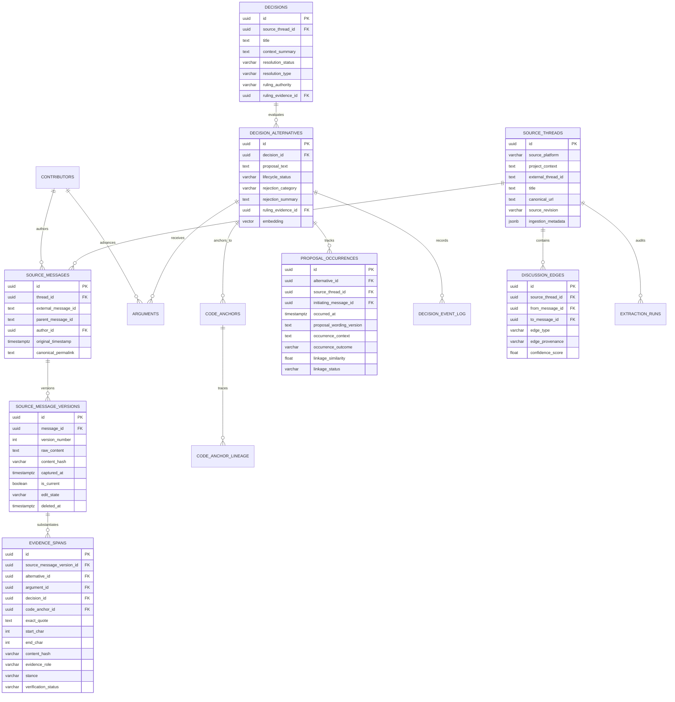
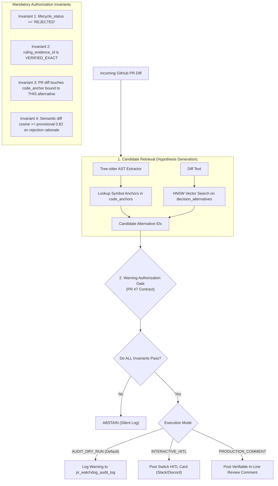

# Storage, Database Schema, and Retrieval Architecture

**Project:** Biscuit — Open Source Decision Intelligence and Knowledge Recovery  
**Team:** Chole Bhature (`@mriarc-08`, `@daksheshsharma2409`, `@utksh1`)  
**Scope:** Canonical Data Contracts, Immutable Evidence Provenance, Decision Lifecycle & Argument Separation, AST Code Anchoring, and Retrieval Guardrails.  
**Specification Level:** Implementation Contract (Consolidated with Issue #5 and PR #7 review requirements).

---

## 1. Storage Engine Infrastructure

The storage infrastructure combines relational integrity, immutable evidence versioning, and vector similarity search in a containerized environment.

```
┌────────────────────────────────────────────────────────────────────────┐
│                   STORAGE & RETRIEVAL INFRASTRUCTURE                   │
├────────────────────────────────────────────────────────────────────────┤
│                                                                        │
│  Primary Engine: Containerized PostgreSQL 16 + pgvector                │
│  • Image: pgvector/pgvector:pg16                                       │
│  • Relational Schema with Full Referential Integrity (No Orphan Spans) │
│  • Immutable Message Versions with SHA-256 Checksums                   │
│  • HNSW Index for 768-dim Vector KNN (nomic-embed-text-v1.5)           │
│  • Bootstrapped via docker-compose.yml + init.sql                      │
│                                                                        │
│  Local Test Fallback (CI / Unit Test Matrix):                          │
│  • SQLite for relational tables                                        │
│  • ChromaDB / In-Memory Vector Index for embeddings                    │
│  • Parity-verified against PostgreSQL schema in CI                     │
│                                                                        │
└────────────────────────────────────────────────────────────────────────┘
```

---

## 2. Canonical Relational & Evidence Architecture

Per **Issue #5** and the **PR #7 Review Contract**:
1. **Source Versioning & Immutability:** `source_messages` captures platform identity, while `source_message_versions` stores immutable content versions with SHA-256 digests. Remote edits generate new version rows; past captures are never overwritten.
2. **Explicit Offset Convention:** Character offsets are strictly **zero-based, start-inclusive, end-exclusive `[start_char, end_char)`** (Python `raw_content[start_char:end_char]`). PostgreSQL substring queries map explicitly via `SUBSTRING(raw_content FROM (start_char + 1) FOR (end_char - start_char))`.
3. **Default Unverified Status:** Evidence spans initialize with `verification_status = 'UNVERIFIED'`. Only explicit byte-for-byte verification promotes a span to `VERIFIED_EXACT`.
4. **Typed Foreign Keys (No Orphan Spans):** Polymorphic `(target_type, target_id)` is replaced with typed foreign keys and a check constraint (`num_nonnulls(...) = 1`).
5. **Decoupled Objections vs. Formal Rejections:** Objections live in `arguments`. A proposal is only marked `REJECTED` if backed by an authoritative ruling in `evidence_spans`.
6. **Proposal-Occurrence Tracking:** Recurring debates are captured in `proposal_occurrences` rather than silently merging distinct proposals.
7. **Alternative-Specific Code Anchors:** `code_anchors` attaches directly to `decision_alternatives(id)`.



---

## 3. Complete Relational DDL Specification

```sql
CREATE EXTENSION IF NOT EXISTS vector;
CREATE EXTENSION IF NOT EXISTS "uuid-ossp";

-- ─────────────────────────────────────────────────────────────
-- 1. CONTRIBUTORS & IDENTITY RESOLUTION
-- ─────────────────────────────────────────────────────────────

CREATE TABLE contributors (
    id UUID PRIMARY KEY DEFAULT uuid_generate_v4(),
    source_platform VARCHAR(32) NOT NULL,  -- 'discourse', 'github', 'slack', 'mailing_list'
    platform_user_id TEXT NOT NULL,        -- Platform unique user id
    canonical_name TEXT NOT NULL,
    author_handle TEXT NOT NULL,           -- e.g. 'gvanrossum', 'markshannon'
    email_prefix TEXT,                     -- Sanitized email identifier for mailing lists
    project_role TEXT,                     -- 'BDFL', 'Core Maintainer', 'Contributor'
    created_at TIMESTAMPTZ DEFAULT NOW(),
    CONSTRAINT uq_contributor_platform UNIQUE (source_platform, platform_user_id)
);

CREATE INDEX idx_contributors_handle ON contributors(author_handle);

-- ─────────────────────────────────────────────────────────────
-- 2. SOURCE PROVENANCE & VERSIONED MESSAGES (IMMUTABLE)
-- ─────────────────────────────────────────────────────────────

CREATE TABLE source_threads (
    id UUID PRIMARY KEY DEFAULT uuid_generate_v4(),
    source_platform VARCHAR(32) NOT NULL, -- 'discourse', 'github_pr', 'github_issue', 'slack', 'mailing_list'
    project_context TEXT NOT NULL,         -- 'python/cpython', 'kubernetes/kubernetes'
    external_thread_id TEXT NOT NULL,      -- 'topic_1234', 'pull_505'
    title TEXT NOT NULL,
    canonical_url TEXT NOT NULL,
    source_revision VARCHAR(64) DEFAULT 'v1',
    ingestion_metadata JSONB DEFAULT '{}'::jsonb,
    created_at TIMESTAMPTZ DEFAULT NOW(),
    CONSTRAINT uq_source_thread UNIQUE (source_platform, project_context, external_thread_id)
);

CREATE TABLE source_messages (
    id UUID PRIMARY KEY DEFAULT uuid_generate_v4(),
    thread_id UUID NOT NULL REFERENCES source_threads(id) ON DELETE CASCADE,
    external_message_id TEXT NOT NULL,
    parent_message_id TEXT,
    author_id UUID REFERENCES contributors(id),
    original_timestamp TIMESTAMPTZ NOT NULL,
    canonical_permalink TEXT NOT NULL,
    created_at TIMESTAMPTZ DEFAULT NOW(),
    CONSTRAINT uq_source_message UNIQUE (thread_id, external_message_id)
);

CREATE INDEX idx_source_messages_thread ON source_messages(thread_id);
CREATE INDEX idx_source_messages_parent ON source_messages(parent_message_id);

CREATE TYPE message_edit_state AS ENUM ('ORIGINAL', 'EDITED', 'DELETED', 'UNAVAILABLE');

CREATE TABLE source_message_versions (
    id UUID PRIMARY KEY DEFAULT uuid_generate_v4(),
    message_id UUID NOT NULL REFERENCES source_messages(id) ON DELETE CASCADE,
    version_number INT NOT NULL DEFAULT 1,
    raw_content TEXT NOT NULL,             -- IMMUTABLE CAPTURE: Never overwritten
    content_hash VARCHAR(64) NOT NULL,     -- SHA-256 of raw_content
    captured_at TIMESTAMPTZ DEFAULT NOW(),
    is_current BOOLEAN NOT NULL DEFAULT TRUE,
    edit_state message_edit_state NOT NULL DEFAULT 'ORIGINAL',
    edit_reason TEXT,
    deleted_at TIMESTAMPTZ,                -- Non-null if tombstoned/deleted remotely
    derived_cleaned_content TEXT,          -- Derived text post-noise-filtering
    CONSTRAINT uq_message_version UNIQUE (message_id, version_number)
);

CREATE INDEX idx_message_versions_current ON source_message_versions(message_id) WHERE is_current = TRUE;

-- ─────────────────────────────────────────────────────────────
-- 3. TYPED DELIBERATION EDGES (GRAPH MODEL)
-- ─────────────────────────────────────────────────────────────

CREATE TYPE discussion_edge_type AS ENUM (
    'PROPOSES',
    'SUPPORTS',
    'OBJECTS',
    'REBUTS',
    'RESOLVES',
    'REFERENCES',
    'DIRECT_REPLY',
    'QUOTE_REFERENCE',
    'MENTION'
);

CREATE TYPE edge_provenance AS ENUM (
    'PLATFORM_METADATA',
    'DETERMINISTIC_RULE',
    'MODEL_INFERRED'
);

CREATE TABLE discussion_edges (
    id UUID PRIMARY KEY DEFAULT uuid_generate_v4(),
    source_thread_id UUID NOT NULL REFERENCES source_threads(id) ON DELETE CASCADE,
    from_message_id UUID NOT NULL REFERENCES source_messages(id) ON DELETE CASCADE,
    to_message_id UUID NOT NULL REFERENCES source_messages(id) ON DELETE CASCADE,
    edge_type discussion_edge_type NOT NULL,
    edge_provenance edge_provenance NOT NULL,
    confidence_score FLOAT NOT NULL DEFAULT 1.0,
    created_at TIMESTAMPTZ DEFAULT NOW(),
    CONSTRAINT chk_edge_confidence CHECK (confidence_score >= 0.0 AND confidence_score <= 1.0)
);

CREATE INDEX idx_edges_thread ON discussion_edges(source_thread_id);
CREATE INDEX idx_edges_nodes ON discussion_edges(from_message_id, to_message_id);

-- ─────────────────────────────────────────────────────────────
-- 4. DECISIONS & ALTERNATIVE LIFECYCLES
-- ─────────────────────────────────────────────────────────────

CREATE TYPE decision_resolution AS ENUM ('RESOLVED', 'UNRESOLVED', 'DISPUTED');
CREATE TYPE resolution_type AS ENUM ('ACCEPTED', 'REJECTED', 'DEFERRED', 'WITHDRAWN', 'SUPERSEDED');
CREATE TYPE ruling_authority AS ENUM ('BDFL', 'CORE_MAINTAINER_CONSENSUS', 'WORKING_GROUP', 'MODEL_INFERRED');

CREATE TABLE decisions (
    id UUID PRIMARY KEY DEFAULT uuid_generate_v4(),
    source_thread_id UUID NOT NULL REFERENCES source_threads(id) ON DELETE CASCADE,
    title TEXT NOT NULL,
    context_summary TEXT NOT NULL,
    resolution_status decision_resolution NOT NULL DEFAULT 'UNRESOLVED',
    resolution_type resolution_type,
    ruling_authority ruling_authority,
    ruling_evidence_id UUID,               -- Foreign key linked below
    created_at TIMESTAMPTZ DEFAULT NOW(),
    updated_at TIMESTAMPTZ DEFAULT NOW()
);

CREATE TYPE proposal_lifecycle AS ENUM (
    'PROPOSED',
    'UNDER_DISCUSSION',
    'ACCEPTED',
    'REJECTED',
    'WITHDRAWN',
    'DEFERRED',
    'SUPERSEDED',
    'UNRESOLVED',
    'DISPUTED',
    'ACCEPTED_WITH_MODIFICATION'
);

CREATE TYPE rejection_category AS ENUM (
    'PERFORMANCE',
    'SYNTAX_AMBIGUITY',
    'BACKWARD_COMPAT',
    'COMPLEXITY',
    'SECURITY',
    'PHILOSOPHICAL'
);

CREATE TABLE decision_alternatives (
    id UUID PRIMARY KEY DEFAULT uuid_generate_v4(),
    decision_id UUID NOT NULL REFERENCES decisions(id) ON DELETE CASCADE,
    proposal_text TEXT NOT NULL,
    lifecycle_status proposal_lifecycle NOT NULL DEFAULT 'PROPOSED',
    rejection_category rejection_category,
    rejection_summary TEXT,
    proposed_by_id UUID REFERENCES contributors(id),
    ruling_evidence_id UUID,               -- Foreign key linked below
    embedding vector(768),                 -- nomic-embed-text-v1.5
    created_at TIMESTAMPTZ DEFAULT NOW(),
    CONSTRAINT uq_alt_proposal UNIQUE (decision_id, proposal_text)
);

-- HNSW Vector Index for Instant Semantic Matching
CREATE INDEX idx_alternatives_embedding 
ON decision_alternatives 
USING hnsw (embedding vector_cosine_ops)
WITH (m = 16, ef_construction = 64);

-- ─────────────────────────────────────────────────────────────
-- 5. ARGUMENTS (DECOUPLED OBJECTIONS VS DECISIONS)
-- ─────────────────────────────────────────────────────────────

CREATE TYPE evidence_stance AS ENUM ('SUPPORT', 'OBJECT', 'NEUTRAL');

CREATE TABLE arguments (
    id UUID PRIMARY KEY DEFAULT uuid_generate_v4(),
    alternative_id UUID NOT NULL REFERENCES decision_alternatives(id) ON DELETE CASCADE,
    author_id UUID REFERENCES contributors(id),
    stance evidence_stance NOT NULL,
    rationale TEXT NOT NULL,
    evidence_span_id UUID,                 -- Foreign key linked below
    created_at TIMESTAMPTZ DEFAULT NOW()
);

CREATE INDEX idx_arguments_alt ON arguments(alternative_id);

-- ─────────────────────────────────────────────────────────────
-- 6. CODE ANCHORS & LINEAGE (ALTERNATIVE-SPECIFIC)
-- ─────────────────────────────────────────────────────────────

CREATE TYPE code_symbol_type AS ENUM (
    'function',
    'class',
    'method',
    'grammar_rule',
    'ast_node',
    'interface',
    'module'
);

CREATE TYPE anchor_state AS ENUM (
    'HISTORICAL',
    'CURRENT',
    'MIGRATED',
    'SPLIT',
    'MERGED',
    'DELETED',
    'AMBIGUOUS'
);

CREATE TABLE code_anchors (
    id UUID PRIMARY KEY DEFAULT uuid_generate_v4(),
    alternative_id UUID NOT NULL REFERENCES decision_alternatives(id) ON DELETE CASCADE,
    repository_url TEXT NOT NULL DEFAULT 'https://github.com/python/cpython',
    language VARCHAR(32) NOT NULL,          -- 'python', 'c', 'rust', 'go'
    symbol_type code_symbol_type NOT NULL,
    qualified_symbol_name TEXT NOT NULL,    -- 'cpython.Parser.Tokenizer.get_next_token'
    source_locator_type VARCHAR(32) NOT NULL DEFAULT 'AST_NODE_QUERY', -- 'FILE_BYTE_RANGE', 'FILE_LINE_RANGE', 'AST_NODE_QUERY'
    start_line INT,
    end_line INT,
    start_byte INT,
    end_byte INT,
    parser_name VARCHAR(64) NOT NULL DEFAULT 'tree-sitter-python',
    grammar_version VARCHAR(32) NOT NULL DEFAULT 'v0.22.0',
    fingerprint_algorithm VARCHAR(32) NOT NULL DEFAULT 'ast-canonical-hash-v1',
    ast_structural_fingerprint VARCHAR(64),
    signature_hash VARCHAR(64),
    anchor_state anchor_state NOT NULL DEFAULT 'HISTORICAL',
    historical_file_path TEXT NOT NULL,
    historical_commit_sha VARCHAR(64) NOT NULL,
    head_commit_sha VARCHAR(64),
    mapping_confidence FLOAT NOT NULL DEFAULT 1.0,
    created_at TIMESTAMPTZ DEFAULT NOW()
);

CREATE INDEX idx_code_anchors_alt ON code_anchors(alternative_id);
CREATE INDEX idx_code_anchors_sym ON code_anchors(qualified_symbol_name);

CREATE TABLE code_anchor_lineage (
    id UUID PRIMARY KEY DEFAULT uuid_generate_v4(),
    code_anchor_id UUID NOT NULL REFERENCES code_anchors(id) ON DELETE CASCADE,
    historical_commit_sha VARCHAR(64) NOT NULL,
    target_commit_sha VARCHAR(64) NOT NULL,
    traversal_strategy VARCHAR(50) NOT NULL, -- 'FORWARD_COMMIT_DAG_DIFF_M'
    historical_path TEXT NOT NULL,
    migrated_path TEXT,
    transition_type VARCHAR(32) NOT NULL,   -- 'EXACT_MATCH', 'RENAME_M', 'COPY_C', 'REWRITE_SPLIT_B', 'SYMBOL_MOVED', 'DELETED', 'AMBIGUOUS'
    confidence_score FLOAT NOT NULL,
    recorded_at TIMESTAMPTZ DEFAULT NOW()
);

-- ─────────────────────────────────────────────────────────────
-- 7. EXACT EVIDENCE SPANS (ANTI-HALLUCINATION PROOF)
-- ─────────────────────────────────────────────────────────────

CREATE TYPE evidence_role AS ENUM (
    'PROPOSAL',
    'OBJECTION',
    'REBUTTAL',
    'RULING',
    'CONCESSION',
    'BENCHMARK_REPORT'
);

CREATE TYPE verification_status AS ENUM ('VERIFIED_EXACT', 'STALE_EDITED', 'UNVERIFIED', 'UNAVAILABLE');

CREATE TABLE evidence_spans (
    id UUID PRIMARY KEY DEFAULT uuid_generate_v4(),
    source_message_version_id UUID NOT NULL REFERENCES source_message_versions(id) ON DELETE CASCADE,
    decision_id UUID REFERENCES decisions(id) ON DELETE CASCADE,
    alternative_id UUID REFERENCES decision_alternatives(id) ON DELETE CASCADE,
    argument_id UUID REFERENCES arguments(id) ON DELETE CASCADE,
    code_anchor_id UUID REFERENCES code_anchors(id) ON DELETE CASCADE,
    exact_quote TEXT NOT NULL,             -- Must match substring in source_message_versions(raw_content)
    start_char INT NOT NULL,               -- 0-based character offset start
    end_char INT NOT NULL,                 -- 0-based character offset end (exclusive)
    content_hash VARCHAR(64) NOT NULL,     -- SHA-256 of exact_quote
    evidence_role evidence_role NOT NULL,
    stance evidence_stance NOT NULL,
    verification_status verification_status NOT NULL DEFAULT 'UNVERIFIED',
    created_at TIMESTAMPTZ DEFAULT NOW(),
    -- Enforce referential integrity: exactly one typed target must be non-null
    CONSTRAINT chk_evidence_target_exactly_one CHECK (
        num_nonnulls(decision_id, alternative_id, argument_id, code_anchor_id) = 1
    ),
    CONSTRAINT chk_char_offsets CHECK (start_char >= 0 AND end_char > start_char)
);

-- Foreign Key Back-Links for Authoritative Rulings
ALTER TABLE decisions ADD CONSTRAINT fk_decisions_ruling_evidence 
FOREIGN KEY (ruling_evidence_id) REFERENCES evidence_spans(id) ON DELETE SET NULL;

ALTER TABLE decision_alternatives ADD CONSTRAINT fk_alternatives_ruling_evidence 
FOREIGN KEY (ruling_evidence_id) REFERENCES evidence_spans(id) ON DELETE SET NULL;

ALTER TABLE arguments ADD CONSTRAINT fk_arguments_evidence 
FOREIGN KEY (evidence_span_id) REFERENCES evidence_spans(id) ON DELETE SET NULL;

-- ─────────────────────────────────────────────────────────────
-- 8. PROPOSAL OCCURRENCE TRACKING (RECURRENCE RECOVERY)
-- ─────────────────────────────────────────────────────────────

CREATE TABLE proposal_occurrences (
    id UUID PRIMARY KEY DEFAULT uuid_generate_v4(),
    alternative_id UUID NOT NULL REFERENCES decision_alternatives(id) ON DELETE CASCADE,
    source_thread_id UUID NOT NULL REFERENCES source_threads(id) ON DELETE CASCADE,
    initiating_message_id UUID NOT NULL REFERENCES source_messages(id) ON DELETE RESTRICT,
    initiating_message_version_id UUID NOT NULL REFERENCES source_message_versions(id) ON DELETE RESTRICT,
    occurred_at TIMESTAMPTZ NOT NULL,
    proposal_wording_version TEXT NOT NULL, -- The specific title or syntax variant used in this occurrence
    occurrence_context TEXT NOT NULL,        -- Why it re-emerged (e.g. "Triggered by PR #412")
    occurrence_outcome VARCHAR(50) NOT NULL, -- 'PROPOSED', 'DISMISSED_AS_DUPLICATE', 'REOPENED', 'RE_REJECTED'
    linkage_similarity FLOAT,                -- Cosine similarity with primary alternative
    linkage_status VARCHAR(50) NOT NULL DEFAULT 'PROPOSED_RECURRENCE', -- 'PROPOSED_RECURRENCE', 'HUMAN_CONFIRMED', 'REJECTED_LINK'
    linkage_evidence_span_id UUID REFERENCES evidence_spans(id),
    created_at TIMESTAMPTZ DEFAULT NOW()
);

CREATE INDEX idx_occurrences_alt ON proposal_occurrences(alternative_id);
CREATE INDEX idx_occurrences_thread ON proposal_occurrences(source_thread_id);

-- ─────────────────────────────────────────────────────────────
-- 9. EXTRACTION RUNS (AUDITABILITY & REPRODUCIBILITY)
-- ─────────────────────────────────────────────────────────────

CREATE TABLE extraction_runs (
    id UUID PRIMARY KEY DEFAULT uuid_generate_v4(),
    source_thread_id UUID NOT NULL REFERENCES source_threads(id) ON DELETE CASCADE,
    pipeline_version VARCHAR(32) NOT NULL,
    model_pass1_name VARCHAR(64) NOT NULL,
    model_pass1_revision VARCHAR(64) NOT NULL,
    model_pass3_name VARCHAR(64) NOT NULL,
    model_pass3_revision VARCHAR(64) NOT NULL,
    model_pass4_name VARCHAR(64) NOT NULL,
    model_pass4_revision VARCHAR(64) NOT NULL,
    embedding_model_name VARCHAR(64) NOT NULL,
    embedding_model_revision VARCHAR(64) NOT NULL,
    prompt_templates_hash VARCHAR(64) NOT NULL,
    source_thread_snapshot_sha256 VARCHAR(64) NOT NULL,
    run_status VARCHAR(32) NOT NULL,         -- 'RUNNING', 'SUCCESS', 'FAILED', 'PARTIAL'
    records_extracted INT DEFAULT 0,
    started_at TIMESTAMPTZ DEFAULT NOW(),
    completed_at TIMESTAMPTZ
);

-- ─────────────────────────────────────────────────────────────
-- 10. PR WATCHDOG AUDIT LOG (DRY-RUN / HITL LOGGING)
-- ─────────────────────────────────────────────────────────────

CREATE TABLE pr_watchdog_audit_log (
    id UUID PRIMARY KEY DEFAULT uuid_generate_v4(),
    repository_url TEXT NOT NULL,
    pr_number INT NOT NULL,
    commit_sha VARCHAR(64) NOT NULL,
    checked_at TIMESTAMPTZ DEFAULT NOW(),
    execution_mode VARCHAR(32) NOT NULL DEFAULT 'AUDIT_DRY_RUN', -- 'AUDIT_DRY_RUN', 'INTERACTIVE_HITL', 'PRODUCTION_COMMENT'
    candidate_alternative_ids JSONB NOT NULL DEFAULT '[]'::jsonb,
    evaluated_similarity FLOAT,
    invariants_satisfied BOOLEAN NOT NULL DEFAULT FALSE,
    authorization_verdict VARCHAR(64) NOT NULL, -- 'WARNING_AUTHORIZED', 'ABSTAINED_UNCERTAIN', 'NO_REJECTED_MATCH', 'ALTERNATIVE_MISMATCH'
    action_taken VARCHAR(64) NOT NULL,          -- 'LOGGED_ONLY', 'HITL_CARD_POSTED', 'COMMENT_PUBLISHED'
    comment_payload JSONB
);

-- ─────────────────────────────────────────────────────────────
-- 11. AUDITABLE DECISION EVENT LOG
-- ─────────────────────────────────────────────────────────────

CREATE TABLE decision_event_log (
    id UUID PRIMARY KEY DEFAULT uuid_generate_v4(),
    alternative_id UUID NOT NULL REFERENCES decision_alternatives(id) ON DELETE CASCADE,
    source_thread_id UUID REFERENCES source_threads(id),
    recurrence_number INT NOT NULL DEFAULT 1,
    event_type VARCHAR(32) NOT NULL,        -- 'STATUS_CHANGE', 'RULING_OVERTURNED', 'RECURRENCE_RECORDED'
    previous_status proposal_lifecycle,
    new_status proposal_lifecycle NOT NULL,
    reason TEXT NOT NULL,
    evidence_span_id UUID REFERENCES evidence_spans(id),
    recorded_at TIMESTAMPTZ DEFAULT NOW()
);
```

---

## 4. Evidence Verification & Offset Math Contract

### Explicit Character Offset Definition
* **Application Layer (Python):**  
  Offsets use **zero-based indexing, start-inclusive, end-exclusive `[start_char, end_char)`**.  
  `extracted_quote = source_message_version.raw_content[start_char:end_char]`
* **Database Layer (PostgreSQL SQL):**  
  PostgreSQL's `SUBSTRING(string FROM start FOR count)` uses **1-based indexing** and takes a length argument:  
  ```sql
  SELECT SUBSTRING(raw_content FROM (start_char + 1) FOR (end_char - start_char)) AS verified_quote
  FROM source_message_versions
  WHERE id = :source_message_version_id;
  ```
* **Unicode & Multiline Normalization:**  
  Offsets count UTF-8 Python Unicode codepoints (`len(str)`). On ingestion, raw text undergoes CRLF normalization (`\r\n` $\rightarrow$ `\n`) before computing hashes and offsets to prevent cross-OS offset drift.

### Verification Procedure
1. Initialize evidence span with `verification_status = 'UNVERIFIED'`.
2. Extract substring from `source_message_versions.raw_content` using `[start_char, end_char)`.
3. If `substring == exact_quote` AND `sha256(exact_quote) == content_hash`:
   - Promote to `VERIFIED_EXACT`.
4. If the message was edited remotely or hash mismatches:
   - Mark as `STALE_EDITED` or `UNVERIFIED`.
   - **Biscuit never silently substitutes alternative sentences.**

---

## 5. Dual-Mode Retrieval & Warning Authorization Gate



### Warning Authorization Invariants & Abstention Rules:
1. **Decision State:** The alternative has `lifecycle_status = 'REJECTED'`. If `DISPUTED`, `UNRESOLVED`, or `PROPOSED`, **ABSTAIN**.
2. **Authoritative Ruling Required:** `ruling_evidence_id` must have `verification_status = 'VERIFIED_EXACT'` signed by an identified authority or consensus. `MODEL_INFERRED` alone cannot authorize a warning comment.
3. **Alternative-Specific Code Grounding:** The PR diff touches a `code_anchor` bound directly to that specific alternative.
4. **Provisional Semantic Calibration:** Cosine similarity of diff hunk embedding meets or exceeds **0.82** (provisional threshold until calibrated on held-out benchmarks).
5. **Hard Negatives:** If the PR touches the file for an unrelated refactor (e.g. ternary operator formatting) rather than introducing the rejected unary `?` operator, the system marks the match as a hard negative and **ABSTAINS**.
6. **Audit/Dry-Run Default:** In-line PR comments are disabled by default. All triggers are recorded to `pr_watchdog_audit_log`.
