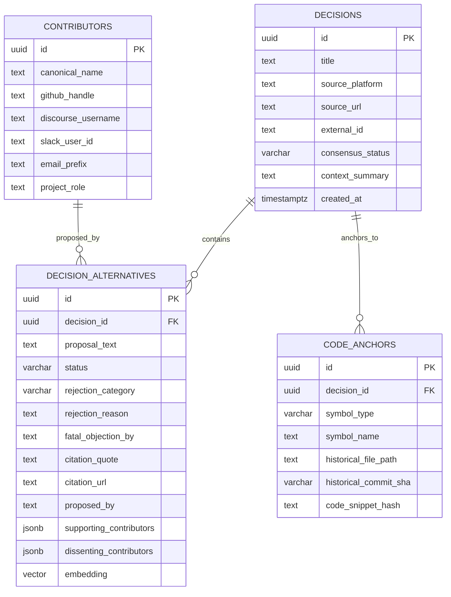
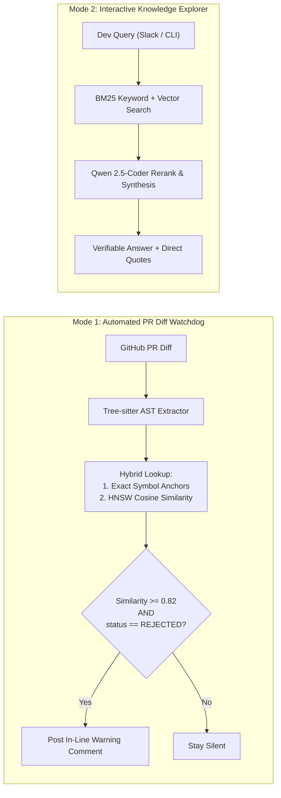

# Storage, Data Store, and Retrieval Architecture

**Project:** Biscuit — Open Source Decision Intelligence and Knowledge Recovery  
**Team:** Chole Bhature (`@mriarc-08`, `@daksheshsharma2409`, `@utksh1`)  
**Scope:** Specification for Database Schema, Vector Indexing, Identity Resolution, and Dual-Mode Retrieval.

---

## 1. Storage Engine Architecture

To satisfy both production rigor and hackathon reproducibility, the storage layer is containerized, zero-friction, and local-first.

```
┌────────────────────────────────────────────────────────┐
│             STORAGE & RETRIEVAL INFRASTRUCTURE         │
├────────────────────────────────────────────────────────┤
│                                                        │
│  Primary Engine: Containerized PostgreSQL 16 + pgvector │
│  • Image: pgvector/pgvector:pg16                       │
│  • Single engine for Relational, JSONB, and Vector KNN │
│  • Bootstrapped via docker-compose.yml + init.sql      │
│                                                        │
│  Local Test Fallback (CI / Fast Unit Tests):           │
│  • SQLite for relational tables                        │
│  • ChromaDB / In-Memory Vector Index for embeddings    │
│  • Runs in GitHub Actions CI in <15 seconds            │
│                                                        │
└────────────────────────────────────────────────────────┘
```

### Dockerized Setup (`docker-compose.yml`)
The entire database environment is spin-up ready with a single command (`docker compose up -d`):

```yaml
version: "3.8"

services:
  biscuit-store:
    image: pgvector/pgvector:pg16
    container_name: biscuit-knowledge-store
    restart: always
    environment:
      POSTGRES_DB: biscuit_db
      POSTGRES_USER: biscuit
      POSTGRES_PASSWORD: biscuit_password
    ports:
      - "5432:5432"
    volumes:
      - pgdata:/var/lib/postgresql/data
      - ./docker/init.sql:/docker-entrypoint-initdb.d/init.sql:ro
    healthcheck:
      test: ["CMD-SHELL", "pg_isready -U biscuit -d biscuit_db"]
      interval: 5s
      timeout: 5s
      retries: 5

volumes:
  pgdata:
```

---

## 2. Complete Database Schema (DDL)

The schema cleanly decouples the high-level decision topic from individual proposed alternatives, code symbol anchors, and contributor profiles.



### 1. `decisions` Table
Captures the overarching debate topic, PEP, KEP, or PR architectural discussion:

```sql
CREATE EXTENSION IF NOT EXISTS vector;
CREATE EXTENSION IF NOT EXISTS "uuid-ossp";

CREATE TYPE decision_status AS ENUM (
    'ACCEPTED',
    'REJECTED',
    'DEFERRED',
    'WITHDRAWN',
    'SUPERSEDED'
);

CREATE TABLE decisions (
    id UUID PRIMARY KEY DEFAULT uuid_generate_v4(),
    title TEXT NOT NULL,
    source_platform TEXT NOT NULL,     -- 'discourse', 'github_pr', 'slack_cncf', 'mailing_list'
    source_url TEXT NOT NULL,          -- Canonical link to debate
    external_id TEXT NOT NULL,         -- e.g. 'topic_1234', 'pr_452', 'pep_505'
    consensus_status decision_status NOT NULL,
    context_summary TEXT NOT NULL,     -- Problem statement being debated
    created_at TIMESTAMPTZ DEFAULT NOW(),
    updated_at TIMESTAMPTZ DEFAULT NOW(),
    CONSTRAINT uq_decisions_source UNIQUE (source_platform, external_id)
);
```

### 2. `decision_alternatives` Table *(The Core Evaluation Entity)*
Isolates candidate approaches, with dedicated fields for why an approach was **rejected**:

```sql
CREATE TYPE alternative_status AS ENUM ('ACCEPTED', 'REJECTED', 'SUPERSEDED');
CREATE TYPE rejection_category AS ENUM (
    'PERFORMANCE',
    'SYNTAX_AMBIGUITY',
    'BACKWARD_COMPAT',
    'COMPLEXITY',
    'SECURITY',
    'PHILOSOPHICAL'
);

CREATE TABLE decision_alternatives (
    id UUID PRIMARY KEY DEFAULT uuid_generate_v4(),
    decision_id UUID NOT NULL REFERENCES decisions(id) ON DELETE CASCADE,
    proposal_text TEXT NOT NULL,             -- e.g. "Use unary ? without dot: a?b"
    status alternative_status NOT NULL,      -- REJECTED, ACCEPTED, etc.
    rejection_category rejection_category,   -- Fatal flaw category
    rejection_reason TEXT,                   -- Why it failed
    fatal_objection_by TEXT,                 -- Maintainer who voiced the fatal objection
    citation_quote TEXT,                     -- Exact verbatim excerpt from debate
    citation_url TEXT,                       -- Direct permalink to specific comment
    proposed_by TEXT,                        -- Contributor who proposed the alternative
    supporting_contributors JSONB DEFAULT '[]'::jsonb, -- Array of usernames
    dissenting_contributors JSONB DEFAULT '[]'::jsonb, -- Array of usernames
    embedding vector(768),                   -- nomic-embed-text-v1.5 embedding
    created_at TIMESTAMPTZ DEFAULT NOW(),
    CONSTRAINT uq_alternative UNIQUE (decision_id, proposal_text)
);

-- Fast Approximate Nearest Neighbor Index (HNSW)
CREATE INDEX idx_alternatives_embedding 
ON decision_alternatives 
USING hnsw (embedding vector_cosine_ops)
WITH (m = 16, ef_construction = 64);
```

### 3. `code_anchors` Table (Surviving Code Moves & Renames)
Connects decisions to AST code identities rather than fragile paths:

```sql
CREATE TYPE code_symbol_type AS ENUM (
    'function',
    'class',
    'grammar_rule',
    'ast_node',
    'module'
);

CREATE TABLE code_anchors (
    id UUID PRIMARY KEY DEFAULT uuid_generate_v4(),
    decision_id UUID NOT NULL REFERENCES decisions(id) ON DELETE CASCADE,
    symbol_type code_symbol_type NOT NULL,
    symbol_name TEXT NOT NULL,               -- e.g. 'parse_subscript', 'Tokenizer'
    historical_file_path TEXT NOT NULL,      -- Path at the time of debate
    historical_commit_sha VARCHAR(40),       -- Git SHA at time of decision
    code_snippet_hash TEXT,                  -- Normalized AST hash of the block
    created_at TIMESTAMPTZ DEFAULT NOW()
);

CREATE INDEX idx_code_anchors_symbol ON code_anchors(symbol_name);
```

### 4. `contributors` Table (Cross-Platform Identity Resolution)
Resolves contributors across disparate open-source platforms:

```sql
CREATE TABLE contributors (
    id UUID PRIMARY KEY DEFAULT uuid_generate_v4(),
    canonical_name TEXT NOT NULL,            -- e.g. "Guido van Rossum"
    github_handle TEXT,                      -- e.g. "gvanrossum"
    discourse_username TEXT,                 -- e.g. "guido"
    slack_user_id TEXT,                      -- e.g. "U01234567"
    email_prefix TEXT,                       -- e.g. "guido@"
    project_role TEXT,                       -- e.g. "Core Developer / BDFL"
    created_at TIMESTAMPTZ DEFAULT NOW(),
    CONSTRAINT uq_contributor_canonical UNIQUE (canonical_name)
);
```

---

## 3. Embedding Model & Vector Specification

- **Embedding Model:** `nomic-embed-text-v1.5`
- **Dimensionality:** 768 dimensions
- **Context Window:** 8,192 tokens (crucial for embedding full code diffs and discussion chunks without premature truncation)
- **Search Prefix Modes:**
  - Ingestion: `search_document: <proposal_text> - Rejected: <rejection_reason>`
  - Retrieval: `search_query: <code_diff_summary or dev_question>`
- **Index Type:** **HNSW** (`vector_cosine_ops`), tuned with `m = 16` and `ef_construction = 64` for $<5\text{ms}$ sub-millisecond query latencies.

---

## 4. Dual-Mode Retrieval Engine

The retrieval engine serves two distinct open-source workflows:



### Mode 1: Automated PR Diff Watchdog
1. **Trigger:** A pull request is opened or updated on GitHub.
2. **AST Parsing:** Tree-sitter extracts changed function signatures, class definitions, and AST nodes from the `git diff`.
3. **Symbol Matching:** Direct query against `code_anchors` for any matching `symbol_name`.
4. **Semantic Embedding Search:** Modified code chunks are embedded and queried against `decision_alternatives`.
5. **False-Positive Guardrail:**
   - **Threshold:** Cosine similarity must be $\ge 0.82$.
   - **Status Check:** Must be marked `status = 'REJECTED'`.
   - **Context Verification:** Modified code must overlap with either an AST symbol anchor or relevant technical keywords.
6. **Action:** Posts an actionable PR comment citing the rejected decision, author, and permalink.

### Mode 2: Interactive Knowledge Query (Developer Chat / CLI)
1. **Trigger:** Developer asks in CNCF Slack/Discord (via Switch) or the CLI:  
   *`"Why didn't we use coalesce() for null handling?"`*
2. **Hybrid Search:** Combines BM25 keyword matching (for exact terms like `coalesce`) with HNSW vector search (for semantic meaning like `eager fallback functions`).
3. **Synthesis:** `Qwen 2.5-Coder-7B` formats the retrieved records into a concise explanation with citations:
   > *"The `coalesce()` proposal was evaluated in PEP-505 and **rejected** because Python's eager evaluation evaluates all arguments before calling the function, breaking short-circuiting. Fatal objection by Mark Shannon in [post-112](https://discuss.python.org/t/.../112)."*

---

## 5. Idempotency & Data Ingestion Guarantees

- **Upsert Safety:** All ingestion pipelines execute `INSERT ... ON CONFLICT (source_platform, external_id) DO UPDATE`.
- **Zero Duplicate Alternatives:** Proposals are slugified and keyed against `(decision_id, proposal_text)`.
- **Traceability Guarantee:** No decision alternative is stored without both an exact verbatim `citation_quote` and a valid `citation_url`.
