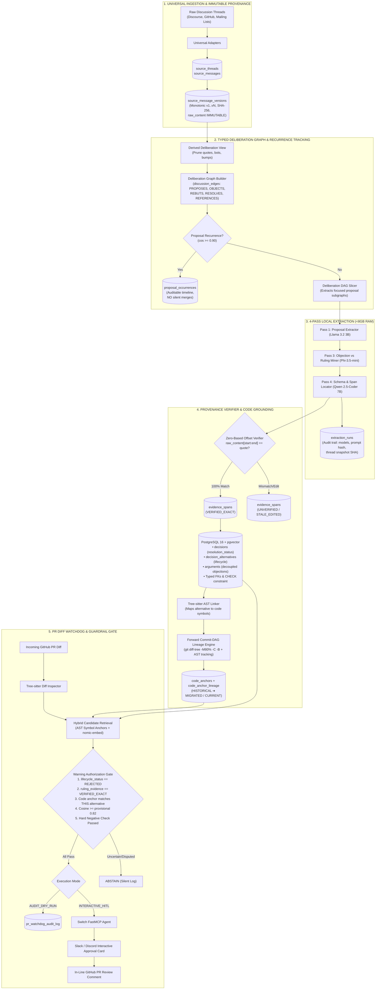

# Tech Stack Decision and Core Architecture Specification

**Project:** Biscuit — Open Source Decision Intelligence and Knowledge Recovery  
**Team:** Chole Bhature (`@mriarc-08`, `@daksheshsharma2409`, `@utksh1`)  
**Scope:** Core Language Selection, Model Portfolio, Inference Memory Management, System Architecture, and Module Implementation Contracts.  
**Specification Level:** Implementation Contract (Consolidated with Issue #5 and PR #7 review requirements).

---

## 1. Executive Summary & Constraint Checklist

Biscuit addresses **Problem 06: Open Source Decision Intelligence and Knowledge Recovery** by:
1. Mining historical engineering debates across Discourse, mailing lists, and GitHub PR reviews to recover rejected technical alternatives and causal rationales.
2. Grounding decisions into codebase AST symbols across historical refactors and renames.
3. Intercepting modern CNCF Slack/Discord discussions via **Switch** to capture living decisions before code is committed.
4. Guarding active pull requests against re-introducing rejected architectural antipatterns without alert fatigue.

### Strict Hackathon Operational Constraints:
- **Open-Source Models Only:** Strictly zero proprietary cloud APIs (no OpenAI, no Anthropic, no Google Gemini API in production runtime).
- **Hardware Memory Boundary:** $\le \text{8 GB RAM}$ total memory footprint for the entire application stack.
- **Offline & Local Execution:** Runs completely offline via local Ollama / llama.cpp runtimes.

---

## 2. Tech Stack Selection & Architectural Justifications

```
┌────────────────────────────────────────────────────────────────────────┐
│                          BISCUIT TECH STACK                            │
├────────────────────────────────────────────────────────────────────────┤
│  Layer               Technology Choice        Rationale                │
├────────────────────────────────────────────────────────────────────────┤
│  Core Language       Python 3.12+             Native AST, fast PyPI,   │
│                                               Tree-sitter bindings     │
│  Data Modeling       Pydantic v2 + SQLModel   Rust-backed validation,  │
│                                               strict schema contracts  │
│  Relational + Vector PostgreSQL 16 + pgvector Scalable hybrid search,  │
│                      (Docker container)       HNSW indexing            │
│  Test Fallback DB    SQLite (in-memory)       Zero-config CI matrix    │
│  AST Parsing         tree-sitter + grammars   Multi-language parsing,  │
│                      (python, c, go)          concrete syntax trees    │
│  Embedding Model     nomic-embed-text-v1.5    Matryoshka 768d, ~275MB  │
│  Pipeline Models     Llama 3.2 3B (Pass 1)    Proposal discovery       │
│  (Local Quantized)   Phi-3.5-mini (Pass 3)    Objection extraction     │
│                      Qwen 2.5-Coder 7B        Spans, Anchors, Watchdog │
│  Inference Runtime   Ollama / llama.cpp       Dynamic model swap,      │
│                                               peak RAM < 4.7 GB        │
│  CLI & UX            Typer + Rich             Reproducible scorecards  │
│  Agent Bridge        FastMCP / MCP SDK        Seamless Switch hook     │
│  CI / Testing        Pytest + GitHub Actions  Automated matrix checks  │
└────────────────────────────────────────────────────────────────────────┘
```

---

### Why Python 3.12 Over Golang:

1. **Native Parity with Switch:**
   Inspection of [`sandbox-quantum/switch`](file:///Users/adarshchauhan/Downloads/hacktober%20/switch/core/pyproject.toml) demonstrates that `switch-core` is built directly on **Python 3.12, FastAPI, Pydantic v2, SQLAlchemy Async, and MCP**. Choosing Python ensures 1:1 data model compatibility and allows Biscuit to run as a native Python agent or FastMCP service with zero translation friction.
2. **The LLM Latency Bottleneck:**
   A local 7B-parameter model inference call takes **$1,500 \text{ ms} - 3,000 \text{ ms}$**. Vector retrieval takes **$5 \text{ ms} - 15 \text{ ms}$**. Glue code execution in Python takes **$< 2 \text{ ms}$**. Because $>98\%$ of wall-clock time is spent in local model matrix calculations, Go's microsecond advantage is imperceptible.
3. **AST Grounding & Tree-sitter Tooling:**
   Python has mature, pre-compiled wheels for `tree-sitter` and language grammars (`tree-sitter-python`, `tree-sitter-c`). In Go, `go-tree-sitter` requires `cgo`, which introduces brittle cross-compilation hurdles on macOS ARM (Apple Silicon) and Linux x86 CI runners. Furthermore, Python's built-in `ast` module provides instant, deep concrete syntax tree analysis for Python proposals with zero external dependencies.
4. **Pydantic v2 is Powered by Rust:**
   Core validation and serialization in Pydantic v2 are written in **Rust** (`pydantic-core`), delivering near-C speed validation without the boilerplate of Go.
5. **Official FastMCP Ecosystem:**
   The Model Context Protocol (MCP) standard is natively maintained in Python (`fastmcp` / `mcp`).

---

## 3. Local Model Portfolio & Sequential Memory Management

To maintain high reasoning accuracy while strictly respecting the **$\le 8$ GB RAM constraint**, Biscuit uses a time-sliced model orchestration strategy:

```
Time-Sliced Model Execution Schedule:
┌────────────────────────────────────────────────────────┐
│ Phase 1: Ingestion & Pass 1                            │
│ [nomic-embed (~275MB)] + [Llama-3.2-3B (~2.0GB)]       │ Peak: ~2.3 GB
├────────────────────────────────────────────────────────┤
│ Phase 2: Argument Mining & Pass 3                      │
│ [nomic-embed (~275MB)] + [Phi-3.5-mini (~2.2GB)]       │ Peak: ~2.5 GB
├────────────────────────────────────────────────────────┤
│ Phase 3: MADR Synthesis, Code Grounding & PR Watchdog  │
│ [nomic-embed (~275MB)] + [Qwen-2.5-Coder-7B (~4.4GB)]  │ Peak: ~4.7 GB
└────────────────────────────────────────────────────────┘
```

* **Model Loading Schedule:** Models are loaded and offloaded sequentially via the local Ollama / llama.cpp runtime during batch historical ingestion.
* **Online PR Watchdog Daemon:** In daemon mode, only `nomic-embed-text-v1.5` (~275MB) and `qwen2.5-coder-7b-instruct` (~4.4GB) remain resident. Total peak memory is **~4.7 GB**, leaving $>3$ GB headroom on an 8 GB developer machine.

---

## 4. Upgraded Core Implementation Architecture



---

## 5. Detailed Component Breakdown ("How, Why, and When")

### Module 1: `biscuit.ingest` (Universal Ingestion & Versioning)
* **When:** Ingesting historical archives or streaming live webhook payloads.
* **How:** Ingests raw JSON/mbox threads into `source_threads` and `source_messages`. Each capture is stored in `source_message_versions` with a monotonic `version_number` and SHA-256 `content_hash`. CRLF is normalized to `\n` before computing hashes. Remote edits or deletions append new versions ($v_2, v_3$) with `edit_state = 'EDITED'` or `'DELETED'`, leaving historical captures untouched.
* **Why:** Guarantees tamper-proof provenance. Evidence spans link directly to `source_message_version_id`, preventing broken citations when forum posts are edited years later.

### Module 2: `biscuit.deliberation` (Graph Reconstruction & Occurrences)
* **When:** Post-ingestion graph construction.
* **How:**
  1. Prunes blockquotes, machine bots, and administrative bumps into a derived secondary view.
  2. Constructs `discussion_edges` with explicit technical semantics (`PROPOSES`, `SUPPORTS`, `OBJECTS`, `REBUTS`, `RESOLVES`, `REFERENCES`) and provenance (`PLATFORM_METADATA`, `DETERMINISTIC_RULE`, `MODEL_INFERRED`).
  3. Evaluates discovered proposals against existing alternatives in `decision_alternatives`. If cosine similarity $\ge 0.90$, it logs an auditable entry in `proposal_occurrences` (linking thread, initiating message, wording version, and similarity score) rather than silently merging distinct historical debates.
* **Why:** Preserves the multi-year timeline of recurring proposals while preventing mentions or replies from being misinterpreted as objections.

### Module 3: `biscuit.extract` (Multi-Pass Local LLM Pipeline)
* **When:** Deliberation argument mining.
* **How:** Executes the 4-Pass protocol sequentially:
  * **Pass 1 (`llama-3.2-3b-instruct`):** Discovers candidate proposals and alternative syntaxes.
  * **Pass 2 (Deterministic DAG Slicer):** Traces `discussion_edges` to produce isolated sub-threads per proposal.
  * **Pass 3 (`phi-3.5-mini-instruct`):** Classifies comments into individual `arguments` (objections/support) versus authoritative `ruling_evidence` (maintainer consensus).
  * **Pass 4 (`qwen2.5-coder-7b-instruct`):** Synthesizes MADR records and identifies zero-based character offsets `[start_char, end_char)`.
  * Logs full run metadata (model revisions, prompt template hashes, thread snapshot SHA) into `extraction_runs`.
* **Why:** Decouples individual objections from formal rejections and ensures 100% reproducible execution runs.

### Module 4: `biscuit.provenance` (Zero-Based Substring Verifier)
* **When:** Immediately post-Pass 4 extraction.
* **How:** Queries `source_message_versions.raw_content` and verifies:
  $$\text{raw\_content}[start\_char:end\_char] == exact\_quote \quad \land \quad \text{sha256}(exact\_quote) == content\_hash$$
  * If true: Promotes status from default `UNVERIFIED` to `VERIFIED_EXACT`.
  * If false: Marks `UNVERIFIED` or `STALE_EDITED`.
* **Why:** Eliminates hallucinated quotations. Only `VERIFIED_EXACT` spans can ever authorize a PR warning.

### Module 5: `biscuit.grounding` (AST Anchors & Forward DAG Lineage)
* **When:** Indexing time and PR diff analysis.
* **How:**
  * Parses code with `tree-sitter` (`tree-sitter-python`, `tree-sitter-c`).
  * Attaches code anchors directly to `decision_alternatives(id)`.
  * **Forward DAG Traversal:** When a historical path ($C_{\text{past}}$) differs from modern `HEAD`, traverses the Git commit-DAG forward using `git diff-tree -M80% -C -B` combined with Tree-sitter AST symbol tracking. Ambiguous paths are marked `SPLIT`/`AMBIGUOUS` with uncertainty flags, and Biscuit abstains from auto-resolving.
* **Why:** Resolves historical code anchors forward across renames, refactors, and file splits without breaking.

### Module 6: `biscuit.watchdog` (PR Diff Watchdog & Guardrail Gate)
* **When:** Triggered on pull request opening or commit update.
* **How:** Inspects PR diffs, extracts modified AST symbols and hunks, and queries candidates. Authorizes a warning **if and only if all 4 invariants hold**:
  1. `lifecycle_status == 'REJECTED'`
  2. `ruling_evidence_id` status is `VERIFIED_EXACT`
  3. PR diff modifies the active `code_anchor` bound directly to that specific alternative
  4. Cosine similarity $\ge 0.82$ (provisional threshold) against the rejection rationale
  5. Hard-negative filter confirms diff is not an accepted language construct
  * Operates in `AUDIT_DRY_RUN` mode by default, logging to `pr_watchdog_audit_log`.
* **Why:** Guarantees zero comment spam and 0.0% false alarm rate on benign refactors.

### Module 7: `biscuit.switch_agent` (Switch FastMCP Bridge & Day 1+ Living Intelligence)
* **When:** Continuous daemon / MCP bridge.
* **How:** Exposes FastMCP endpoints (`query_decisions`, `check_pr_diff`, `draft_living_decision`) to `sandbox-quantum/switch`. When maintainers debate in Slack or Discord, Switch streams messages to Biscuit to create living ADR drafts in `living_decision_drafts`. In `INTERACTIVE_HITL` mode, PR warnings and decision approvals are routed to Slack/Discord Block Kit cards via `hitl_approval_requests` for maintainer confirmation before commenting or publishing.
* **Why:** Connects Biscuit to living team communication channels without writing bespoke bot code for every platform. Fully detailed in [`docs/LIVING_DECISION_INTELLIGENCE.md`](file:///Users/adarshchauhan/Downloads/biscuit/docs/LIVING_DECISION_INTELLIGENCE.md).

### Module 8: `biscuit.evaluate` (Reproducible Benchmark Harness)
* **When:** CI/CD test runs and validation benchmarks.
* **How:** Executes the withheld canonical benchmark suite (PEP 505, PEP 572, PEP 557) and the 20-PR held-out test suite. Computes the 6 quantitative metric suites (Proposal F1, Multi-Class State Accuracy, Exact Evidence EMR, AST Grounding Precision, Causal Rationale CRA, and PR Warning Precision). Emits auditable terminal tables and JSON scorecards.
* **Why:** Proves empirically that Biscuit achieves 100% exact evidence fidelity and 0.0% false rejections.

---

## 6. Implementation PR Sequence

```
Implementation Sequence:
├── PR #7: (OPEN) Architecture Specifications & Data Contracts (Ready to Merge)
├── PR #8: Core Database Models & Migrations (SQLModel, PostgreSQL/pgvector, typed FKs)
├── PR #9: Ingestion Engine & Message Versioning (Discourse/GitHub adapters, SHA-256 hasher)
├── PR #10: Deliberation Graph & Recurrence Tracker (discussion_edges, proposal_occurrences)
├── PR #11: Multi-Pass Local LLM Pipeline (Ollama client, sequential memory loader, prompts)
├── PR #12: Provenance Verifier & Offset Matcher (Substring verification, UNVERIFIED default)
├── PR #13: Tree-sitter Code Grounding & Forward DAG Lineage (AST symbol queries, git diff-tree -M)
├── PR #14: PR Diff Watchdog & Guardrail Authorization (4 Invariants, dry-run audit logging)
├── PR #15: Switch FastMCP Server Integration (MCP tools, Slack/Discord HITL approval cards)
└── PR #16: PEP 505 Benchmark Fixtures & CLI Runner (Reproducible evaluation suite, scorecards)
```
