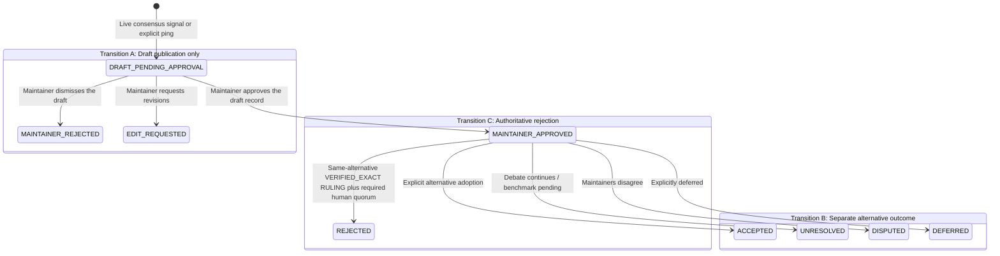

# Biscuit: The Two-Way Architecture Specification
## Unified Architecture Blueprint: Historical Knowledge Recovery (The Past) & Living Decision Intelligence (Day 1+)

**Project:** Biscuit — Open Source Decision Intelligence and Knowledge Recovery  
**Team:** Chole Bhature (`@mriarc-08`, `@daksheshsharma2409`, `@utksh1`)  
**Track:** Problem 06 — Open Source Decision Intelligence and Knowledge Recovery  
**Document Level:** Authoritative Master Architecture Specification  

---

## 1. Executive Overview: The Symmetrical Two-Way Architecture

Open-source decision intelligence cannot succeed as a one-directional system:
* **If a tool only looks backward (The Past):** It mines historical archives once, but as soon as development continues, newly debated decisions in CNCF Slack, Discord, or Zulip are lost into the chat void. The system immediately starts decaying into obsolescence.
* **If a tool only looks forward (Day 1+):** It monitors active chat and pull requests, but lacks the 10-year institutional memory of *why* foundational designs, syntaxes, or architectures were rejected in the past. New contributors repeat old mistakes, and the system cannot explain the historical rationale.

**Biscuit is architected as Two Halves of One Brain:**
1. **Pillar 1: The Past (Historical Knowledge Recovery):** Ingests historical mailing lists, Discourse archives (`discuss.python.org`), and closed GitHub pull requests. It reconstructs deliberation graphs, separates individual objections from authoritative rulings, preserves exact decoded source content, and records zero-based Unicode code-point offsets into that string. SHA-256 digests are computed over UTF-8 bytes of the exact decoded content and quoted evidence.
2. **Pillar 2: Day 1+ (Living Decision Intelligence):** Receives live discussion and approval activity through [Switch agent-controller 0.31.0 at a pinned upstream commit](https://github.com/sandbox-quantum/switch/tree/7e57cd433a922bc91a00150c106e6ef1f15b1057). Biscuit exposes its own MCP tools using the Python FastMCP SDK; Switch is the collaboration/agent platform, not the FastMCP SDK. Model signals create reviewable drafts only. Maintainers separately assign alternative outcomes and record authoritative rulings.

Both pillars use the **same PostgreSQL 16 + pgvector relational knowledge base**. Append-only source versions, evidence links, and database constraints provide auditable provenance under the documented role/trigger assumptions. Warning authorization requires verified, alternative-specific human authority and code-lineage evidence; avoiding false alerts is an evaluation objective, not an unconditional guarantee.

---

## 2. Master System Architecture Blueprint

```mermaid
flowchart TD
    %% ─────────────────────────────────────────────────────────────
    %% PILLAR 1: THE PAST
    %% ─────────────────────────────────────────────────────────────
    subgraph P1["PILLAR 1: THE PAST (Historical Knowledge Recovery Engine)"]
        direction TB
        HistRaw["Historical Archives<br/>• discuss.python.org (Discourse)<br/>• python-ideas (Mbox Archives)<br/>• Historical Closed GitHub PRs"] --> UnivIngest["Universal Ingestion Engine<br/>(RFC-822 / REST JSON Adapters)"]
        
        UnivIngest --> RawMsgStore[("source_threads<br/>source_messages<br/>source_message_versions<br/>(exact decoded content; SHA-256 over UTF-8 bytes)")]
        
        RawMsgStore --> DelibClean["Derived Deliberation View<br/>• Quote Pruning ([Quoting post-N])<br/>• Automated Bot & Bump Filtering"]
        
        DelibClean --> DelibGraph["Deliberation Graph Builder<br/>discussion_edges:<br/>PROPOSES, SUPPORTS, OBJECTS, REBUTS, RESOLVES"]
        
        %% Similarity retrieves recurrence candidates only; a human confirms links.
        DelibGraph --> RecurResolver{"Recurrence candidate?<br/>(Cosine >= 0.90; retrieval only)"}
        RecurResolver -- Candidate --> ProposedOccurrence[("proposal_occurrences<br/>linkage_status = PROPOSED_RECURRENCE")]
        ProposedOccurrence --> HumanLinkReview{"Human confirms same alternative?"}
        HumanLinkReview -- Confirm --> ConfirmedOccurrence[("Confirmed occurrence<br/>recorded in decision_event_log")]
        HumanLinkReview -- Reject / Uncertain --> UnlinkedOccurrence[("Unlinked / unresolved occurrence<br/>no lifecycle change")]
        
        %% Proposal discovery precedes the single deterministic Pass 2 slicer.
        DelibGraph --> P1_Llama["Pass 1: Proposal Discovery<br/>(Llama 3.2 3B Instruct)"]
        P1_Llama --> P2_Slice["Pass 2: Deliberation Slicing<br/>(Deterministic Graph Traversal)"]
        P2_Slice --> P3_Phi["Pass 3: Argument & Stance Mining<br/>(Phi-3.5-mini-instruct)"]
        P3_Phi --> P4_Qwen["Pass 4: Schema & MADR Synthesis<br/>(Qwen 2.5-Coder 7B Instruct)"]
        
        P4_Qwen --> ExactVerifier{"Exact Evidence Verifier<br/>raw_content[start_char:end_char] == exact_quote?<br/>SHA-256(UTF-8 exact_quote) == content_hash?"}
        ExactVerifier -- Match --> VerifiedSpan[("evidence_spans<br/>(VERIFIED_EXACT)")]
        ExactVerifier -- Mismatch --> UnverifiedSpan[("evidence_spans<br/>(UNVERIFIED / STALE_EDITED)")]
        
        P4_Qwen --> ExtAudit[("extraction_runs<br/>• Pipeline & Slicer Version<br/>• Prompt Template Hashes<br/>• Source Thread Snapshot SHA")]
        VerifiedSpan --> RelationalCore
        UnverifiedSpan --> RelationalCore
    end

    %% ─────────────────────────────────────────────────────────────
    %% PILLAR 2: DAY 1+ LIVING INTELLIGENCE
    %% ─────────────────────────────────────────────────────────────
    subgraph P2["PILLAR 2: DAY 1+ (Living Decision Intelligence & Switch Interception)"]
        direction TB
        LiveChat["Live Engineering Channels<br/>• CNCF Slack (#sig-node, #sig-arch)<br/>• Python / Rust Discord<br/>• Zulip Working Groups"] --> SwitchGateway["Switch agent-controller 0.31.0<br/>(chat connectors + session activity API)"]
        
        SwitchGateway --> LiveBuffer["Live Deliberation Window Buffer<br/>(Session Tracking & Context Window)"]
        
        LiveBuffer --> RollingDAG["Rolling Deliberation Graph<br/>(Streaming discussion_edges)"]
        
        RollingDAG --> TriggerCheck{"Trigger Condition:<br/>1. Autonomous Consensus Heuristic<br/>2. Explicit Ping (@biscuit record-decision)"}
        
        TriggerCheck -- Triggered --> DraftEngine["Living MADR Synthesis Engine<br/>(Qwen 2.5-Coder 7B Instruct)"]
        
        DraftEngine --> LiveDraftStore[("living_decision_drafts<br/>(DRAFT_PENDING_APPROVAL)")]
        
        LiveDraftStore --> SwitchCard["Switch Approval Activity<br/>(authenticated maintainer action; callback validation in Biscuit)"]
        
        SwitchCard --> HumanAction{"Core Maintainer Action"}
        HumanAction -- Approve Draft --> PublishDraft["Set draft_status = MAINTAINER_APPROVED<br/>publish draft record only"]
        PublishDraft --> RelationalCore
        HumanAction -- Review Alternative --> OutcomeReview{"Explicit alternative outcome?"}
        OutcomeReview -- Accept / Defer / Unresolved --> RecordOutcome["Record explicit non-rejection lifecycle outcome"]
        RecordOutcome --> RelationalCore
        OutcomeReview -- Reject with verified RULING + quorum --> RejectAction["Record authoritative ruling sign-offs<br/>lifecycle = REJECTED"]
        HumanAction -- Edit / Dismiss --> DraftUpdate["Update Draft or Tombstone"]
    end

    %% ─────────────────────────────────────────────────────────────
    %% SHARED KNOWLEDGE CORE
    %% ─────────────────────────────────────────────────────────────
    subgraph Core["UNIFIED RELATIONAL KNOWLEDGE BASE & AST CODE GROUNDING"]
        direction TB
        RelationalCore[("PostgreSQL 16 + pgvector<br/>• decisions (resolution_status)<br/>• decision_alternatives (lifecycle_status)<br/>• arguments (decoupled objections)<br/>• proposal_occurrences (recurrence)<br/>• decision_alternative_ruling_signoffs")]
        RejectAction --> RelationalCore
        
        RelationalCore --> ASTLinker["Tree-sitter CST + language AST parsers<br/>(versioned symbols & structural fingerprints)"]
        
        ASTLinker --> GitLineage["Forward Topological Commit-DAG Lineage Engine<br/>• git rev-list --topo-order --reverse C_past..HEAD<br/>• git diff-tree -M80% -C -B -p<br/>• Multi-Parent Merge Disambiguation"]
        
        GitLineage --> AnchorStore[("code_anchors & code_anchor_lineage<br/>(HISTORICAL ➔ MIGRATED / CURRENT)")]
    end

    %% ─────────────────────────────────────────────────────────────
    %% OMNICHANNEL GUARDRAILS & CHAT FEEDBACK
    %% ─────────────────────────────────────────────────────────────
    subgraph Guardrails["ACTIVE PR GUARDRAIL & CHAT INTERACTION FEEDBACK LOOP"]
        direction TB
        PR["Incoming GitHub Pull Request Diff"] --> PRWatcher["PR Watchdog Diff Inspector"]
        
        PRWatcher --> CandidateGen["Step 1: Candidate Retrieval (Signal Only)<br/>• Tree-sitter AST Symbol Match<br/>• HNSW Vector Search (Provisional Cosine >= 0.82)"]
        AnchorStore --> CandidateGen
        RelationalCore --> CandidateGen
        
        CandidateGen --> AuthGate{"Step 2: Warning Authorization Gate<br/>ALL 4 invariants required:<br/>1. lifecycle_status = REJECTED<br/>2. Same-alt VERIFIED_EXACT RULING + non-model human quorum<br/>3. Active CURRENT/MIGRATED alternative anchor + unique lineage<br/>4. Independent AST/CST structural equivalence"}
        
        AuthGate -- Invariant Failure --> AbstainLog["ABSTAIN (Audit log only)<br/>No public warning when proof fails"]
        AuthGate -- Authorized --> ExecMode{"Execution Mode"}
        
        ExecMode -- AUDIT_DRY_RUN (Default) --> AuditTable[("pr_watchdog_audit_log")]
        ExecMode -- INTERACTIVE_HITL --> SwitchPRCard["Switch approval activity for maintainer review<br/>'Potential alternative-specific conflict. Post warning?'"]
        SwitchPRCard -- Maintainer Clicks Post --> PostPRComment["In-Line GitHub PR Review Comment<br/>(Exact Citation, Permalinks & MADR link)"]
        ExecMode -- PRODUCTION_COMMENT --> PostPRComment
        
        %% Interactive Chat Query Flow
        ChatQuery["Maintainer in Slack:<br/>'@biscuit did we ever consider unary ?'"] --> FastMCP_Tool["Switch + Biscuit MCP: query_decisions()"]
        FastMCP_Tool --> HybridRetrieval["Hybrid HNSW + AST Symbol Lookup"]
        RelationalCore --> HybridRetrieval
        HybridRetrieval --> ChatAnswer["In-Thread Verified Slack Reply<br/>'Rejected in PEP 505 post-48 by Guido van Rossum<br/>Reason: Lexical ambiguity with ternary'"]
    end

    P1 -.-> Core
    P2 -.-> Core
    Core -.-> Guardrails
```



---

## 3. Pillar 1: Historical Knowledge Recovery (The Past)

### 3.1 The Hackathon Problem Solved
During the hackathon evaluation:
> *"Given raw discussion threads for Python PEPs (e.g. PEP 505, PEP 572) without the PEP itself, can the system recover the ideas that were rejected and the reasons why?"*

In open source, historical debates are messy, sprawling over 200+ posts, with nested blockquotes, emotional side-tangents, administrative banter, and multiple competing syntax variants. Standard monolithic LLM prompts fail because:
1. Small 3B–7B models truncate or lose needle-in-a-haystack causal rejections.
2. Models hallucinate consensus when an vocal contributor objects without maintainer authority.
3. Quotations returned by LLMs are imprecise or fabricated, destroying auditability.

### 3.2 The 4-Pass Deliberation Pipeline (8 GB target; unmeasured estimate)
Biscuit is designed around a **4-Pass pipeline** that orchestrates local, open-source models sequentially. Model sizes below are planning estimates; the complete application has not yet been profiled on the target 8 GB machine:

| Pass | Model / Engine | Purpose | Output Contract |
|---|---|---|---|
| **Pass 1: Proposal Discovery** | `Llama-3.2-3B-Instruct` (Q4_K_M ~2.0 GB) | High-throughput scanning of thread chunks. Identifies all candidate syntaxes, APIs, or architectural proposals. | Emits list of distinct proposal names and structural candidate summaries. |
| **Pass 2: Deliberation Slicing** | Deterministic DAG Slicer (Graph Algorithm) | Reconstructs reply chains, quote trees, and mentions from `discussion_edges`. Slices debate into proposal-specific subgraphs. | Delivers targeted 1,000-word context packets per alternative, isolating arguments. |
| **Pass 3: Argument & Stance Mining** | `Phi-3.5-mini-instruct` (Q4_K_M ~2.2 GB) | Deep reasoning over isolated packets. Decouples individual member objections (`arguments`) from authoritative maintainer rulings (`ruling_evidence`). | Classifies stance (`SUPPORT`, `OBJECT`), identifies fatal rationale, and records proponent/objector handles. |
| **Pass 4: Schema & MADR Synthesis** | `Qwen-2.5-Coder-7B-Instruct` (Q4_K_M ~4.4 GB) | Synthesizes complete Markdown Architectural Decision Records (MADR) and extracts exact character offsets. | Emits JSON payload with `exact_quote`, zero-based `[start_char, end_char)`, and links. |

### 3.3 Exact Evidence Verification Invariant
The verifier establishes source-text fidelity; it does not by itself establish decision authority or correctness:
* Every evidence span is initialized with `verification_status = 'UNVERIFIED'`.
* The verification engine queries `source_message_versions.raw_content` using zero-based, start-inclusive, end-exclusive offsets:
  $$\text{slice} = \text{raw\_content}[start\_char:end\_char]$$
* Verification checks exact decoded-string equality and an independently computed UTF-8 digest:
  $\text{raw\_content}[start\_char:end\_char] == exact\_quote \quad \land \quad \text{SHA256}(\text{UTF8}(exact\_quote)) == content\_hash$
* Only when both checks pass is the span promoted to `VERIFIED_EXACT`. Offsets are Unicode code-point indices into the exact decoded string; they are not UTF-8 byte offsets.
* If a post was remotely edited, the span is flagged as `STALE_EDITED`.
* **Authorization Rule:** An unverified span (`UNVERIFIED` or `STALE_EDITED`) is retained for audit but can **never** satisfy the warning authorization gate.

---

## 4. Pillar 2: Living Decision Intelligence (Day 1+)

### 4.1 Capturing Knowledge Before Code is Written
Over 150,000 developers on CNCF Slack hash out Kubernetes Enhancement Proposals (KEPs) in channels like `#sig-node` and `#sig-architecture` months before a pull request is submitted. In the Python Discord and Rust Zulip, core teams debate memory safety, typing, and syntax every day.

**Biscuit integrates with [Switch agent-controller 0.31.0](https://github.com/sandbox-quantum/switch/tree/7e57cd433a922bc91a00150c106e6ef1f15b1057), pinned to the exact upstream release commit.** Switch owns the chat/agent-session boundary; Biscuit implements its own MCP server using FastMCP.

```
┌────────────────────────────────────────────────────────────────────────┐
│               LIVING DECISION INTELLIGENCE WORKFLOWS                  │
├────────────────────────────────────────────────────────────────────────┤
│                                                                        │
│  WORKFLOW 1: AUTONOMOUS DRAFT SYNTHESIS & HITL CARD                   │
│  Live Chat Debate ──> Consensus Heuristic ──> Living Draft ──>         │
│  Switch Block Kit Card ──> Maintainer Clicks [Approve] ──> Formal ADR   │
│                                                                        │
│  WORKFLOW 2: CONVERSATIONAL IN-THREAD ASSISTANT                       │
│  Maintainer asks: "@biscuit did we ever consider Approach X?" ──>      │
│  FastMCP query_decisions() ──> In-Thread Reply with Citation & Post Link│
│                                                                        │
│  WORKFLOW 3: MAINTAINER-GATED PR GUARDRAIL ROUTING                     │
│  PR Diff Violates Past Ruling ──> Switch Slack Card to Maintainer ──>  │
│  Maintainer Confirms ──> Public GitHub PR In-Line Comment Published    │
│                                                                        │
└────────────────────────────────────────────────────────────────────────┘
```

### 4.2 Switch Integration Contract: MCP Protocol and FastMCP SDK
The **Model Context Protocol (MCP)** is the tool protocol; **FastMCP** (`fastmcp>=3.2.0,<4`) is the Python SDK Biscuit uses to implement its MCP server. Switch is the collaboration/agent platform connecting chat channels, agent sessions, and approval activities. They are separate components, not a product called “Switch + Biscuit MCP”.

The upstream integration target is [Switch agent-controller 0.31.0 at commit `7e57cd433a922bc91a00150c106e6ef1f15b1057`](https://github.com/sandbox-quantum/switch/tree/7e57cd433a922bc91a00150c106e6ef1f15b1057). The activity API surface used by this design is `POST /agent-sessions/{session_id}/approvals`, `POST /agent-sessions/{session_id}/approvals/{request_id}/close`, `POST /agent-sessions/{session_id}/approvals/{request_id}/delivered`, and `GET /agent-sessions/approvals/outcomes` ([pinned route implementation](https://github.com/sandbox-quantum/switch/blob/7e57cd433a922bc91a00150c106e6ef1f15b1057/core/switch_core/bridges/agent/api/activity_routes.py)). Switch owns approval-activity delivery; Biscuit validates returned actor identity, action, request state, expiry, idempotency, and payload integrity before making database transitions. Integrations use this published HTTP/API boundary rather than importing Switch internal Python modules.

#### FastMCP Exposed Tools:
1. `query_decisions(query: str, repo: str) -> list[DecisionSummary]`
   - Hybrid HNSW vector search + AST symbol query returning historical and living decisions.
2. `check_pr_diff(pr_diff: str, repository: str) -> GuardrailVerdict`
   - Executes the 4-Invariant Warning Authorization Gate against an incoming PR diff.
3. `draft_living_decision(thread_context: str, session_id: str) -> DraftResult`
   - Ingests a live discussion transcript, extracts alternatives, and constructs a `living_decision_drafts` record.

### 4.3 Human-in-the-Loop (HITL) State De-Conflation
A critical architectural contribution of Biscuit is **de-conflating draft publication from authoritative outcome rulings**:



* **Transition A (Draft Approval):** Approving a Switch card changes only `living_decision_drafts.draft_status` to `MAINTAINER_APPROVED` and publishes the draft record. It does **not** set `decision_resolution`, `resolution_type`, or an alternative lifecycle state.
* **Transition B (Alternative Outcome):** A separate maintainer action records `ACCEPTED`, `UNDER_DISCUSSION`, `DISPUTED`, `UNRESOLVED`, or `DEFERRED` for an individual alternative. The overarching decision is resolved separately only after its outcome rules are evaluated.
* **Transition C (Authoritative Rejection):** `REJECTED` is permitted only when a `VERIFIED_EXACT` `RULING` span is linked to that exact alternative, is authored by an identified non-model authority, and satisfies the role-specific quorum: an identified BDFL; a Core Maintainer ruling author plus one distinct verified Core Maintainer sign-off; or a Working Group Chair plus one distinct verified Working Group Member sign-off.

---

## 5. The Relational Core & Code Grounding Engine

### 5.1 Dual-Source Relational Parity
Both historical batch ingestion and live chat ingestion write to the identical schema in **PostgreSQL 16 + pgvector**:

```
                                  ┌────────────────────────┐
                                  │     source_threads     │
                                  └───────────┬────────────┘
                                              │ 1:N
                                  ┌───────────▼────────────┐
                                  │    source_messages     │
                                  └───────────┬────────────┘
                                              │ 1:N (ON DELETE RESTRICT)
                                  ┌───────────▼────────────┐
                                  │ source_message_versions│
                                  └─────┬────────────┬─────┘
                     ┌──────────────────┘            └─────────────────┐
                     │ 1:N                                             │ 1:N
         ┌───────────▼────────────┐                        ┌───────────▼────────────┐
         │     evidence_spans     │                        │    discussion_edges    │
         │ (VERIFIED_EXACT quote) │                        │ (PROPOSES, RESOLVES...)│
         └───────────┬────────────┘                        └────────────────────────┘
                     │ Linked to exactly ONE target:
         ┌───────────┼─────────────────────────┬────────────────────────┐
         │           │                         │                        │
┌────────▼──┐ ┌──────▼────────────────┐ ┌──────▼────────┐    ┌──────────▼────────────┐
│ decisions │ │ decision_alternatives │ │   arguments   │    │      code_anchors     │
└───────────┘ └──────┬────────────────┘ └───────────────┘    └──────────┬────────────┘
                     │ 1:N                                              │ 1:N
         ┌───────────▼────────────┐                        ┌───────────▼────────────┐
         │  proposal_occurrences  │                        │  code_anchor_lineage   │
         │  (Multi-Year Timeline) │                        │ (Commit-DAG Migration) │
         └────────────────────────┘                        └────────────────────────┘
```

### 5.2 Tree-sitter CST and Language AST Grounding
File paths change; syntax symbols endure. Biscuit keeps parser representations distinct:
* **Tree-sitter:** Produces Concrete Syntax Trees (CSTs) for supported language grammars and preserves syntax details useful for source mapping.
* **Python `ast`:** Produces Python Abstract Syntax Trees (ASTs); it is not a CST parser.
* **Symbol Identity:** Qualified identifier (e.g. `cpython.Parser.tokenizer.get_next_token`) plus repository, commit, language, and parser/grammar versions.
* **Structural Fingerprint:** A versioned SHA-256 fingerprint of the explicitly identified normalized AST or CST subtree. Each anchor records parser release, grammar revision, fingerprint algorithm, and normalization version; do not call an AST fingerprint a CST fingerprint or vice versa.

### 5.3 Forward Topological Commit-DAG Lineage Engine
To track historical code anchors forward across 5+ years of refactors to modern `HEAD`:
* **Rejection of `git log --follow`:** `--follow` is a single-file backward history command; it cannot resolve a historical anchor commit forward to modern HEAD.
* **Topological Commit Iteration:** Traverses forward using `git rev-list --topo-order --reverse $C_{\text{past}}..HEAD`.
* **Diff Tree Heuristics:** Executes `git diff-tree -r -M80% -C -B -p <parent> <commit>`:
  - `-M80%`: Follows renames when file similarity $\ge 80\%$.
  - `-C`: Tracks code copied into modular helper libraries.
  - `-B`: Detects total file rewrites or splits.
* **Multi-Parent Merge Handling:**
  - Enumerates every parent of each merge commit and computes a separate transition from each parent to the merge commit; stores the parent SHA and parent index for every transition.
  - A combined diff may be retained as supplementary context, but it cannot replace per-parent comparisons or silently select a mainline parent.
  - Collapse parent histories into one resolved anchor only when viable parent paths converge on the same symbol/path or independent AST/CST evidence establishes equivalence. If parents diverge, multiple targets remain plausible, or a mapping cannot be demonstrated, set lineage to `AMBIGUOUS`, keep `mapping_confidence = NULL`, and abstain from warning authorization.

---

## 6. PR Watchdog Guardrails: 4-Invariant Warning Authorization

To eliminate developer alert fatigue, Biscuit strictly separates **candidate hypothesis retrieval** from **warning authorization proof**:

```
                                  INCOMING PR DIFF
                                         │
                                         ▼
                 ┌───────────────────────────────────────────────┐
                 │       STEP 1: CANDIDATE RETRIEVAL             │
                 │  • Tree-sitter Symbol Match in code_anchors   │
                 │  • HNSW Cosine Search (Provisional >= 0.82)   │
                 │    (Strictly a retrieval signal; NEVER proves) │
                 └───────────────────────┬───────────────────────┘
                                         │
                                         ▼
                 ┌───────────────────────────────────────────────┐
                 │    STEP 2: WARNING AUTHORIZATION GATE         │
                 │  ALL FOUR MANDATORY INVARIANTS MUST PASS:     │
                 │  1. lifecycle_status == 'REJECTED'            │
                 │  2. Same-alt VERIFIED_EXACT RULING; BDFL,      │
                 │     Core Maintainer quorum, or WG quorum       │
                 │  3. Active CURRENT/MIGRATED alt anchor with   │
                 │     unique, unambiguous parent-aware lineage   │
                 │  4. Independent AST/CST equivalence confirms  │
                 │     rejected construct is reintroduced        │
                 └───────────────────────┬───────────────────────┘
                                         │
                         ┌───────────────┴───────────────┐
                     ALL PASS                         ANY FAIL
                         │                               │
                         ▼                               ▼
                 [EXECUTION MODE]                  [ABSTAIN]
             ┌───────────┼───────────┐         (Silent audit log;
             │           │           │          zero developer spam)
             ▼           ▼           ▼
        AUDIT_DRY_RUN  HITL_CARD  PRODUCTION_COMMENT
```

---

## 7. Hardware & Memory Budget (8 GB system-RAM target; unmeasured estimate)

The following is a **planning budget**, not a measured result or a guarantee that the complete application fits. The total combines system/host overhead with application processes, so it is a system-memory estimate and must not be labeled process RSS. Replace these estimates with peak measurements on the target machine using the pinned model files, exact quantization/context length, runtime/offload settings, PostgreSQL configuration, and complete live-service workload.

```
Estimated Peak System-Memory Budget (Qwen phase):
┌─────────────────────────────────────────────────────────────┬───────────┐
│ Component                                                   │ RAM Usage │
├─────────────────────────────────────────────────────────────┼───────────┤
│ OS, host daemons, and system cache                          │ ~1.50 GB  │
│ PostgreSQL 16 + pgvector (Docker container)                 │ ~0.35 GB  │
│ Python 3.11+ runtime, FastAPI, async services (estimate)       │ ~0.25 GB  │
│ Shared embedding model: nomic-embed-text-v1.5 (Q4 resident) │ ~0.28 GB  │
│ Qwen 2.5-Coder-7B-Instruct Q4_K_M model weights             │ ~4.40 GB  │
│ KV cache/context/runtime buffers (unmeasured placeholder)     │ ~0.30 GB  │
├─────────────────────────────────────────────────────────────┼───────────┤
│ ESTIMATED SYSTEM-MEMORY TOTAL                               │ ~7.08 GB  │
│ ARITHMETIC HEADROOM TO AN 8.00 GB LIMIT                      │ ~0.92 GB  │
└─────────────────────────────────────────────────────────────┴───────────┘
```

* The component arithmetic is `1.50 + 0.35 + 0.25 + 0.28 + 4.40 + 0.30 = 7.08 GB`. The earlier approximately 6.8 GB estimate omitted or folded the resident embedding-model allowance into peak model memory; this document now accounts for it separately.
* **Sequential Model Loading:** Llama 3.2 3B, Phi-3.5 mini, and Qwen 2.5 Coder 7B weights are intended to load one at a time. The Qwen phase assumes the embedding model, runtime, database, and host overhead overlap. Model offload behavior and KV-cache consumption must be measured, not inferred from weights alone.
* **Acceptance Evidence:** Proposed first profile: CPU-only 8 GB host, single worker/request, Qwen Q4_K_M, context initially capped at 2,048 tokens, batch <=128, sequential model unload verified. Record peak full-host RAM, per-service RSS/PSS, swap/OOM, model-load overlap and KV/cache use; pin model artifact hashes, quantization, runtime/OS, PostgreSQL settings, workload, and concurrency. The 0.30 GB KV/cache line is only a placeholder; reduce context/concurrency or change model if the workload exceeds 8 GB.

---
## 8. Summary Comparison Matrix: The Two Pillars

| Dimension | Pillar 1: The Past (Historical Mining) | Pillar 2: Day 1+ (Living Intelligence) |
|---|---|---|
| **Primary Data Sources** | Discourse (`discuss.python.org`), mbox archives, closed GitHub PRs | CNCF Slack (`#sig-node`), Discord, Zulip channels |
| **Ingestion Protocol** | Batch pagination & historical archive parsing | Switch chat/session activity API plus Biscuit MCP tool invocation |
| **Deliberation Extraction** | 4-Pass sequential local LLM pipeline | Rolling deliberation graph & consensus heuristics |
| **Verification Gate** | Zero-based character offset verifier `[start_char, end_char)` | Interactive Human-in-the-Loop (HITL) approval cards in chat |
| **Code Grounding** | Forward topological commit-DAG lineage (`git diff-tree -M80%`) | Direct AST symbol binding at time of decision capture |
| **Actionable Output** | Permanent Markdown Architectural Decision Records (MADRs) | Live in-thread chat answers + maintainer-gated PR review warnings |
| **Target Audience** | Historical evaluators, auditors, new contributors exploring codebase | Active core maintainers, code reviewers, and pull request authors |

---

## 9. Related Specifications & Reference Documents
* [`docs/TECH_STACK.md`](./TECH_STACK.md): Dedicated Master Technology Stack & Dependency Specification.
* [`docs/TECH_STACK_AND_ARCHITECTURE.md`](./TECH_STACK_AND_ARCHITECTURE.md): Core language justification (Python vs Go), full module contracts, and PR sequence.
* [`docs/LIVING_DECISION_INTELLIGENCE.md`](./LIVING_DECISION_INTELLIGENCE.md): Switch agent-session activity integration, Biscuit MCP tools, approval security, and draft/outcome separation.
* [`docs/STORAGE_AND_RETRIEVAL.md`](./STORAGE_AND_RETRIEVAL.md): Canonical PostgreSQL DDL, composite foreign keys, append-only triggers, and vector indexes.
* [`docs/INGESTION_AND_EXTRACTION.md`](./INGESTION_AND_EXTRACTION.md): Ingestion adapters, noise suppression, and 4-pass extraction prompt contracts.
* [`docs/CODE_GROUNDING_AND_AST.md`](./CODE_GROUNDING_AND_AST.md): Tree-sitter CST parsing, commit-DAG diff traversal, and warning authorization invariants.
* [`docs/EVALUATION_AND_BENCHMARKS.md`](./EVALUATION_AND_BENCHMARKS.md): Quantitative metric suites, ground-truth fixtures, and benchmark execution harness.
