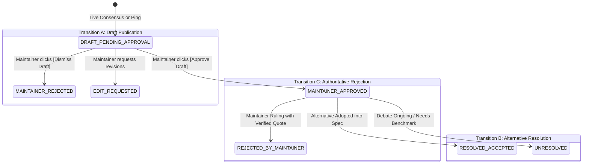

# Biscuit: The Two-Way Architecture Specification
## Unified Architecture Blueprint: Historical Knowledge Recovery (The Past) & Living Decision Intelligence (Day 1+)

**Project:** Biscuit — Open Source Decision Intelligence and Knowledge Recovery  
**Team:** Chole Bhature (`@mriarc-08`, `@daksheshsharma2409`, `@utksh1`)  
**Track:** Problem 06 — Open Source Decision Intelligence and Knowledge Recovery  
**Document Level:** Authoritative Master Architecture Specification  

---

## 1. Executive Overview: The Symmetrical Two-Way Architecture

Open-source decision intelligence cannot succeed as a one-directional system:
* **If a tool only looks backward (The Past):** It mines historical archives once, but as soon as development continues, newly debated decisions in CNCF Slack, Discord, or Zulip are lost into the chat void. The system immediately starts decaying into obsolescence.
* **If a tool only looks forward (Day 1+):** It monitors active chat and pull requests, but lacks the 10-year institutional memory of *why* foundational designs, syntaxes, or architectures were rejected in the past. New contributors repeat old mistakes, and the system cannot explain the historical rationale.

**Biscuit is architected as Two Halves of One Brain:**
1. **Pillar 1: The Past (Historical Knowledge Recovery):** Ingests 5–10 years of public mailing lists, Discourse archives (`discuss.python.org`), and closed GitHub pull requests. It extracts candidate proposals, slices deliberation graphs, decouples objections from maintainer consensus, maps quotes to zero-based byte offsets, and grounds decisions to codebase AST symbols across historical file moves and refactors.
2. **Pillar 2: Day 1+ (Living Decision Intelligence via Switch):** Streams real-time discussions from modern chat channels (CNCF Slack, Discord, Zulip) via **Switch FastMCP**. It detects emerging consensus, synthesizes draft Architecture Decision Records (MADRs), routes interactive Block Kit approval cards to maintainers, and actively guards future GitHub PRs against re-introducing rejected antipatterns.

Both pillars feed into and query the **same unified PostgreSQL 16 + pgvector relational knowledge graph**, enforcing strict tamper-proof provenance, maintainer-governed authority boundaries, and zero false PR alert spam.

---

## 2. Master System Architecture Blueprint

```mermaid
flowchart TD
    %% ─────────────────────────────────────────────────────────────
    %% PILLAR 1: THE PAST
    %% ─────────────────────────────────────────────────────────────
    subgraph P1["PILLAR 1: THE PAST (Historical Knowledge Recovery Engine)"]
        direction TB
        HistRaw["Historical Archives<br/>• discuss.python.org (Discourse)<br/>• python-ideas (Mbox Archives)<br/>• Historical Closed GitHub PRs"] --> UnivIngest["Universal Ingestion Engine<br/>(RFC-822 / REST JSON Adapters)"]
        
        UnivIngest --> RawMsgStore[("source_threads<br/>source_messages<br/>source_message_versions<br/>(SHA-256 Wire Byte Immutability)")]
        
        RawMsgStore --> DelibClean["Derived Deliberation View<br/>• Quote Pruning ([Quoting post-N])<br/>• Automated Bot & Bump Filtering"]
        
        DelibClean --> DelibGraph["Deliberation Graph Builder<br/>discussion_edges:<br/>PROPOSES, SUPPORTS, OBJECTS, REBUTS, RESOLVES"]
        
        DelibGraph --> RecurResolver{"Proposal Recurrence?<br/>(Candidate Cosine >= 0.90)"}
        RecurResolver -- Yes --> OccurStore[("proposal_occurrences<br/>• Links thread & initiating version<br/>• Auditable timeline (NO silent merge)")]
        RecurResolver -- No --> DAGSlicer["Deterministic Deliberation DAG Slicer<br/>(Extracts targeted proposal subgraphs)"]
        
        DAGSlicer --> P1_Llama["Pass 1: Proposal Discovery<br/>(Llama 3.2 3B Instruct)"]
        P1_Llama --> P2_Slice["Pass 2: Deliberation Slicing<br/>(Deterministic Graph Traversal)"]
        P2_Slice --> P3_Phi["Pass 3: Argument & Stance Mining<br/>(Phi-3.5-mini-instruct)"]
        P3_Phi --> P4_Qwen["Pass 4: Schema & MADR Synthesis<br/>(Qwen 2.5-Coder 7B Instruct)"]
        
        P4_Qwen --> ExactVerifier{"Exact Substring Verifier<br/>raw_content[start:end] == quote?<br/>SHA-256(quote) == hash?"}
        ExactVerifier -- Match --> VerifiedSpan[("evidence_spans<br/>(VERIFIED_EXACT)")]
        ExactVerifier -- Mismatch --> UnverifiedSpan[("evidence_spans<br/>(UNVERIFIED / STALE_EDITED)")]
        
        P4_Qwen --> ExtAudit[("extraction_runs<br/>• Pipeline & Slicer Version<br/>• Prompt Template Hashes<br/>• Source Thread Snapshot SHA")]
    end

    %% ─────────────────────────────────────────────────────────────
    %% PILLAR 2: DAY 1+ LIVING INTELLIGENCE
    %% ─────────────────────────────────────────────────────────────
    subgraph P2["PILLAR 2: DAY 1+ (Living Decision Intelligence & Switch Interception)"]
        direction TB
        LiveChat["Live Engineering Channels<br/>• CNCF Slack (#sig-node, #sig-arch)<br/>• Python / Rust Discord<br/>• Zulip Working Groups"] --> SwitchGateway["Switch FastMCP Platform<br/>(WebSocket Event Bridge)"]
        
        SwitchGateway --> LiveBuffer["Live Deliberation Window Buffer<br/>(Session Tracking & Context Window)"]
        
        LiveBuffer --> RollingDAG["Rolling Deliberation Graph<br/>(Streaming discussion_edges)"]
        
        RollingDAG --> TriggerCheck{"Trigger Condition:<br/>1. Autonomous Consensus Heuristic<br/>2. Explicit Ping (@biscuit record-decision)"}
        
        TriggerCheck -- Triggered --> DraftEngine["Living MADR Synthesis Engine<br/>(Qwen 2.5-Coder 7B Instruct)"]
        
        DraftEngine --> LiveDraftStore[("living_decision_drafts<br/>(DRAFT_PENDING_APPROVAL)")]
        
        LiveDraftStore --> SwitchCard["Switch Interactive Approval Card<br/>• Slack Block Kit / Discord Modal<br/>• HMAC-SHA256 Authenticated Callback"]
        
        SwitchCard --> HumanAction{"Core Maintainer Action"}
        HumanAction -- Approve Draft --> PublishDecision["Promote to Formal Decision<br/>(resolution: RESOLVED, type: ACCEPTED)"]
        HumanAction -- Reject Alternative --> RejectAction["Record Ruling Sign-off<br/>(lifecycle: REJECTED, evidence: RULING)"]
        HumanAction -- Edit / Dismiss --> DraftUpdate["Update Draft or Tombstone"]
    end

    %% ─────────────────────────────────────────────────────────────
    %% SHARED KNOWLEDGE CORE
    %% ─────────────────────────────────────────────────────────────
    subgraph Core["UNIFIED RELATIONAL KNOWLEDGE BASE & AST CODE GROUNDING"]
        direction TB
        VerifiedSpan --> RelationalCore[("PostgreSQL 16 + pgvector<br/>• decisions (resolution_status)<br/>• decision_alternatives (lifecycle_status)<br/>• arguments (decoupled objections)<br/>• proposal_occurrences (recurrence)<br/>• ruling_signoffs (maintainer authority)")]
        PublishDecision --> RelationalCore
        RejectAction --> RelationalCore
        
        RelationalCore --> ASTLinker["Tree-sitter CST + Python AST Parser<br/>(Extracts qualified symbols & AST fingerprints)"]
        
        ASTLinker --> GitLineage["Forward Topological Commit-DAG Lineage Engine<br/>• git rev-list --topo-order --reverse C_past..HEAD<br/>• git diff-tree -M80% -C -B -p<br/>• Multi-Parent Merge Disambiguation"]
        
        GitLineage --> AnchorStore[("code_anchors & code_anchor_lineage<br/>(HISTORICAL ➔ MIGRATED / CURRENT)")]
    end

    %% ─────────────────────────────────────────────────────────────
    %% OMNICHANNEL GUARDRAILS & CHAT FEEDBACK
    %% ─────────────────────────────────────────────────────────────
    subgraph Guardrails["ACTIVE PR GUARDRAIL & CHAT INTERACTION FEEDBACK LOOP"]
        direction TB
        PR["Incoming GitHub Pull Request Diff"] --> PRWatcher["PR Watchdog Diff Inspector"]
        
        PRWatcher --> CandidateGen["Step 1: Candidate Retrieval (Signal Only)<br/>• Tree-sitter AST Symbol Match<br/>• HNSW Vector Search (Provisional Cosine >= 0.82)"]
        AnchorStore --> CandidateGen
        RelationalCore --> CandidateGen
        
        CandidateGen --> AuthGate{"Step 2: Warning Authorization Gate<br/>ALL 4 Invariants Mandatory:<br/>1. lifecycle_status == REJECTED<br/>2. ruling_evidence VERIFIED_EXACT signed by maintainer<br/>3. Modified code touches THIS alternative anchor<br/>4. AST subtree confirms structural equivalence"}
        
        AuthGate -- Invariant Failure --> AbstainLog["ABSTAIN (Silent Audit Logging)<br/>Prevent Alert Fatigue"]
        AuthGate -- Authorized --> ExecMode{"Execution Mode"}
        
        ExecMode -- AUDIT_DRY_RUN (Default) --> AuditTable[("pr_watchdog_audit_log")]
        ExecMode -- INTERACTIVE_HITL --> SwitchPRCard["Switch HITL Card in Maintainer Slack<br/>'PR #12 re-introduces rejected syntax. Post warning?'"]
        SwitchPRCard -- Maintainer Clicks Post --> PostPRComment["In-Line GitHub PR Review Comment<br/>(Exact Citation, Permalinks & MADR link)"]
        ExecMode -- PRODUCTION_COMMENT --> PostPRComment
        
        %% Interactive Chat Query Flow
        ChatQuery["Maintainer in Slack:<br/>'@biscuit did we ever consider unary ?'"] --> FastMCP_Tool["Switch FastMCP: query_decisions()"]
        FastMCP_Tool --> HybridRetrieval["Hybrid HNSW + AST Symbol Lookup"]
        RelationalCore --> HybridRetrieval
        HybridRetrieval --> ChatAnswer["In-Thread Verified Slack Reply<br/>'Rejected in PEP 505 post-48 by Guido van Rossum<br/>Reason: Lexical ambiguity with ternary'"]
    end

    P1 -.-> Core
    P2 -.-> Core
    Core -.-> Guardrails
```



---

## 3. Pillar 1: Historical Knowledge Recovery (The Past)

### 3.1 The Hackathon Problem Solved
During the hackathon evaluation:
> *"Given raw discussion threads for Python PEPs (e.g. PEP 505, PEP 572) without the PEP itself, can the system recover the ideas that were rejected and the reasons why?"*

In open source, historical debates are messy, sprawling over 200+ posts, with nested blockquotes, emotional side-tangents, administrative banter, and multiple competing syntax variants. Standard monolithic LLM prompts fail because:
1. Small 3B–7B models truncate or lose needle-in-a-haystack causal rejections.
2. Models hallucinate consensus when an vocal contributor objects without maintainer authority.
3. Quotations returned by LLMs are imprecise or fabricated, destroying auditability.

### 3.2 The 4-Pass Deliberation Pipeline (<8 GB RAM)
Biscuit processes historical debates through a **4-Pass pipeline** orchestrating local, open-source models sequentially:

| Pass | Model / Engine | Purpose | Output Contract |
|---|---|---|---|
| **Pass 1: Proposal Discovery** | `Llama-3.2-3B-Instruct` (Q4_K_M ~2.0 GB) | High-throughput scanning of thread chunks. Identifies all candidate syntaxes, APIs, or architectural proposals. | Emits list of distinct proposal names and structural candidate summaries. |
| **Pass 2: Deliberation Slicing** | Deterministic DAG Slicer (Graph Algorithm) | Reconstructs reply chains, quote trees, and mentions from `discussion_edges`. Slices debate into proposal-specific subgraphs. | Delivers targeted 1,000-word context packets per alternative, isolating arguments. |
| **Pass 3: Argument & Stance Mining** | `Phi-3.5-mini-instruct` (Q4_K_M ~2.2 GB) | Deep reasoning over isolated packets. Decouples individual member objections (`arguments`) from authoritative maintainer rulings (`ruling_evidence`). | Classifies stance (`SUPPORT`, `OBJECT`), identifies fatal rationale, and records proponent/objector handles. |
| **Pass 4: Schema & MADR Synthesis** | `Qwen-2.5-Coder-7B-Instruct` (Q4_K_M ~4.4 GB) | Synthesizes complete Markdown Architectural Decision Records (MADR) and extracts exact character offsets. | Emits JSON payload with `exact_quote`, zero-based `[start_char, end_char)`, and links. |

### 3.3 Zero-Based Exact Substring Verification Invariant
To ensure 100% anti-hallucination compliance:
* Every evidence span is initialized with `verification_status = 'UNVERIFIED'`.
* The verification engine queries `source_message_versions.raw_content` using zero-based, start-inclusive, end-exclusive offsets:
  $$\text{slice} = \text{raw\_content}[start\_char:end\_char]$$
* Verification verifies both exact substring equality and SHA-256 hash match:
  $$\text{slice} == exact\_quote \quad \land \quad \text{sha256}(exact\_quote) == content\_hash$$
* Only upon a 100% byte-for-byte match is the span promoted to `VERIFIED_EXACT`.
* If a post was remotely edited, the span is flagged as `STALE_EDITED`.
* **Non-negotiable Rule:** An unverified span (`UNVERIFIED` or `STALE_EDITED`) can **never** authorize an automated GitHub PR warning.

---

## 4. Pillar 2: Living Decision Intelligence (Day 1+)

### 4.1 Capturing Knowledge Before Code is Written
Over 150,000 developers on CNCF Slack hash out Kubernetes Enhancement Proposals (KEPs) in channels like `#sig-node` and `#sig-architecture` months before a pull request is submitted. In the Python Discord and Rust Zulip, core teams debate memory safety, typing, and syntax every day.

**Biscuit intercepts this living flow via Switch (`sandbox-quantum/switch` v0.31.0):**

```
┌────────────────────────────────────────────────────────────────────────┐
│               LIVING DECISION INTELLIGENCE WORKFLOWS                  │
├────────────────────────────────────────────────────────────────────────┤
│                                                                        │
│  WORKFLOW 1: AUTONOMOUS DRAFT SYNTHESIS & HITL CARD                   │
│  Live Chat Debate ──> Consensus Heuristic ──> Living Draft ──>         │
│  Switch Block Kit Card ──> Maintainer Clicks [Approve] ──> Formal ADR   │
│                                                                        │
│  WORKFLOW 2: CONVERSATIONAL IN-THREAD ASSISTANT                       │
│  Maintainer asks: "@biscuit did we ever consider Approach X?" ──>      │
│  FastMCP query_decisions() ──> In-Thread Reply with Citation & Post Link│
│                                                                        │
│  WORKFLOW 3: MAINTAINER-GATED PR GUARDRAIL ROUTING                     │
│  PR Diff Violates Past Ruling ──> Switch Slack Card to Maintainer ──>  │
│  Maintainer Confirms ──> Public GitHub PR In-Line Comment Published    │
│                                                                        │
└────────────────────────────────────────────────────────────────────────┘
```

### 4.2 Switch FastMCP Integration Contract
Biscuit exposes an official **Model Context Protocol (MCP)** server via the **FastMCP SDK** (`fastmcp>=3.2.0,<4`), seamlessly linking with Switch's core platform:

#### FastMCP Exposed Tools:
1. `query_decisions(query: str, repo: str) -> list[DecisionSummary]`
   - Hybrid HNSW vector search + AST symbol query returning historical and living decisions.
2. `check_pr_diff(pr_diff: str, repository: str) -> GuardrailVerdict`
   - Executes the 4-Invariant Warning Authorization Gate against an incoming PR diff.
3. `draft_living_decision(thread_context: str, session_id: str) -> DraftResult`
   - Ingests a live discussion transcript, extracts alternatives, and constructs a `living_decision_drafts` record.

### 4.3 Human-in-the-Loop (HITL) State De-Conflation
A critical architectural contribution of Biscuit is **de-conflating draft publication from authoritative outcome rulings**:



* **Transition A (Draft Approval):** Approving a draft in Slack simply authenticates the record for publication into the database. It does **NOT** mark alternatives as `REJECTED`.
* **Transition B (Alternative Outcome):** Alternatives default to `PROPOSED` or `UNDER_DISCUSSION`.
* **Transition C (Authoritative Rejection):** An alternative is marked `REJECTED` **if and only if** an authorized human maintainer explicitly records a ruling backed by a verified `RULING` evidence span.

---

## 5. The Relational Core & Code Grounding Engine

### 5.1 Dual-Source Relational Parity
Both historical batch ingestion and live chat ingestion write to the identical schema in **PostgreSQL 16 + pgvector**:

```
                                  ┌────────────────────────┐
                                  │     source_threads     │
                                  └───────────┬────────────┘
                                              │ 1:N
                                  ┌───────────▼────────────┐
                                  │    source_messages     │
                                  └───────────┬────────────┘
                                              │ 1:N (ON DELETE RESTRICT)
                                  ┌───────────▼────────────┐
                                  │ source_message_versions│
                                  └─────┬────────────┬─────┘
                     ┌──────────────────┘            └─────────────────┐
                     │ 1:N                                             │ 1:N
         ┌───────────▼────────────┐                        ┌───────────▼────────────┐
         │     evidence_spans     │                        │    discussion_edges    │
         │ (VERIFIED_EXACT quote) │                        │ (PROPOSES, RESOLVES...)│
         └───────────┬────────────┘                        └────────────────────────┘
                     │ Linked to exactly ONE target:
         ┌───────────┼─────────────────────────┬────────────────────────┐
         │           │                         │                        │
┌────────▼──┐ ┌──────▼────────────────┐ ┌──────▼────────┐    ┌──────────▼────────────┐
│ decisions │ │ decision_alternatives │ │   arguments   │    │      code_anchors     │
└───────────┘ └──────┬────────────────┘ └───────────────┘    └──────────┬────────────┘
                     │ 1:N                                              │ 1:N
         ┌───────────▼────────────┐                        ┌───────────▼────────────┐
         │  proposal_occurrences  │                        │  code_anchor_lineage   │
         │  (Multi-Year Timeline) │                        │ (Commit-DAG Migration) │
         └────────────────────────┘                        └────────────────────────┘
```

### 5.2 Tree-sitter AST Symbol Grounding
File paths change; syntax symbols endure. Biscuit grounds alternatives to **Concrete Syntax Tree (CST)** symbols using `tree-sitter`:
* **Symbol Identity:** Qualified identifier (e.g. `cpython.Parser.tokenizer.get_next_token`).
* **Structural Fingerprint:** SHA-256 hash of the normalized, identifier-masked AST subtree. Refactoring variable names does not alter the structural fingerprint.

### 5.3 Forward Topological Commit-DAG Lineage Engine
To track historical code anchors forward across 5+ years of refactors to modern `HEAD`:
* **Rejection of `git log --follow`:** `--follow` is a single-file backward history command; it cannot resolve a historical anchor commit forward to modern HEAD.
* **Topological Commit Iteration:** Traverses forward using `git rev-list --topo-order --reverse $C_{\text{past}}..HEAD`.
* **Diff Tree Heuristics:** Executes `git diff-tree -r -M80% -C -B -p <parent> <commit>`:
  - `-M80%`: Follows renames when file similarity $\ge 80\%$.
  - `-C`: Tracks code copied into modular helper libraries.
  - `-B`: Detects total file rewrites or splits.
* **Multi-Parent Merge Handling:**
  - Evaluates combined diffs (`git diff-tree -c -p $M`).
  - Tracks parent $P_1$ (mainline trunk) when cleanly merged.
  - If parents contain divergent or conflicting symbol modifications, flags the transition as `AMBIGUOUS` with `mapping_confidence = NULL`, halting automated migration and logging an auditable event.

---

## 6. PR Watchdog Guardrails: 4-Invariant Warning Authorization

To eliminate developer alert fatigue, Biscuit strictly separates **candidate hypothesis retrieval** from **warning authorization proof**:

```
                                  INCOMING PR DIFF
                                         │
                                         ▼
                 ┌───────────────────────────────────────────────┐
                 │       STEP 1: CANDIDATE RETRIEVAL             │
                 │  • Tree-sitter Symbol Match in code_anchors   │
                 │  • HNSW Cosine Search (Provisional >= 0.82)   │
                 │    (Strictly a retrieval signal; NEVER proves) │
                 └───────────────────────┬───────────────────────┘
                                         │
                                         ▼
                 ┌───────────────────────────────────────────────┐
                 │    STEP 2: WARNING AUTHORIZATION GATE         │
                 │  ALL FOUR MANDATORY INVARIANTS MUST PASS:     │
                 │  1. lifecycle_status == 'REJECTED'            │
                 │  2. ruling_evidence IS VERIFIED_EXACT signed   │
                 │     by human authority (BDFL / Consensus)     │
                 │  3. PR diff modifies code_anchor bound to     │
                 │     THIS specific alternative                 │
                 │  4. AST subtree confirms structural           │
                 │     equivalence with the rejected construct   │
                 └───────────────────────┬───────────────────────┘
                                         │
                         ┌───────────────┴───────────────┐
                     ALL PASS                         ANY FAIL
                         │                               │
                         ▼                               ▼
                 [EXECUTION MODE]                  [ABSTAIN]
             ┌───────────┼───────────┐         (Silent audit log;
             │           │           │          zero developer spam)
             ▼           ▼           ▼
        AUDIT_DRY_RUN  HITL_CARD  PRODUCTION_COMMENT
```

---

## 7. Hardware & Memory Budget ($\le 8\text{ GB RAM}$)

Biscuit executes completely within the hackathon's **8 GB RAM boundary** using sequential time-sliced model orchestration:

```
Full-Stack Memory Profile (Peak Execution Budget):
┌─────────────────────────────────────────────────────────────┬───────────┐
│ Component                                                   │ RAM Usage │
├─────────────────────────────────────────────────────────────┼───────────┤
│ OS Overhead, Host Daemons, & System Disk Cache              │ ~1.50 GB  │
│ PostgreSQL 16 + pgvector (Docker container)                 │ ~0.35 GB  │
│ Python 3.12 Runtime, FastAPI, & Async Event Services        │ ~0.25 GB  │
│ Shared Embedding Model: nomic-embed-text-v1.5 (Q4 resident) │ ~0.28 GB  │
│ Peak Quantized Model: Qwen 2.5-Coder-7B-Instruct (Q4_K_M)  │ ~4.40 GB  │
│ KV Cache Budget & Context Overhead                          │ ~0.30 GB  │
├─────────────────────────────────────────────────────────────┼───────────┤
│ TOTAL ESTIMATED PEAK RESIDENT RSS                           │ ~7.08 GB  │
│ SAFETY HEADROOM UNDER 8.0 GB BOUNDARY                       │ > 0.90 GB │
└─────────────────────────────────────────────────────────────┴───────────┘
```

* **Sequential Memory Management:** Models are never loaded concurrently. Ingestion runs `Llama-3.2-3B` (~2.0 GB), argument mining runs `Phi-3.5-mini` (~2.2 GB), and schema synthesis / watchdog analysis runs `Qwen-2.5-Coder-7B` (~4.4 GB), offloading each model via Ollama / llama.cpp before loading the next.

---

## 8. Summary Comparison Matrix: The Two Pillars

| Dimension | Pillar 1: The Past (Historical Mining) | Pillar 2: Day 1+ (Living Intelligence) |
|---|---|---|
| **Primary Data Sources** | Discourse (`discuss.python.org`), mbox archives, closed GitHub PRs | CNCF Slack (`#sig-node`), Discord, Zulip channels |
| **Ingestion Protocol** | Batch pagination & historical archive parsing | Real-time WebSocket streaming via Switch FastMCP |
| **Deliberation Extraction** | 4-Pass sequential local LLM pipeline | Rolling deliberation graph & consensus heuristics |
| **Verification Gate** | Zero-based character offset verifier `[start_char, end_char)` | Interactive Human-in-the-Loop (HITL) approval cards in chat |
| **Code Grounding** | Forward topological commit-DAG lineage (`git diff-tree -M80%`) | Direct AST symbol binding at time of decision capture |
| **Actionable Output** | Permanent Markdown Architectural Decision Records (MADRs) | Live in-thread chat answers + maintainer-gated PR review warnings |
| **Target Audience** | Historical evaluators, auditors, new contributors exploring codebase | Active core maintainers, code reviewers, and pull request authors |

---

## 9. Related Specifications & Reference Documents
* [`docs/TECH_STACK_AND_ARCHITECTURE.md`](./TECH_STACK_AND_ARCHITECTURE.md): Core language justification (Python vs Go), full module contracts, and PR sequence.
* [`docs/LIVING_DECISION_INTELLIGENCE.md`](./LIVING_DECISION_INTELLIGENCE.md): Switch FastMCP architecture, Slack Block Kit cards, HMAC verification, and session state.
* [`docs/STORAGE_AND_RETRIEVAL.md`](./STORAGE_AND_RETRIEVAL.md): Canonical PostgreSQL DDL, composite foreign keys, append-only triggers, and vector indexes.
* [`docs/INGESTION_AND_EXTRACTION.md`](./INGESTION_AND_EXTRACTION.md): Ingestion adapters, noise suppression, and 4-pass extraction prompt contracts.
* [`docs/CODE_GROUNDING_AND_AST.md`](./CODE_GROUNDING_AND_AST.md): Tree-sitter CST parsing, commit-DAG diff traversal, and warning authorization invariants.
* [`docs/EVALUATION_AND_BENCHMARKS.md`](./EVALUATION_AND_BENCHMARKS.md): Quantitative metric suites, ground-truth fixtures, and benchmark execution harness.
